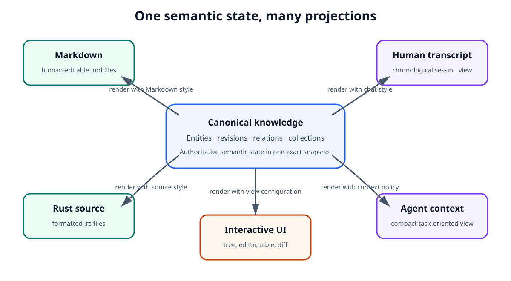
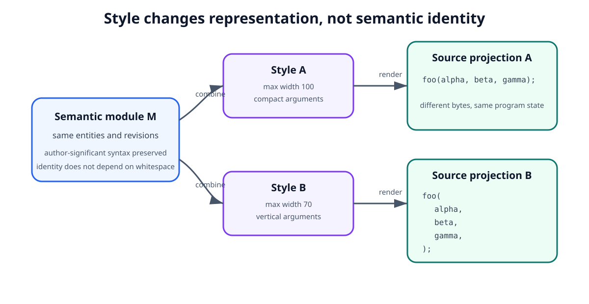
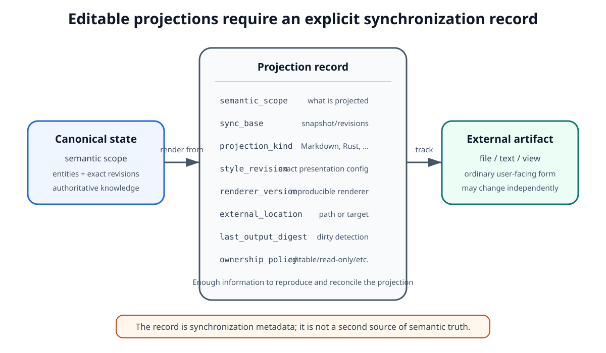
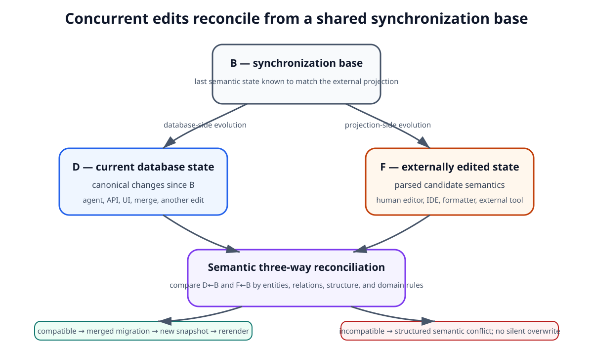

# Projections and Bidirectional Editing

## 1. Purpose

Scriberig stores canonical knowledge as structured semantic entities and revisions rather than treating files, transcripts, rendered pages, or user-interface trees as the primary source of truth.

Humans and external tools still need familiar representations. Source code must appear as source files. Markdown must appear as Markdown. Sessions may appear as chronological transcripts. A browser may show a semantic tree, a rich editor, a diff, or a task-oriented view. An agent may receive a compact context containing only the information relevant to its current work.

These are all projections of semantic state.

A projection is not merely exported text. It is a controlled representation of canonical knowledge for a particular consumer, format, style, and purpose.

Some projections are read-only. Some are editable. For editable projections, changes made outside Scriberig must be interpreted and brought back into the canonical knowledge system as semantic changes.

This document defines the architectural rules for projection, style, rendering, external editing, import, reconciliation, and conflict handling.

The central principle is:

> Canonical knowledge and its representations are separate. Rendering moves from semantic state to a projection; reconciliation interprets edited projections back into semantic migrations.

This document intentionally does not prescribe parser libraries, filesystem watcher libraries, pretty-print algorithms, editor frameworks, wire protocols, or concrete reconciliation data structures. Those belong in lower-level designs.

---

## 2. Projection Is a General System Concept

Projection is not limited to files.

Examples include:

```text
semantic Markdown document + Markdown style
    -> .md file

semantic Rust module + Rust style
    -> .rs file

session graph + human chat style
    -> chronological transcript

session graph + agent context policy
    -> model context

knowledge graph + browser view configuration
    -> interactive tree

semantic diff + presentation style
    -> human-readable change view

PDF knowledge + page layout projection
    -> rendered page view
```

The same canonical object may have several projections at the same time.

The same projection kind may also have several styles.

For example, one semantic Rust module may be rendered with different formatting preferences without creating different semantic programs.

This gives Scriberig one consistent mental model:

```text
canonical knowledge
       |
       +----> projection A
       |
       +----> projection B
       |
       +----> projection C
```

The database remains authoritative. Projections exist to make that knowledge useful to humans, agents, compilers, external tools, and user interfaces.

Figure 1 makes the important direction of authority explicit: Markdown, source code, transcripts, agent context, and interactive UI views are different renderings of one canonical semantic state. None of the projected forms becomes a competing source of truth merely because it is easier for a particular consumer to use.



**Figure 1 — One semantic state can support many simultaneous projections for different consumers and purposes.**

---

## 3. Canonical State and Projection State Are Different

A projection must not become accidental canonical state merely because it is visible or editable.

Consider a semantic paragraph entity `P`.

Its canonical revision may contain:

```text
text: "Objects are immutable."
```

A Markdown projection may render it as:

```markdown
Objects are immutable.
```

An HTML projection may render it as:

```html
<p>Objects are immutable.</p>
```

An agent summary projection may render it as:

```text
Paragraph P: explains object immutability.
```

These representations are not three competing versions of the paragraph.

They are representations derived from one canonical semantic state.

The system must preserve this direction of authority even when a projection is editable.

An edited projection is therefore interpreted as a proposal for semantic change, not as an unconditional replacement for canonical knowledge.

---

## 4. Projection Classes

Different projections have different editing and synchronization requirements.

At Level 1, Scriberig should distinguish at least the following classes.

### 4.1 Read-only projections

These are generated views with no reverse-editing contract.

Examples may include:

- rendered reports;
- generated HTML;
- diagnostic views;
- some PDF renderings;
- summaries;
- temporary previews.

A consumer may copy or transform them externally, but Scriberig does not interpret those external changes as edits to canonical state.

### 4.2 Editable projections

These have a defined parser and reconciliation path back into semantic state.

Examples include:

- Markdown files;
- source-code files;
- structured configuration files;
- other formats for which the domain adapter can recover enough semantic structure.

An editable projection participates in synchronization with canonical state.

### 4.3 Ephemeral projections

These are generated for one operation or interaction and need not have persistent external identity.

Examples include:

- agent context;
- command output;
- temporary semantic summaries;
- preview fragments;
- transient UI renderings.

Ephemeral projections may still be cached, but they are not independently authoritative.

### 4.4 Interactive projections

A user interface may project the graph into an interactive tree, editor, table, form, or diagram.

Interactive editing should still produce the same semantic operations and migrations as other editing paths.

The UI must not become a privileged back door that mutates canonical database rows directly.

---

## 5. A Projection Has Explicit Inputs

A projection should be understood as the result of exact declared inputs.

Conceptually:

```text
Projection = render(
    semantic scope,
    snapshot,
    projection kind,
    style,
    renderer version,
    rendering context
)
```

Not every projection needs every input, but the dependencies must be explicit enough to support reproducibility and caching.

A projection may depend on:

- one entity or a semantic scope;
- exact revisions visible in a snapshot;
- a projection format;
- a style revision;
- a renderer implementation/version;
- domain-specific configuration;
- layout context;
- environment information that genuinely affects the result.

Implicit dependencies should be minimized.

If a projection changes because an undeclared global setting changed, it becomes difficult to cache, reproduce, compare, or reconcile reliably.

---

## 6. Styles Are Separate from Semantic Content

Formatting and presentation choices should not normally change semantic identity.

A style is itself semantic configuration and may be stored as a normal entity with immutable revisions.

For example:

```text
RustStyle

max_width: 100
indent_width: 4
brace_style: same_line
imports: grouped
```

A second user may prefer:

```text
RustStyle

max_width: 120
indent_width: 4
brace_style: same_line
imports: grouped
```

The Rust module does not change merely because the style changes.

Only the projection changes.

Conceptually:

```text
semantic module M + style A -> source A
semantic module M + style B -> source B
```

The same principle applies beyond source code.

Styles or projection policies may control:

- Markdown formatting;
- table alignment;
- line wrapping;
- whitespace;
- source-code formatting;
- transcript verbosity;
- UI presentation;
- agent context detail;
- human diff presentation.

Styles should have stable conceptual identity and immutable revisions like other semantic configuration.

A user-facing style alias may move to a newer style revision without rewriting semantic content.

Figure 2 shows why style belongs beside semantic content rather than inside it. The same exact semantic module can be combined with different immutable style revisions to produce different bytes and layouts while preserving one program identity.



**Figure 2 — Style is an independent rendering input; changing presentation does not by itself change semantic identity.**

---

## 7. Style Must Not Hide Semantic Transformation

A style controls representation, not meaning.

The boundary must be conservative.

For example, line wrapping, spacing, indentation, and brace placement are suitable style concerns.

Replacing one programming construct with another merely because they are currently equivalent is not ordinary formatting.

For example:

```text
if-let
```

and:

```text
match
```

may express related behavior, but choosing between them is a semantic/syntactic authoring decision rather than a simple style preference.

Likewise, a Markdown renderer should not silently rewrite the conceptual document structure merely to satisfy aesthetic preferences.

The canonical domain representation must preserve author-significant choices.

A projection adapter may support optional semantic transformations, but those must be explicit operations rather than invisible style effects.

---

## 8. Rendering Is Deterministic Over Declared Inputs

Given the same exact semantic inputs, style, renderer version, and relevant rendering context, rendering should produce the same projection.

Conceptually:

```text
render(inputs) -> exact output
```

This property enables:

- caching;
- reproducibility;
- projection hashing;
- reliable dirty detection;
- deterministic tests;
- synchronization across clients;
- safe reuse of unchanged fragments.

If a renderer intentionally uses nondeterministic information, such as current time, randomness, or environment state, those inputs must become explicit or the result must be treated as non-reproducible derived output.

Deterministic rendering is especially important for editable file projections because Scriberig must know what it last produced before interpreting an external edit.

---

## 9. Rendering May Be Incremental

A projection of a large semantic scope should not require complete recomputation whenever a small part changes.

The immutable revision model allows rendering to reuse unchanged fragments.

For example:

```text
Module
  Function A unchanged
  Function B changed
  Function C unchanged
```

A renderer may reuse cached representations for `Function A` and `Function C` while recomputing only the affected portion of `Function B` and the minimum enclosing layout context.

The conceptual cache key should use exact immutable inputs rather than mutable paths or global snapshot identity.

For example:

```text
(revision, style revision, renderer version)
    -> render intermediate
```

Some final layouts depend on surrounding width or indentation. In such cases the reusable cache value may be an intermediate layout representation rather than final text.

The Level 1 requirement is not a particular pretty-print algorithm.

It is:

> Projection architecture must permit reuse at semantic boundaries and must not require global invalidation for unrelated local changes.

---

## 10. Persistent Projection Records

Editable external projections need persistent synchronization metadata.

Conceptually, a projection record identifies:

- what semantic scope is projected;
- what snapshot or exact revisions formed its synchronization base;
- the projection kind;
- the style revision;
- the renderer version;
- the external location, if any;
- the exact output Scriberig last considered synchronized;
- enough metadata to detect external modification.

For a file projection this may include a path and a hash of the last rendered file.

The exact schema is a lower-level concern.

The Level 1 requirement is:

> Scriberig must retain enough information to distinguish its last synchronized projection from both current canonical state and current externally edited state.

This is necessary for correct three-way reconciliation.

Figure 3 is a conceptual schema, not a database table prescription. What matters at this level is that the synchronization record connects an exact semantic base to an exact external representation and records every input needed to reproduce or safely compare that representation.



**Figure 3 — An editable projection record remembers enough exact state to reproduce output, detect drift, and support later reconciliation.**

---

## 11. External Files Remain Normal Files

Although source files are projections rather than canonical storage, Scriberig must preserve ordinary filesystem workflows.

Users may:

- open files with their preferred editor;
- modify files with command-line tools;
- run formatters;
- move files;
- use IDE refactoring tools;
- switch Git branches;
- generate files with external programs;
- stop using Scriberig temporarily and continue editing.

The system must not require hidden identifiers embedded into every source file merely to maintain internal object identity.

A projected repository should remain understandable and usable by ordinary tools to the greatest extent allowed by the domain.

Scriberig therefore treats filesystem changes as external observations that may need semantic import.

This gives the system an intentional asymmetry:

```text
canonical state -> projection

external projection edit -> semantic reconciliation -> canonical change
```

The filesystem is a human interoperability surface, not the final authority.

---

## 12. Editing a Projection Produces a Candidate Semantic State

When an editable projection changes externally, Scriberig should not directly replace canonical data with new parsed data.

The basic flow is:

```text
last synchronized projection
          |
          v
external edit
          |
          v
parse edited projection
          |
          v
candidate semantic representation
          |
          v
reconcile with canonical knowledge
          |
          v
semantic migration
          |
          v
new snapshot
```

Parsing answers:

> What semantic structure can be recovered from the edited representation?

Reconciliation answers:

> How does that recovered structure correspond to the entities and revisions already known to Scriberig?

These are separate problems.

A parser may produce a structurally correct candidate graph without knowing which existing entity each candidate node should correspond to.

Figure 4 shows the complete round trip. The critical point is that an external edit passes through parsing, identity reconciliation, migration, and validation before it becomes canonical; after commit, Scriberig renders again so the external artifact once more has a known synchronization base.


**Figure 4 — Bidirectional editing is a controlled semantic round trip, not direct replacement of the database with edited bytes.**

---

## 13. Reconciliation Preserves Conceptual Identity Where Justified

Because Scriberig separates stable entity identity from immutable revisions, external editing needs to determine continuity.

Suppose the canonical state contains:

```text
Paragraph P
revision R1:
"Sessions form a tree."
```

The user edits the projection to:

```text
"Sessions form a persistent tree."
```

The usual interpretation is not:

```text
delete P
create unrelated paragraph Q
```

It is:

```text
P: R1 -> R2
```

The paragraph entity survives; its revision changes.

Similarly, inserting another paragraph before `P` should not change `P` merely because its textual position moved.

Reconciliation should therefore use semantic and structural evidence to preserve entity continuity when justified.

Possible evidence may include:

- exact unchanged content;
- semantic type;
- structural role;
- neighboring entities;
- collection order;
- parent context;
- names or signatures;
- similarity of content;
- domain-specific identity rules;
- explicit metadata when a format naturally provides it.

The exact matching algorithm belongs in domain-specific lower-level design.

Figure 5 illustrates the intended identity behavior. A modified paragraph normally keeps its stable entity and receives a new immutable revision, an inserted block gets a new entity, and an unchanged paragraph is reused exactly; position helps matching but does not define identity.


**Figure 5 — Reconciliation preserves conceptual continuity where evidence supports it instead of treating every edited block as an unrelated new object.**

---

## 14. Reconciliation Must Not Pretend Certainty

Some external edits are ambiguous.

For example, if two identical paragraphs exist and one is modified, positional and contextual information may be sufficient to infer which entity changed, or it may not.

A code transformation may resemble either:

- an update to one function;
- deletion plus insertion;
- extraction into another function;
- a move followed by modification.

The system must not silently invent lineage when confidence is insufficient.

Ambiguous cases should result in one of:

- a conservative generic migration;
- explicit conflict or ambiguity information;
- user choice;
- agent-assisted interpretation when permitted;
- creation of new entities rather than unsupported continuity claims.

Incorrect stable identity is more damaging than creating a new entity when continuity cannot be established safely.

---

## 15. Content Changes and Structural Changes Must Remain Distinct

Projection reconciliation should preserve the distinction defined by the storage model.

Example content change:

```text
Paragraph P
R1: "Files are projections."
R2: "Files are editable projections."
```

The containing section may still contain the same entity `P` and therefore may not require a structural revision.

Example structural change:

```text
Section S
before: [P1, P2]
after:  [P1, P3, P2]
```

The section's child collection changed.

This distinction matters because it:

- minimizes revision churn;
- improves semantic diffs;
- improves cache reuse;
- makes history easier to understand;
- helps agents reason about the effect of changes.

Textual diff alone cannot reliably preserve this distinction.

---

## 16. Formatting-Only Changes Are Not Semantic Changes

A central benefit of separating semantic state from projection style is that formatting-only edits need not create semantic history.

For example, a user may change:

```text
foo(a,b,c)
```

to:

```text
foo(a, b, c)
```

If the domain parser determines that both projections describe the same canonical syntax and the difference belongs entirely to presentation, then canonical semantic state does not change.

Scriberig may choose to:

- recognize the edit as style information;
- update a user or projection style;
- normalize the projection back to the configured style;
- preserve selected formatting hints outside semantic identity;
- report that no semantic migration occurred.

The exact policy may differ by domain.

The invariant is:

> Presentation-only differences must not be mistaken for semantic knowledge changes merely because textual bytes differ.

---

## 17. Canonical Syntax May Still Include Author-Significant Form

Formatting independence does not mean that every syntactic difference is irrelevant.

For source code especially, some choices belong to canonical syntax even when multiple forms compile to similar behavior.

Examples may include:

- expression structure;
- control-flow construct choice;
- macro invocation syntax;
- attributes;
- comments with semantic or explanatory purpose;
- chosen module structure;
- author-visible syntactic organization.

A domain adapter must define the boundary between:

```text
canonical syntax/meaning
```

and:

```text
projection formatting
```

That boundary is domain-specific but must be explicit.

Scriberig should prefer preserving meaningful author intent rather than aggressively normalizing programs into a compiler-oriented intermediate representation.

---

## 18. Three-Way Reconciliation Is the Normal Concurrency Model

An external projection may be edited while canonical state also changes independently.

Therefore reconciliation cannot assume that the edited file was based on the current snapshot.

The system should retain three conceptual states:

```text
B = synchronization base
D = current canonical database state
F = current externally edited projection
```

Conceptually:

```text
      B
     / \
    D   F
```

The task is not simply to replace `D` with `F`.

It is to understand both changes relative to `B` and combine them semantically where possible.

This is analogous to three-way version-control merging, but the comparison happens through domain semantics rather than only through lines.

If database-side and external edits affect disjoint semantic entities, they should normally merge automatically.

If both affect the same semantic state incompatibly, the system should produce a structured conflict.

Figure 6 shows why the synchronization base must be retained. Current database state `D` and externally edited state `F` are both interpreted relative to the same base `B`; compatible semantic changes combine into a migration and new snapshot, while incompatible changes remain explicit structured conflicts rather than one side silently overwriting the other.



**Figure 6 — Three-way semantic reconciliation combines independent changes and preserves conflicts when both sides changed the same meaning incompatibly.**

---

## 19. Conflicts Are Semantic Objects, Not Error Strings

A reconciliation conflict should preserve enough structured information for a human, agent, UI, CLI, or API client to inspect and resolve it.

A conflict may identify:

- the synchronization base;
- the current canonical revision;
- the candidate imported revision;
- the affected entity or relation;
- the conflicting semantic operations;
- available alternatives;
- domain-specific diagnostics;
- provenance of each side.

Different interfaces may render the same conflict differently.

For example:

```text
CLI -> concise textual conflict
Web -> interactive semantic diff
Agent -> structured conflict tool result
API -> typed conflict object
```

The conflict itself should not be reduced to one presentation.

---

## 20. Successful Reconciliation Produces a Migration

External editing is one source of migrations, not a special mutation mechanism.

After reconciliation succeeds:

```text
external edit
   -> semantic operations
   -> migration
   -> validation
   -> new snapshot
```

The migration provides provenance and lineage between old and new canonical state.

This is the same conceptual path used by:

- a web editor;
- a TUI edit;
- an API client;
- an agent;
- a semantic refactoring command;
- a merge operation.

There should not be one mutation model for users and another for agents.

All canonical writes should converge on semantic operations, migrations, validation, and snapshot creation.

---

## 21. Re-Rendering Establishes the New Synchronization Point

After an externally edited projection has been successfully reconciled and committed, Scriberig should be able to render the resulting canonical state again.

That rendering becomes the new synchronized projection baseline.

Conceptually:

```text
external edit
    |
    v
semantic migration
    |
    v
new canonical snapshot
    |
    v
canonical render
    |
    v
new synchronization base
```

This step is important even if the resulting text is visually similar to the user's edit.

It makes ownership clear:

> Once imported, the semantic state is authoritative and the external representation is again a projection of that state.

If configured style differs from the user's temporary formatting, the file may be normalized during this render.

The system should make such behavior predictable and domain-configurable.

---

## 22. Projection Ownership Must Be Explicit

Not every file found in a project should automatically be rewritten by Scriberig.

A projection must have an ownership/synchronization relationship that is explicit enough to answer:

- Is Scriberig responsible for rendering this artifact?
- May external edits be imported?
- Is this artifact read-only?
- What semantic scope does it represent?
- Which style applies?
- What was the last synchronization base?

This prevents accidental capture of unrelated files and allows mixed projects where only some artifacts are managed projections.

A project may contain:

```text
managed editable projections
managed read-only generated projections
unmanaged ordinary files
external artifacts imported as knowledge
```

These categories must not be conflated.

---

## 23. Renames and Moves Are Projection Changes Unless Semantics Say Otherwise

A semantic entity's identity should not normally depend on its projected filesystem path.

Moving a function, document, or module projection may change layout or containment metadata without changing the underlying conceptual entities.

For example:

```text
src/foo.rs
```

moving to:

```text
src/network/foo.rs
```

must not automatically imply that every contained function became a new conceptual function.

However, some programming languages assign semantic meaning to file/module placement.

Therefore the rule is:

> Projection location is separate from semantic identity, except where a domain schema explicitly models location as semantically significant.

Domain adapters are responsible for expressing those cases.

---

## 24. Source Code Projections

For source code, the semantic representation should preserve author-significant syntax while formatting remains a projection concern.

Conceptually:

```text
canonical syntax/semantic graph
        |
        +-- style A -> source projection A
        |
        +-- style B -> source projection B
```

Users remain free to edit the generated source file using ordinary tools.

On import:

```text
source text
    -> parser
    -> candidate syntax graph
    -> entity matching
    -> semantic migration
```

Source-code projection adapters should not use line numbers as primary identity.

Line numbers are useful presentation coordinates but are unstable semantic handles.

Stable entities and exact revisions should remain the primary internal references.

Compiler-derived facts such as symbol resolution, types, call graphs, and diagnostics may participate in reconciliation or validation but remain derived knowledge unless a domain design explicitly says otherwise.

---

## 25. Markdown and Document Projections

Markdown is a particularly suitable first editable projection because its semantic structure maps naturally to knowledge objects such as:

- sections;
- headings;
- paragraphs;
- lists;
- list items;
- tables;
- rows;
- cells;
- code blocks;
- links;
- quotations.

The Markdown file should remain normal readable Markdown without requiring hidden database IDs in every paragraph.

External edits are reconciled through structure and content.

For example:

```text
old:
Section S -> [P1, P2]

edited projection:
Section S -> [P1 changed, P3 inserted, P2 unchanged]
```

The preferred semantic interpretation is:

```text
P1 receives a new revision
P3 is created
P2 is reused
Section S receives a structural revision because its child collection changed
```

This demonstrates the general bidirectional model without requiring source-code compiler semantics.

---

## 26. PDF and Other Less-Editable Formats

Not every projection must support arbitrary round-trip editing.

A PDF may be:

- an external artifact from which semantic knowledge is extracted;
- a generated read-only projection of canonical knowledge;
- a visual view with annotations represented separately as semantic entities.

The presence of a parser does not imply that a format is suitable for lossless bidirectional editing.

Adapters should explicitly declare their capabilities.

For example:

```text
renderable
parseable
editable
round-trip capable
structure preserving
style preserving
```

Scriberig should prefer an honest limited adapter over pretending that a lossy format has a reliable reverse mapping.

---

## 27. Sessions and Agent Context Are Projections Too

The same projection model applies to sessions.

A canonical session may be stored as structured entities such as:

- goals;
- branches;
- turns;
- tool invocations;
- tool results;
- decisions;
- summaries;
- tasks;
- artifact references.

A human transcript is one projection:

```text
session graph + chat style -> chronological conversation
```

An agent context is another:

```text
session graph + context policy -> compact working context
```

The agent context may deliberately omit completed branch bodies while including their short descriptions and outcomes.

That omission does not delete session knowledge.

It is merely a projection optimized for limited model context.

This reinforces the architectural rule that views should be tailored to consumers without changing canonical knowledge.

---

## 28. User Interfaces Are Projection Clients

The web editor, TUI, CLI, and third-party applications should all operate on the same semantic state and operation model.

A browser may show:

- raw database entities and relations;
- domain-oriented trees;
- rich document editors;
- source-code views;
- semantic diffs;
- migration history;
- session branches;
- agent activity.

These are projections and interactions over shared canonical state.

A UI edit should create the same kind of semantic migration that would result from an equivalent external file edit.

The integrated Scriberig editor must not rely on private mutation semantics unavailable to third-party clients.

This helps keep reusable libraries, CLI, API, agent tools, and the reference web application aligned.

---

## 29. Agents Use Semantic Editing Rather Than Projection Mutation

Agents should normally operate directly on semantic capabilities rather than editing source text blindly.

For example, an agent may request operations such as:

```text
replace paragraph
insert section
rename symbol
replace expression
move code group
```

These operations create candidate semantic migrations.

The system may then render affected projections.

An agent can still inspect a source projection when textual form matters, but projection bytes should not become the primary mutation interface merely because they are familiar.

This keeps agent work aligned with stable entities, exact revisions, semantic diffs, validation, and branch-based workflows.

---

## 30. Projection Reconciliation Must Be Domain-Aware but Architecturally Uniform

Markdown, Rust, PDFs, sessions, and future domains require different parsers and semantic matching rules.

The framework should nevertheless preserve one common lifecycle:

```text
render
observe external state
parse
build candidate semantic representation
reconcile
produce semantic operations
validate
commit migration
render again
```

Domain adapters specialize the middle of that flow.

They define:

- canonical semantic boundaries;
- parse behavior;
- rendering behavior;
- style capabilities;
- identity matching evidence;
- structural equivalence;
- formatting equivalence;
- conflict semantics;
- validation rules;
- round-trip guarantees.

The surrounding projection system should remain domain-independent.

---

## 31. Projection Adapters Must Declare Loss and Guarantees

A projection may not contain every fact present in canonical state.

For example, an agent context intentionally contains only a subset of a session.

A Markdown file may not encode every piece of provenance attached to its semantic entities.

A rendered source file may omit derived analysis.

Therefore adapters should distinguish between:

```text
information represented by the projection
information preserved externally
information recoverable on parse
information intentionally omitted
```

Bidirectional editing is safe only when the adapter understands what can and cannot be reconstructed.

The system must not assume that parsing a projection recreates the whole canonical universe.

Reconciliation occurs against existing canonical state precisely so omitted knowledge can remain intact.

---

## 32. Reconciliation Should Preserve Unrepresented Knowledge

Suppose a paragraph has canonical relationships to:

- a decision;
- provenance metadata;
- an agent summary;
- a source citation.

A Markdown projection may contain only the paragraph text.

Editing that text must not silently delete the relationships that the projection cannot represent.

The imported candidate representation describes only the semantic dimensions governed by that projection.

Reconciliation must therefore modify the projected semantic surface while preserving unrelated canonical knowledge unless the edit explicitly changes it.

This is a major difference between:

```text
replace database from parsed file
```

and:

```text
reconcile a partial external projection with existing semantic state
```

The second is the required model.

---

## 33. Validation Happens Before Promotion

Successfully parsing and reconciling an edit does not necessarily mean the resulting semantic state is valid.

Before promoting a migration to the intended canonical branch or root, the system may apply domain validation such as:

- schema validation;
- syntax validation;
- type checking;
- compiler checks;
- linting;
- tests;
- project invariants;
- projection round-trip checks.

Validation results should be structured derived knowledge with exact dependencies.

The projection system should be able to report failure without destroying either the external user edit or the previous valid canonical state.

Immutable snapshots and migration branches make this natural.

---

## 34. Failed Imports Must Be Recoverable

External files are controlled by users and other programs. They may temporarily contain invalid or incomplete state.

For example, while typing, a source file may not parse.

The system must not interpret every temporary invalid state as corruption of canonical knowledge.

A failed import should preserve:

- the last valid canonical snapshot;
- the last synchronized projection base;
- the externally observed content or enough information to retry;
- diagnostics explaining why import could not complete.

When the file becomes valid again, reconciliation can resume from the correct base.

This is necessary for normal editor workflows where files frequently pass through transient invalid states.

---

## 35. Synchronization Must Avoid Feedback Loops

Rendering a projection may itself trigger filesystem or UI change notifications.

Those notifications must not be mistaken for independent external edits.

Conceptually, the projection system must distinguish:

```text
change produced by Scriberig rendering
```

from:

```text
change produced independently by a user or external tool
```

The mechanism is a lower-level concern, but the architectural invariant is important:

> Rendering and observation must converge to a stable synchronized state rather than repeatedly re-importing Scriberig's own output.

Projection hashes, operation identities, synchronization records, or equivalent mechanisms may be used to establish this distinction.

---

## 36. Projection History and Semantic History Are Related but Different

Canonical migrations describe semantic history.

Projection changes may include additional non-semantic events such as:

- formatting changes;
- style changes;
- path moves;
- regeneration;
- transient invalid edits;
- local presentation settings.

Not every projection event belongs in canonical semantic history.

The system may retain projection operation history for diagnostics or auditing, but it must preserve the distinction between:

```text
knowledge changed
```

and:

```text
representation changed
```

This distinction is essential for meaningful version history.

---

## 37. Projection Diff and Semantic Diff Serve Different Purposes

A textual or visual projection diff answers:

> How did this representation change?

A semantic diff answers:

> How did canonical knowledge change?

Both are useful.

For example, a source formatter may produce a large textual diff and an empty semantic diff.

A semantic refactoring may produce a small high-level semantic diff but touch many rendered lines.

Scriberig should support both views without confusing them.

The semantic diff is the primary description of canonical change.

Projection diffs remain valuable for interoperability, review, debugging, and user familiarity.

---

## 38. Projection Configuration Is Knowledge

Projection definitions and styles may themselves be stored in the universal knowledge system.

Examples include:

- which semantic module maps to which path;
- which style a user prefers;
- which projection format is active;
- whether an artifact is editable or read-only;
- which context policy an agent session uses.

These configuration entities benefit from the same identity, revisions, snapshots, provenance, branching, and history as other knowledge.

However, derived runtime synchronization state may remain outside canonical knowledge when it is purely operational and rebuildable.

The distinction should follow the general rule:

> User-meaningful configuration belongs to knowledge; disposable acceleration and observation state belongs to derived/runtime storage.

---

## 39. The Projection System Must Be Usable Without Agents

Projection, rendering, parsing, and reconciliation are platform capabilities.

A consumer may use Scriberig purely as:

- a semantic document store with editable Markdown files;
- a structured source-code database;
- a formatter-independent code repository;
- a bidirectional document conversion system;
- a semantic synchronization engine;
- a database-backed editor platform.

Therefore projection libraries must not depend on model providers, prompts, agent sessions, or agent-specific tool protocols.

Agents consume projection and semantic APIs like any other client.

This keeps the platform reusable and allows the agent system to evolve independently.

---

## 40. Core Invariants

All lower-level projection and editing designs must preserve the following invariants.

1. Canonical knowledge is stored independently from its projections.
2. A projection is derived from explicit semantic state and rendering inputs.
3. Formatting style is separate from semantic content unless a domain explicitly defines otherwise.
4. Styles and projection configuration may have normal stable identities and immutable revisions.
5. Rendering should be deterministic over declared inputs.
6. Editable projections require an explicit reverse mapping through parse and reconciliation.
7. Parsing an edited projection creates a candidate representation; it does not directly replace canonical state.
8. Reconciliation preserves stable entity identity only when continuity is justified.
9. Ambiguous identity must not be silently invented.
10. Content changes and structural changes remain distinct.
11. Formatting-only changes should not create semantic history.
12. Unrepresented canonical knowledge must survive edits to partial projections.
13. External edits become semantic migrations rather than privileged direct writes.
14. Web, CLI, TUI, API, and agent edits converge on the same migration model.
15. Concurrent canonical and external changes use a three-way reconciliation model.
16. Conflicts are structured semantic data, not only textual error messages.
17. Failed imports preserve the last valid canonical state and remain recoverable.
18. Re-rendering after successful reconciliation establishes a new synchronization base.
19. Projection paths and visual layout do not define semantic identity unless a domain explicitly makes them semantic.
20. Fine-grained render caches depend on exact local immutable inputs rather than global snapshot identity.
21. Domain adapters declare their round-trip guarantees and information loss honestly.
22. Projection infrastructure remains useful without the agent runtime.

---

## 41. Decisions Deferred to Lower-Level Design

This document does not decide:

- filesystem watcher implementation;
- parser libraries;
- formatter libraries;
- exact pretty-print representation;
- projection database tables;
- synchronization record schema;
- reconciliation scoring algorithms;
- confidence thresholds;
- exact conflict object schema;
- editor autosave behavior;
- debounce intervals;
- file-locking policy;
- HTTP endpoints;
- Rust traits;
- TypeScript interfaces;
- web component APIs;
- source-language-specific AST structure;
- exact style properties;
- storage format for cached fragments.

Those decisions should be derived from the invariants in this document and specified in Level 2 and Level 3 designs.

---

## 42. Summary

Scriberig treats files, transcripts, agent contexts, and user-interface views as projections of one semantic knowledge system.

The canonical database does not compete with normal human workflows. Instead, Scriberig renders ordinary representations that humans and tools can use, then interprets supported external edits back into semantic migrations.

The fundamental cycle is:

```text
canonical semantic state
        |
        v
      render
        |
        v
    projection
        |
        v
 human or external edit
        |
        v
       parse
        |
        v
candidate semantic structure
        |
        v
    reconcile
        |
        v
semantic migration
        |
        v
validation and new snapshot
        |
        v
      render
```

Styles control representation without redefining semantic identity.

Stable entities preserve conceptual continuity across external edits. Immutable revisions preserve exact historical state. Snapshot identity provides whole-world consistency. Reconciliation connects edited external representations back to those concepts without requiring hidden IDs in ordinary files.

This model allows Scriberig to combine a database-first semantic architecture with ordinary source files, Markdown editors, web interfaces, external tools, and agents without making any one representation the permanent source of truth.