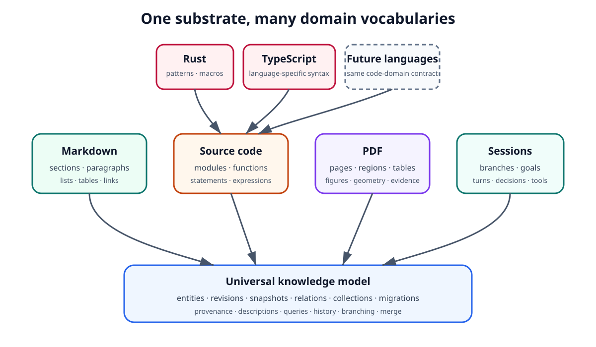
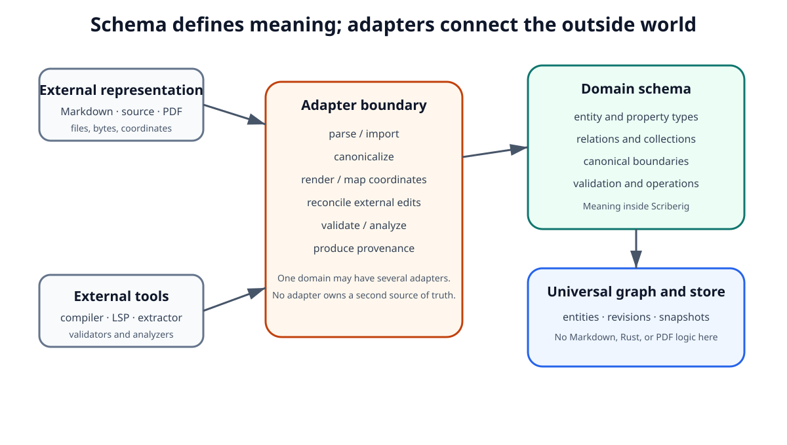
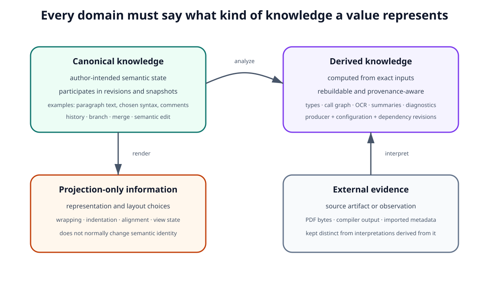
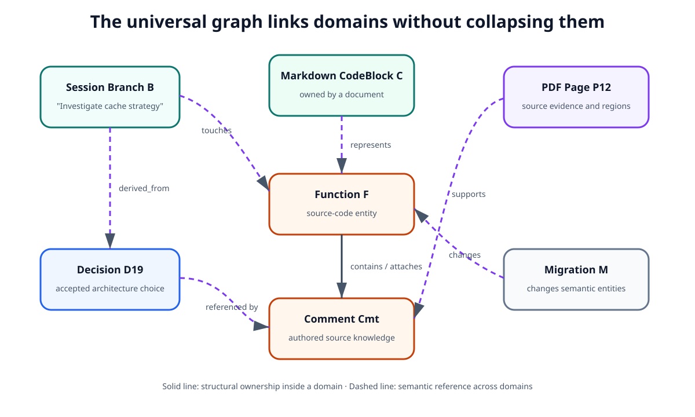
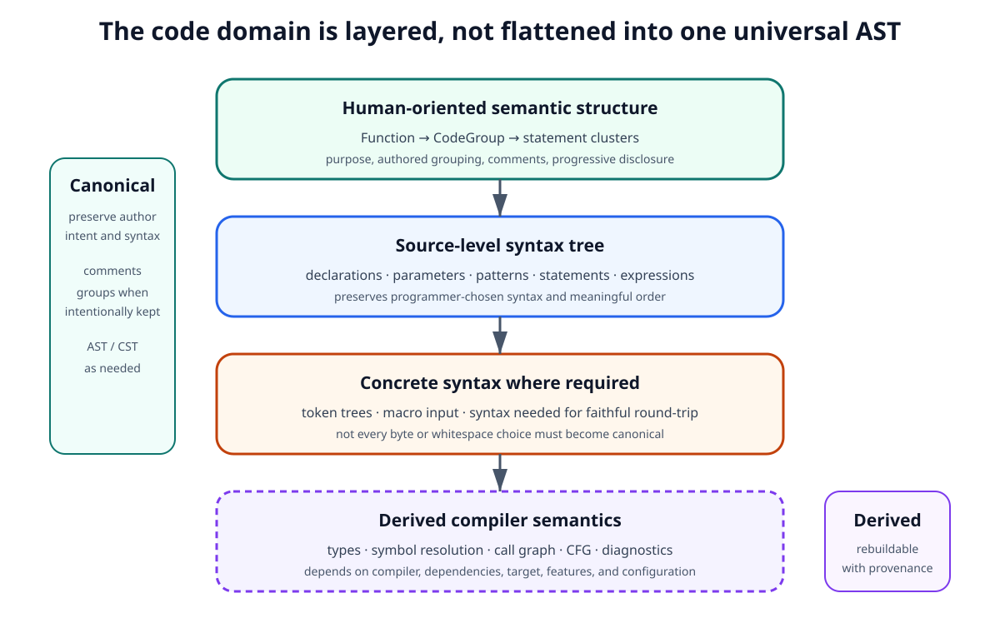
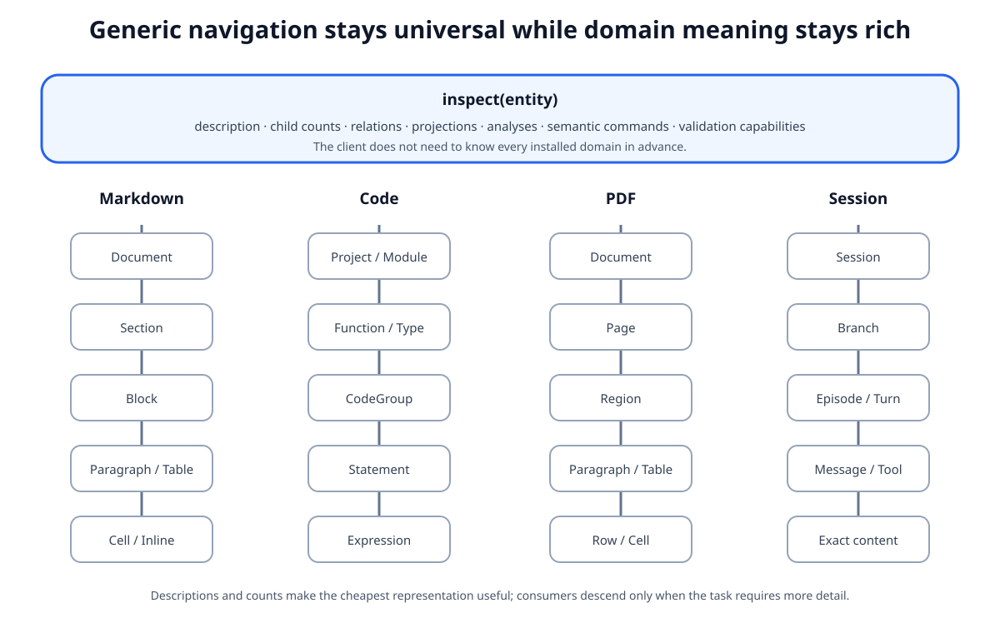

# Domain Modeling and Adapters

## 1. Purpose

Scriberig uses one universal knowledge model, but useful systems are built from domains with their own semantics.

Markdown has sections, paragraphs, lists, tables, links, and code blocks. Source code has modules, functions, parameters, statements, expressions, comments, attributes, and language-specific syntax. PDFs have pages, text regions, tables, figures, annotations, and layout. Sessions have branches, turns, goals, decisions, tool invocations, and results.

These domains must not become independent storage systems.

They specialize the universal knowledge model through schemas, adapters, projections, validation, semantic operations, descriptions, and derived analysis.

The central rule is:

> A domain defines meaning and behavior over the universal knowledge model. An adapter translates between that meaning and external representations or tools without creating a second source of truth.

This document defines the architectural role of domains and adapters, the boundary between canonical and derived information, and the rules that domain implementations must preserve.

It intentionally does not prescribe Rust traits, parser libraries, compiler APIs, SQL layouts, HTTP endpoints, or concrete UI components. Those belong in lower-level designs.

---

## 2. Design Goals

Domain modeling must satisfy the following goals.

### 2.1 Preserve one universal substrate

A new domain must not require a new persistence architecture.

Markdown, Rust, PDFs, sessions, and future domains should all use the same concepts for:

- entities;
- revisions;
- snapshots;
- typed properties;
- relations;
- collections;
- migrations;
- provenance;
- descriptions;
- derived knowledge;
- querying;
- history;
- branching;
- merging.

The domain defines vocabulary and constraints. It does not replace the substrate.

### 2.2 Preserve domain meaning

Universality must not flatten important distinctions.

A Rust expression is not merely text. A Markdown table row is not merely a list of strings. A PDF table cell may have extraction uncertainty and page geometry. A session branch has purpose, outcome, and provenance that differ from document containment.

Each domain must be able to preserve the choices that matter to its users and tools.

### 2.3 Support progressive disclosure

Domains must expose useful semantic boundaries that let consumers move from coarse structure to fine detail.

A consumer should be able to inspect a document before paragraphs, a function before expressions, a PDF before regions, and a session before turns.

The canonical model should therefore preserve or derive meaningful navigation units rather than forcing every consumer to traverse raw low-level syntax.

### 2.4 Separate canonical knowledge from derived analysis

A parser, compiler, OCR system, static analyzer, model, renderer, or external service may produce valuable information.

That information should be storable and queryable, but it must not silently become canonical knowledge merely because it exists in the same database.

### 2.5 Support ordinary external tools

A domain adapter should make Scriberig interoperable with the existing tools of that domain whenever practical.

Examples include:

- normal Markdown editors;
- source-code editors and formatters;
- compilers and language servers;
- PDF viewers and extraction tools;
- browser applications;
- third-party API clients.

### 2.6 Remain useful without agents

Domain schemas, parsing, rendering, querying, reconciliation, and analysis must not depend on an agent runtime.

Agents are consumers of domain capabilities, not a prerequisite for them.

---

## 3. Domain Specialization

A domain specializes the universal model by defining a coherent vocabulary and rules over it.

The key point is that all domains share the same persistence, identity, history, graph, query, migration, and provenance foundations. A language specialization such as Rust may refine the source-code domain further, but it still does not introduce a separate knowledge system.



_Figure 1. Domain specialization over one universal knowledge substrate._

The reader should notice that specialization happens upward: the universal layer supplies generic knowledge mechanics, while each domain supplies its own vocabulary and constraints. Source code is itself a domain family, allowing Rust, TypeScript, and future languages to share broad concepts without flattening their language-specific syntax.

A domain may define:

- entity types;
- property types;
- relation types;
- collection semantics;
- canonical structure;
- validation rules;
- semantic operations;
- navigation summaries;
- descriptions;
- projection kinds;
- reconciliation rules;
- derived analyses;
- domain-specific queries;
- domain-specific commands;
- domain-specific UI views.

The universal store does not need hard-coded knowledge of these concepts.

For example, the store does not need to understand that a Rust `match` expression has arms or that a Markdown table contains rows. Those meanings belong to domain schemas and adapters.

---

## 4. Domain Schemas and Adapters Are Different

A schema and an adapter have related but distinct responsibilities.

A schema defines what knowledge means once it is inside Scriberig. An adapter connects that knowledge to some external representation, tool, parser, compiler, or environment.



_Figure 2. Schema and adapter responsibilities are intentionally separate._

The important boundary is that schemas define meaning inside the knowledge system, while adapters translate to and from external systems. A domain may have several adapters, and a schema may exist even when there is no file format at all. The universal store remains unaware of Markdown parsing, Rust compiler APIs, PDF extraction, or session rendering.

A schema may define:

- entity and property types;
- relation types and valid endpoints;
- ordered and unordered collection semantics;
- required and optional structure;
- canonical versus derived fields;
- validation rules;
- supported projections;
- semantic operations;
- schema version.

An adapter may provide some or all of:

- parsing;
- importing;
- canonicalization;
- rendering;
- reconciliation;
- validation;
- analysis;
- domain-specific queries;
- semantic operations;
- descriptions;
- external coordinate mapping.

Not every adapter needs every capability.

For a programming language, separate adapters may eventually connect to source syntax, formatting, compiler analysis, language-server analysis, test execution, and package metadata. For PDFs, different extractors may coexist with different quality, speed, licensing, or platform requirements.

Adapters must operate through public knowledge-model operations rather than bypassing the model with domain-specific persistence tables that become independent sources of truth.

Domain-specific indexes are allowed, but they must be rebuildable or explicitly classified as canonical domain state.

---

## 5. Canonical, Derived, Projection-Only, and External Knowledge

Every important field or relation in a domain must have a clear authority class.

Canonical knowledge is the state that participates in snapshots, semantic history, branching, merging, and semantic editing. Derived knowledge is computed from canonical knowledge or external evidence and must retain provenance and dependency information. Projection-only information affects representation but not normally semantic identity. External evidence preserves source artifacts or observations independently from interpretations made from them.



_Figure 3. Domain information is classified by authority and purpose._

The reader should notice that all four classes may coexist in the same database without having equal authority. A compiler fact can be queryable without becoming canonical source syntax; a PDF extraction can be useful without being treated as identical to the original PDF bytes; a formatting choice can affect a rendered file without changing the program's semantic revision.

### 5.1 Canonical does not mean minimal

Canonical state should not be reduced to the smallest representation that happens to preserve execution or rendering today.

If an author made a meaningful syntactic or structural choice, the domain should normally preserve it.

For example, two source constructs that currently compile to equivalent behavior may still represent different chosen syntax and should not automatically collapse to the same canonical state.

### 5.2 Canonical does not mean exact bytes

Presentation details that do not carry domain meaning should not automatically become canonical.

Formatting, line wrapping, indentation width, table alignment spacing, and similar choices may belong to projection style rather than semantic identity.

The domain owns this distinction.

### 5.3 Derived knowledge records its dependencies

Examples of derived knowledge include:

- symbol resolution;
- inferred types;
- call, control-flow, and data-flow graphs;
- compiler and lint diagnostics;
- macro expansion;
- document summaries and topic labels;
- PDF text extraction and table detection;
- OCR results and reading order;
- branch summaries and relevance indexes;
- model-generated descriptions.

A derived result should identify exact inputs, producer, configuration, and profile whenever those affect the result.

If the inputs and producer configuration remain unchanged, the result may be reused. If they change, the result may need recomputation even though the conceptual entity identity remains stable.

---

## 6. Adapter Boundaries and Dependency Direction

Adapters should have narrow, explicit boundaries.

The dependency direction is always from domain-specific integration toward the universal platform:

1. external format or tool;
2. adapter;
3. domain schema;
4. universal graph and knowledge model;
5. universal persistence.

Higher layers depend on lower layers. Lower layers do not call back into specific domains.

This keeps the universal store reusable for applications that never install a particular adapter and allows smaller deployments to install only the domains they need.

Multiple adapters may serve the same schema. Derived results therefore identify the adapter or producer that created them when that identity affects interpretation.

---

## 7. Domain Composition and Cross-Domain Relations

Real knowledge frequently crosses domain boundaries.

A Markdown document may contain a code block. A PDF may contain a source-code excerpt. A session branch may reference a function, paragraph, PDF page, migration, or test result. A source-code comment may link to a design decision.

These relationships should use the same universal graph machinery rather than forcing domains into isolated silos.



_Figure 4. Cross-domain relations connect knowledge without transferring ownership._

The distinction to notice is between containment and reference. A Markdown document can own a code block while that code block references a source function; the document does not thereby own the function. A session branch can touch a function without copying it. A decision can be supported by a PDF page without absorbing the PDF content into the decision.

Examples include:

```text
SessionBranch --touches--> Function
Decision --supported_by--> PDFPage
MarkdownCodeBlock --represents--> FunctionRevision
Comment --references--> Decision
Migration --changes--> Paragraph
Migration --changes--> Function
```

Cross-domain links must not require either domain to copy the other's content or force unrelated revisions to churn.

---

## 8. Markdown and Structured Documents

Markdown is the first recommended document-domain specialization because it has meaningful structure while remaining easy to inspect and edit with ordinary tools.

A Markdown model should support semantic entities such as:

```text
MarkdownDocument
Section
Heading
Paragraph
List
ListItem
Table
TableRow
TableCell
CodeBlock
QuoteBlock
Link
ImageReference
InlineContent
```

The exact set may evolve, but several principles are architectural.

### 8.1 Sections are semantic navigation units

A document should expose top-level sections before paragraphs. Nested sections provide natural progressive disclosure.

### 8.2 Paragraphs are independently addressable

Paragraphs should be entities that can be inspected, described, referenced, changed, and searched without requiring a consumer to load the full file.

### 8.3 Tables expose rows and cells

Search and editing should be able to return or modify a row or cell semantically rather than only by byte coordinates.

### 8.4 Formatting is not automatically canonical

Whitespace, table alignment, wrapping, and similar choices normally belong to projection style unless the domain explicitly decides otherwise.

### 8.5 External editing remains supported

A `.md` file is an editable projection. The Markdown adapter parses an external edit, matches semantic entities where possible, and produces semantic changes rather than treating the file as an opaque replacement blob.

---

## 9. Source Code as a Domain Family

Source code should be modeled as a family of related domains rather than one universal AST that pretends all programming languages are identical.

A language-independent code layer may define broad concepts such as:

```text
Module
Type
Function
Parameter
CodeGroup
Statement
Expression
Comment
Symbol
Reference
```

Language-specific schemas then refine those concepts.

The common layer exists to enable shared operations where semantics genuinely overlap. It must not erase language-specific constructs merely to force uniformity.

### 9.1 Canonical source syntax preserves meaningful author choices

The canonical code model should normally include:

- declarations;
- parameters;
- statements;
- expressions;
- patterns;
- type syntax;
- attributes or annotations;
- macro invocations or equivalent language constructs;
- intentionally preserved comments;
- meaningful ordering;
- other syntax that affects author intent or round-trip fidelity.

Compiler intermediate representation should not be the primary canonical program representation because it may erase syntax choices, comments, macros, and source-level structure needed by humans and agents.

### 9.2 AST nodes may have semantic identity

AST nodes may be normal domain entities where independent identity is useful. This enables inspection and semantic operations at function, code-group, statement, and expression levels.

Storage granularity and semantic granularity do not need to be identical. Lower-level implementations may optimize physical representation while preserving logical addressability.

### 9.3 Comments are first-class source knowledge

Comments should not automatically be discarded as parser trivia.

They may encode documentation, explanations, invariants, safety arguments, TODOs, warnings, directives, and user intent. A source comment is authored source content; a generated description is derived knowledge unless explicitly promoted.

### 9.4 Code groups provide a human-oriented layer

Raw AST depth is often too fine-grained for navigation.

A function should be able to expose conceptual groups such as validation, loading, persistence, event emission, and result construction. A `CodeGroup` may be based on preserved grouping, comments, blocks, blank-line boundaries, explicit editor actions, static analysis, or generated descriptions.

The domain must distinguish which aspects are canonical and which are inferred.

### 9.5 Concrete syntax is preserved where required

Some constructs cannot safely round-trip through a simplified AST alone. Rust macros are a representative example.

The code domain may therefore need several structural layers.



_Figure 5. Source code is represented through several layers rather than one flattened AST._

The important distinction is that source-level syntax, comments, macros, and token structures needed for faithful round-trip may be canonical, while compiler semantics such as inferred types, call graphs, control flow, and diagnostics remain derived. Human-oriented code groups sit above low-level syntax to reduce the information cost of understanding code.

### 9.6 Compiler and static-analysis integration is derived

Compiler-derived information may depend on:

- compiler version;
- dependency graph;
- enabled features;
- build target;
- environment;
- configuration.

The producer and dependency set must therefore be explicit enough to support correct invalidation and reproducibility.

Compiler facts should remain queryable through the same universal graph even though they are not canonical program syntax.

---

## 10. PDFs and Imported Documents

PDFs differ from Markdown and source code because they are often imported artifacts rather than editable semantic projections.

The original PDF should be preservable as exact source evidence. An adapter may then derive structured entities such as:

```text
PDFDocument
PDFPage
TextRegion
Paragraph
Table
TableRow
TableCell
Figure
Annotation
```

Some extracted structure may be certain; some may be inferred. The domain must preserve provenance and confidence where extraction is uncertain.

A consumer must be able to distinguish:

- exact imported PDF bytes;
- parser or extractor interpretation;
- page geometry and source regions;
- model-generated descriptions or summaries.

These may coexist in the same database without having equal authority.

Page coordinates remain important, but they should not replace semantic identity. A semantic paragraph can retain page and bounding-region metadata for highlighting while still being searchable, referenceable, summarizable, and related to other entities through semantic handles.

If a later extractor produces improved structure, the system should preserve provenance and lineage instead of pretending the earlier extraction never existed.

---

## 11. Sessions as a Domain

Sessions use the same universal model as documents and code.

A session-domain schema may define:

```text
Session
Branch
Goal
HumanInput
AgentOutput
Observation
Question
Decision
ToolInvocation
ToolResult
BranchResult
Summary
Task
```

Typical relations include:

```text
Session --contains--> Branch
Branch --contains--> Turn
Branch --touches--> Entity
Decision --derived_from--> Branch
ToolResult --produced_by--> ToolInvocation
BranchResult --produced_by--> Branch
```

A branch may have a short description, purpose, outcome, state, and touched entities so that it can be navigated without loading all contained turns.

The session domain may render several projections from the same underlying session knowledge:

- human transcript;
- agent context;
- branch tree;
- audit history;
- decision log.

The session domain must not be tied to one model provider or one chat UI.

---

## 12. Progressive Disclosure and Capability Discovery

Each domain should define natural levels of inspection.

The agent, CLI, API server, browser, and third-party applications should not need to load complete objects by default. An inspection response should provide concise descriptions, child counts, semantic handles, and available capabilities before finer content is requested.



_Figure 6. Generic clients discover domain capabilities and descend from coarse structure to fine detail._

The reader should notice that the navigation grammar stays universal while the domain hierarchy differs. A generic client can call `inspect` without understanding every installed domain, discover what the entity supports, and then choose a relevant relation, projection, analysis, or semantic command.

Natural hierarchies include:

```text
Markdown:
Document -> Section -> Block -> Paragraph/Table/List -> Cell/Item/InlineContent

Code:
Project -> Module -> Function/Type -> CodeGroup -> Statement -> Expression

PDF:
Document -> Page -> Region -> Paragraph/Table/Figure -> Row/Cell

Session:
Session -> Branch -> Episode/Turn -> Message/ToolInteraction
```

These are views over the graph, not a requirement that the universal database be stored as one tree.

Important entities should expose concise descriptions suitable for navigation, with provenance identifying whether the description is authored, parsed, compiler-derived, statically inferred, model-generated, or imported.

Generated descriptions should normally remain derived knowledge and should not alter the canonical revision of the described entity.

---

## 13. Search and Semantic Handles

Search should return semantic domain objects whenever possible rather than only coordinates in an external representation.

Examples include:

```text
Markdown search result
  Paragraph P
  containing Section S

Table search result
  TableRow R
  containing Table T

Code search result
  Function F
  CodeGroup G
  Statement S

PDF search result
  Paragraph P
  Page 12
  source region ...

Session search result
  Branch B
  Decision D
```

External coordinates such as filenames, line numbers, page numbers, and byte ranges remain useful metadata, but semantic handles should be preferred for continued interaction.

A consumer should be able to receive a semantic handle and immediately use it for later operations such as inspect, follow, diff, history, render, or a domain-specific command.

---

## 14. Domain Semantic Operations

Domains may define semantic operations that are more meaningful than generic graph edits.

Examples include:

```text
Markdown:
  rename heading
  insert paragraph
  move section
  add table row

Code:
  rename symbol
  replace expression
  add parameter
  move statement
  extract function

Session:
  start branch
  complete branch
  promote decision
  reopen task
```

These operations ultimately produce ordinary revisions and universal migrations.

A domain-specific command is therefore an ergonomic and validation layer, not an alternate history mechanism.

Generic graph operations remain available where appropriate, especially for infrastructure and debugging, but normal domain users should not need to express every change as raw relation manipulation.

---

## 15. Validation Belongs to the Domain Boundary

The universal store can validate universal invariants, but domain correctness requires domain knowledge.

Examples include:

```text
Markdown:
  structural validity

Rust:
  parse validity
  language constraints
  compiler validation

PDF:
  source-region consistency
  extractor output shape

Session:
  valid branch state transitions
  valid result references
```

Adapters and domain services should provide validation before changes are promoted when correctness matters.

Validation results should be stored as derived knowledge with explicit provenance rather than silently mutating canonical state.

---

## 16. Reconciliation Is Domain-Specific

Bidirectional editing requires domain knowledge.

The universal projection system can orchestrate change detection, base-projection tracking, snapshot references, conflict representation, and migration commit. Only the domain adapter can decide what an external edit means.


_Figure 7. External edits become semantic migrations through domain-aware reconciliation._

The critical point is that the adapter must infer semantic continuity explicitly. External files often contain no Scriberig entity IDs, so a reconciler may use exact content equality, structural role, parent context, sibling order, names or signatures, text similarity, syntax similarity, or stable external identifiers. When continuity is uncertain, the system should create a new entity or report ambiguity rather than silently inventing identity.

For Markdown, reconciliation may match sections and paragraphs. For source code, it may match declarations and syntax subtrees. Another structured format may match rows, records, or semantic keys.

The adapter produces semantic changes rather than directly updating persistence internals.

---

## 17. Adapter Versioning and Schema Evolution

Adapters evolve independently from schemas.

A parser may improve. A PDF extractor may identify tables more accurately. A compiler integration may change. A reconciliation algorithm may gain new behavior. Derived results must therefore identify the adapter version or producer profile that created them when that version affects interpretation.

Schema evolution changes what stored domain knowledge means. It may add entity types or relations, refine validation rules, split one concept into several, introduce richer canonical structure, or deprecate old structures.

The distinction is:

```text
schema version
  defines what stored domain knowledge means

adapter version
  defines how an external representation or tool maps to that schema
```

Existing history must remain interpretable.

Schema migrations are different from ordinary user-content migrations. Both should remain inspectable and reproducible.

---

## 18. Generic Operations and Domain Extensions

All domains remain reachable through the universal interaction grammar:

```text
inspect
list
follow
find
query
diff
history
render
branch
apply
commit
```

Domain-specific operations extend this grammar rather than replacing it.

For example, inspecting a function may advertise parameters, code groups, references, callers, history, and source rendering. Inspecting a PDF page may advertise paragraphs, tables, figures, source image, and reading order.

The agent, CLI, API server, browser, TUI, and third-party libraries should all consume the same underlying domain capabilities.

Adapters are part of the knowledge platform, not part of the agent runtime. Markdown parsing, Rust analysis, PDF extraction, and session storage must all work without an agent model provider.

---

## 19. Domain UI Views

Domains may provide reusable UI views, but UI code is not the canonical domain model.

Examples include:

- Markdown section browser;
- source-code function inspector;
- PDF page viewer;
- session branch tree.

These views should consume the same public domain APIs available to other clients.

A full Scriberig application may compose low-level graph browsing with high-level semantic views, but neither should require privileged access to private storage internals.

The UI should be able to move between a raw universal graph view and a domain-specific semantic view without changing the underlying entity being inspected.

---

## 20. Future Domains and Minimal Installations

The architecture must support domains that were not anticipated when the core system was written.

Possible future domains include spreadsheets, notebooks, CAD or geospatial structures, database schemas, API specifications, diagrams, issue trackers, email, calendars, media transcripts, scientific datasets, and build graphs.

A new domain should ideally require:

```text
schema
adapter(s)
projection(s)
validation
optional derived analysis
optional UI views
```

It should not require modification of the fundamental entity, revision, or snapshot architecture.

If adding a reasonable new domain requires changing the universal storage model, that is evidence that an architectural assumption should be re-examined.

The same modularity allows deployments to stop at different layers:

- storage-only deployment: universal store;
- knowledge-graph deployment: store + schemas + queries;
- Markdown deployment: knowledge graph + Markdown domain;
- code-analysis deployment: knowledge graph + code domain + language adapter;
- full Scriberig deployment: multiple domains + sessions + agents + web editor.

No domain should make unrelated domains mandatory dependencies.

---

## 21. Domain Testing and Conformance

Every domain should be testable against common architectural invariants.

Important checks include:

- canonical data round-trips without semantic loss;
- derived data can be rebuilt;
- provenance remains visible;
- semantic identities survive irrelevant projection changes;
- external edits produce migrations rather than direct mutation;
- domain validation is applied at the domain boundary;
- unchanged entities and revisions can be reused;
- generic graph inspection continues to work;
- domain-specific inspection exposes richer meaning;
- no agent runtime is required for domain functionality.

Detailed conformance suites belong in lower-level design, but all domain implementations should ultimately be measured against the same Level 1 rules.

---

## 22. Resulting Architecture

The complete domain architecture can be read from bottom to top: a universal knowledge platform provides the stable substrate; independently installable domains add semantic vocabulary; adapters connect those domains to real external representations and tools; and every consumer uses the same public capabilities.


_Figure 8. Resulting domain architecture and common consumer surface._

The most important property is symmetry: Markdown, code, PDFs, sessions, and future domains differ where their semantics differ, but they remain identical in how they participate in identity, revisions, snapshots, relations, migrations, provenance, history, querying, and capability discovery. The integrated Scriberig product is only one consumer of that platform.

Across every domain, the same questions remain valid:

```text
What entity is this?
What revision is visible in this snapshot?
What relations does it have?
What is canonical?
What is derived?
Where did this knowledge come from?
What projections are available?
What semantic operations are valid?
What changed between two states?
```

That consistency is the purpose of the domain architecture.

---

## 23. Architectural Invariants

The following rules apply to every domain.

1. A domain specializes the universal model; it does not create a separate persistence architecture.
2. Domain schemas define meaning, constraints, and canonical structure.
3. Adapters connect external representations and tools to domain schemas.
4. Canonical, derived, projection-only, and external-evidence knowledge remain distinguishable.
5. Derived knowledge records provenance and exact dependencies when practical.
6. Projection formatting does not become semantic identity unless the domain explicitly requires it.
7. Containment and reference are different relationships.
8. Cross-domain relations may connect entities without copying or owning them.
9. Domain-specific operations produce ordinary revisions and migrations.
10. Reconciliation is explicit and domain-aware.
11. Ambiguous external identity matching must not invent false continuity silently.
12. Compiler, analyzer, OCR, and model output are not automatically canonical.
13. Domain entities expose semantic handles suitable for continued interaction.
14. Domains provide progressive disclosure from coarse structure to fine detail.
15. Important entities may expose concise descriptions with provenance.
16. Domain functionality remains usable without agents.
17. Adapters and schemas are versioned independently when necessary.
18. A domain may have multiple adapters.
19. Generic clients discover capabilities rather than hard-code every domain.
20. New domains should be addable without changing the fundamental store.

Scriberig should be able to become richer in every specialized domain without fragmenting into unrelated subsystems.