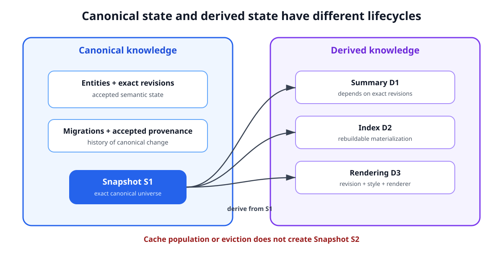
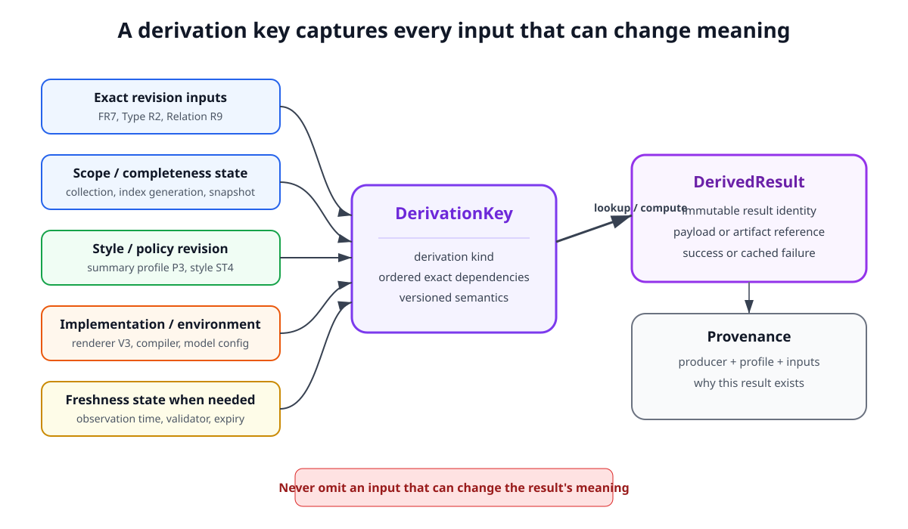
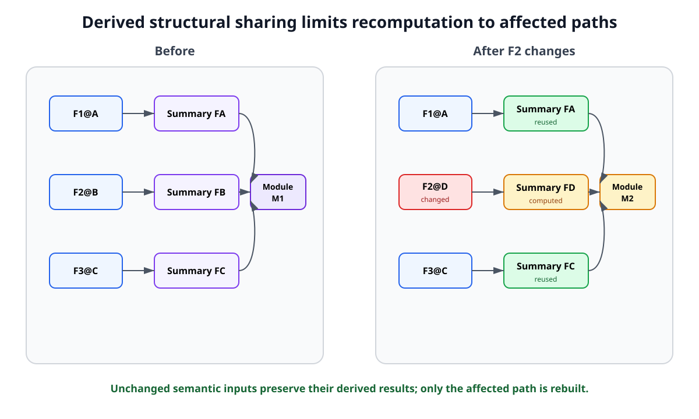
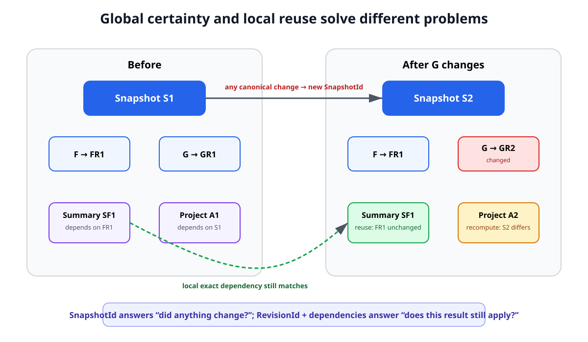

# Derived Knowledge, Caching, and Incrementality

## 1. Purpose

Scriberig stores canonical knowledge as structured entities, revisions, relations, collections, and snapshots. That canonical state is intentionally small in meaning: it describes what the system currently knows as authoritative project and session state.

Many useful representations and analyses are computed from that state rather than authored directly.

Examples include:

- short object descriptions;
- structural summaries;
- model-generated explanations;
- rendered source fragments;
- pretty-print intermediate representations;
- reverse-relation indexes;
- full-text indexes;
- embeddings;
- symbol tables;
- type information;
- call graphs;
- control-flow graphs;
- compiler diagnostics;
- semantic diffs;
- query results;
- agent-context fragments;
- validation results;
- PDF extraction results;
- external search observations.

These are **derived knowledge**.

Derived knowledge may be expensive to compute, may have different provenance and trust properties than canonical knowledge, and may become obsolete when one of its inputs changes.

Scriberig must therefore make derived knowledge reusable without allowing cache state to redefine canonical history.

The central principle is:

> Derivations are immutable results of explicit inputs. Cache reuse follows exact dependencies, while canonical snapshots remain independent of cache population.

This document defines the architectural rules for derived knowledge, provenance, cache identity, dependency tracking, incremental recomputation, freshness, eviction, and promotion into canonical knowledge.

Concrete cache tables, serialization formats, dependency-index data structures, task schedulers, model APIs, compiler integrations, and eviction algorithms belong in lower-level designs.

---

## 2. Canonical and Derived Knowledge Are Different Roles

Canonical knowledge answers questions such as:

- What entities currently exist?
- What exact revision of each entity belongs to this snapshot?
- What relations and collections define current semantic structure?
- What decisions, authored descriptions, or project state have been accepted?

Derived knowledge answers questions such as:

- How should this function be summarized?
- Which functions call this function?
- How does this revision render under this style?
- What types does the compiler infer?
- What changed between these two revisions?
- Which objects match this search query?
- What compact context should an agent receive?

The same physical database may store both.

They must not have the same authority semantics.

A cache entry appearing or disappearing must not itself mean that project knowledge changed.

For example:

```text
Snapshot S1
  Paragraph P -> Revision PR7

compute summary(P@PR7)
  -> Summary D1
```

The existence of `D1` does not require:

```text
S1 -> S2
```

No canonical knowledge changed.

Only a derived representation became available.

---

## 3. Cache Population Must Not Advance the Canonical Snapshot

This is a critical invariant.

The global `SnapshotId` identifies the exact canonical knowledge universe.

It must not change because:

- a summary was generated;
- an index was rebuilt;
- a compiler analysis finished;
- a renderer populated its cache;
- an embedding was calculated;
- an agent-context fragment was materialized;
- a query result was memoized;
- an old cache entry was evicted.

Otherwise background work would continuously manufacture meaningless project history.

Conceptually:

```text
                 Canonical State
                       |
                 Snapshot S1
                       |
         +-------------+-------------+
         |             |             |
         v             v             v
      summary        index        rendering
         |             |             |
         v             v             v
        D1            D2            D3
```

`D1`, `D2`, and `D3` may live in the same storage system, but they are outside the canonical snapshot root unless explicitly promoted.

This gives Scriberig both:

```text
stable semantic history
+
aggressive derived caching
```

The figure below should be read as an authority boundary, not as a requirement for separate physical databases. Canonical revisions and derived artifacts may share storage, but only canonical state participates in `SnapshotId`; computing or evicting a derived artifact changes availability and performance, not semantic history.



*Figure 1. Canonical snapshots are independent from derived-cache population and eviction.*

---

## 4. Derived Results Are Still Immutable Objects

Derived does not mean mutable or disposable in representation.

A computed result should normally be recorded as an immutable value with enough identity and provenance to answer:

- what was computed;
- from which exact inputs;
- using which derivation definition;
- under which configuration;
- by which implementation, tool, or model;
- when external state was observed;
- what result was produced.

For example:

```text
Derived Summary D

subject:
  Function F @ Revision FR12

profile:
  function-summary

derivation:
  summary-policy V4

engine:
  model/configuration M7

result:
  "Validates the request and persists the account change."
```

The summary result does not mutate if the function later changes.

A new function revision requires a separately justified derived result.

This makes historical derived information reproducible and inspectable while it is retained.

---

## 5. Derivation Identity Is More Than Output Identity

Two important identities must not be confused:

```text
result identity
```

and:

```text
derivation key
```

A result may be content-addressed by its produced value.

However, cache lookup must answer a different question:

> Have we already computed the requested derivation from these exact relevant inputs?

Conceptually:

```text
DerivationKey
  -> DerivedResult
```

A derivation key may include:

- derivation kind;
- exact input revisions;
- relevant relation or collection revisions;
- style or policy revision;
- tool or implementation version;
- compiler or runtime configuration;
- model configuration;
- external-source freshness state;
- other domain-specific inputs.

The exact representation is a lower-level concern.

The invariant is that no input capable of changing the meaning of the result may be silently omitted.

The schema view below makes the distinction concrete: the lookup key describes the computation and all meaning-changing inputs, while the immutable result has its own identity and provenance. This is why output equality alone is not sufficient evidence that two derivations are interchangeable.



*Figure 2. A derivation key records the exact semantic and computational conditions under which a cached result is reusable.*

---

## 6. Revision Identity, Not Entity Identity, Drives Exact Cache Reuse

An `EntityId` provides conceptual continuity.

A `RevisionId` identifies exact immutable state.

Therefore this is generally unsafe:

```text
cache key:
  EntityId
```

because the entity may now resolve to another revision.

This is generally safe:

```text
cache key:
  exact relevant RevisionId values
  + derivation configuration
```

For example:

```text
Function F
  R1 -> summary S1
  R2 -> summary S2
```

`F` remains the same conceptual function, but `S1` cannot automatically be reused as the summary of `R2`.

Entity identity remains useful for:

- locating related derived results;
- showing history;
- selecting the newest compatible result;
- associating caches with a conceptual object.

Exact validity comes from revision dependencies.

---

## 7. Snapshot Identity Is a Global Change Fingerprint

A `SnapshotId` answers whether any canonical state in its scope changed.

This makes it extremely useful as a coarse signal.

If:

```text
snapshot_before == snapshot_after
```

then no canonical knowledge changed.

If:

```text
snapshot_before != snapshot_after
```

then some canonical knowledge changed.

However, a global snapshot change does **not** mean every derived result is stale.

For example:

```text
Snapshot S1
  Function F -> FR1
  Function G -> GR1

Snapshot S2
  Function F -> FR1
  Function G -> GR2
```

A summary whose only semantic dependency is `F@FR1` remains reusable.

Therefore:

> Snapshot identity is the right key for global-state derivations and the right signal that something changed, but it is too coarse for most local cache invalidation.

Scriberig should use global certainty and local dependency tracking together.

---

## 8. Global Derivations May Depend on the Snapshot

Some results genuinely describe the complete state of a scope.

Examples include:

- a complete project manifest;
- a query asking for every entity satisfying a condition;
- a project-wide validation result;
- a global dependency audit;
- a full search index generation;
- a repository-wide statistical report.

For these derivations, depending on a project or knowledge snapshot may be correct.

Conceptually:

```text
ProjectSnapshot S
+ AnalysisProfile A
-> ProjectAnalysis D
```

When the snapshot changes, reuse must be reconsidered because the derivation explicitly depended on the whole scope.

This is not undesirable invalidation.

It accurately reflects the derivation's declared dependency.

---

## 9. Dependencies Must Be Explicit Enough to Explain Validity

Every reusable derived result should have a dependency description sufficient to explain why it is still valid.

For a local summary:

```text
summary(Function F@FR7)
```

may depend only on:

```text
FR7
summary profile P3
model/policy M2
```

A type-checking result may depend on:

```text
function revision
referenced type revisions
import/module structure
compiler configuration
feature configuration
toolchain version
```

A rendered fragment may depend on:

```text
object revision
style revision
renderer version
```

Dependency descriptions are part of the derivation contract, not optional debugging metadata.

Without them, Scriberig cannot distinguish reusable work from stale work reliably.

---

## 10. Dependencies May Be Direct or Transitive

A derived result may depend directly on canonical state:

```text
FunctionRevision
  -> FunctionSummary
```

It may also depend on another derived result:

```text
FunctionRevision
  -> FunctionSummary
  -> ModuleSummary
  -> ProjectSummary
```

This can significantly reduce recomputation.

If one function changes, a project summary need not require every function to be summarized again.

Unchanged function summaries remain reusable.

Only the affected derivation path needs new results.

Conceptually:

```text
F1@A -> Summary FA ----\
F2@B -> Summary FB -----+--> Module Summary M1
F3@C -> Summary FC ----/
```

If only `F2` changes:

```text
F1@A -> reuse Summary FA
F2@D -> compute Summary FD
F3@C -> reuse Summary FC

FA + FD + FC -> Module Summary M2
```

This is derived structural sharing.

The key point in the next figure is that transitive derivations form a graph of reusable immutable results. A changed leaf does not force unrelated siblings to be regenerated; only nodes on a dependency path from the changed input must be reconsidered.



*Figure 3. Transitive derived results preserve structural sharing when only one semantic input changes.*

---

## 11. Derived Dependency Graphs Must Not Be Hidden

A cache system that knows only that "result X is stale" is less useful than one that can explain why.

Scriberig should be able to expose relationships such as:

```text
DerivedResult D
  depends_on -> Revision R1
  depends_on -> Revision R2
  depends_on -> StyleRevision SR4
  produced_by -> DerivationProfile P7
```

This supports:

- precise invalidation;
- debugging;
- provenance inspection;
- distributed cache validation;
- agent reasoning;
- UI explanation;
- incremental scheduling.

Derived dependencies may be stored as indexes or metadata rather than canonical semantic relations, but they must remain inspectable.

---

## 12. Absence and Scope Are Dependencies Too

Positive dependencies alone are not sufficient for every derivation.

Consider:

```text
find all callers of Function F
```

Suppose the result is:

```text
[G, H]
```

Recording only dependencies on `G` and `H` is incorrect.

A new function `J` may later be added that also calls `F`.

Neither `G` nor `H` changed, yet the query result is stale.

The result depended on the scope in which the absence of other callers was established.

Similar cases include:

- "all implementations of trait T";
- "all paragraphs containing X";
- "there are no unresolved diagnostics";
- "all branches touching entity E";
- "all entities of type K".

Such derivations need a dependency on an appropriate scope, collection, index generation, or snapshot.

The architectural rule is:

> A dependency model must represent both the objects a result used and the scope over which completeness or absence was asserted.

---

## 13. Dependency Precision Is a Tradeoff

A derivation may choose a broad dependency when fine-grained dependency discovery is expensive.

For example:

```text
precise:
  depends on revisions R1, R2, R3 and collection C7
```

or:

```text
conservative:
  depends on ProjectSnapshot S
```

Both can be correct.

The difference is reuse efficiency.

A conservative dependency may invalidate more work than necessary but must not return an incorrect result.

A precise dependency can maximize reuse but costs more to discover and maintain.

Therefore:

> Scriberig should prefer correctness first and allow domains to increase dependency precision incrementally.

This is important for early adapters.

They should not require perfect incremental analysis before they can be useful.

---

## 14. Incrementality Follows Semantic Change, Not File Change

A textual file change is not itself a sufficient invalidation boundary.

For example, a user may reformat an entire source file while preserving exactly the same canonical syntax.

After reconciliation:

```text
semantic revisions unchanged
```

Therefore semantic analyses and model-generated understanding should remain reusable.

Only projection-specific results whose style or exact rendered bytes changed may need recomputation.

Conversely, a one-character edit may alter one expression and therefore invalidate:

- that expression's derived representation;
- analyses that depend on it;
- summaries that depend on the containing function;
- global results whose declared scope includes it.

Scriberig should propagate invalidation through semantic dependencies rather than through file timestamps or line ranges.

---

## 15. Incremental Recalculation Has a Standard Shape

After a canonical migration produces a new snapshot, incremental derived work conceptually follows this process:

```text
old snapshot
    |
    | canonical migration
    v
new snapshot
    |
    v
identify changed entity revisions / structures
    |
    v
find affected derivations
    |
    +---- unaffected -> reuse
    |
    +---- affected ----> recompute when needed
```

The system should not assume that every affected result must be recomputed immediately.

Some derived knowledge is useful enough to maintain eagerly.

Other results should be lazy.

The distinction belongs to policy rather than correctness.

The flow below separates correctness from scheduling. Exact semantic changes and reverse dependencies determine which results remain valid; only after that decision does policy choose whether affected results should be rebuilt eagerly or left for lazy recomputation.


*Figure 4. Incremental invalidation follows semantic dependency edges, while eager versus lazy recomputation is a scheduling choice.*

---

## 16. Eager and Lazy Derivation Are Both Valid

Examples of derived information that may justify eager maintenance include:

- indexes required for interactive navigation;
- small reverse-relation indexes;
- basic search metadata;
- diagnostics expected continuously in an editor.

Examples that may be better computed lazily include:

- expensive model-generated summaries;
- whole-project explanations;
- rare semantic analyses;
- large renderings;
- deep agent-context expansions.

Both strategies use the same validity model.

The difference is only when work occurs.

A cache miss should not change the semantic meaning of the system.

It changes only latency and availability of a derived view.

---

## 17. Derived Indexes Are Rebuildable Materializations

Indexes should normally be treated as derived state.

Examples include:

- entity-to-parent indexes;
- relation reverse indexes;
- symbol-reference indexes;
- caller/callee indexes;
- full-text indexes;
- search token indexes;
- embedding indexes;
- provenance lookup indexes;
- branch-to-touched-entity indexes.

The canonical graph must remain meaningful if these indexes are removed.

An index may be necessary for acceptable performance, but it is not thereby canonical truth.

This provides an important recovery invariant:

> Canonical state plus schemas and derivation definitions must be sufficient to rebuild disposable derived indexes.

Indexes may have their own version, configuration, and scope identities so clients can understand what state they represent.

---

## 18. Rendering Is a Derivation

Projection rendering is one important form of derived computation.

Conceptually:

```text
semantic revision
+ style revision
+ renderer definition
-> rendered representation
```

A reusable render result must therefore depend on exact relevant identities.

For example:

```text
(FunctionRevision FR9,
 RustStyleRevision ST4,
 RendererVersion RV3)
    -> PrettyPrintRepresentation P
```

If another function changes, this result remains reusable.

If only the style changes, semantic analyses remain reusable while the render result may not.

This separation is one of the major benefits of removing presentation from semantic identity.

---

## 19. Layout-Sensitive Rendering May Have Several Derived Layers

Some rendering cannot be reduced to a single cached text fragment because final layout depends on surrounding width or indentation.

The architecture should allow several derivation layers:

```text
semantic revision
    |
    v
render structure / pretty-print representation
    |
    v
contextual layout
    |
    v
bytes or UI representation
```

A higher-level cached representation may be reusable across many layout contexts even if final text is not.

This principle generalizes beyond source formatting.

For example, a semantic table can have a reusable logical presentation before a terminal, browser, or PDF renderer applies its final dimensions.

Level 1 requires only that cache boundaries correspond to real dependencies rather than arbitrary implementation layers.

---

## 20. Summaries and Descriptions Are Derived Knowledge by Default

Scriberig uses short descriptions to make large knowledge graphs navigable by humans and agents.

Unless authored or explicitly accepted as canonical knowledge, these descriptions are derived.

For example:

```text
Function F@R7
  -> one-line description
  -> structural summary
  -> behavioral explanation
```

Different summary profiles may coexist.

A branch may have:

```text
short navigation label
purpose summary
outcome summary
full historical transcript
```

Only the underlying session and authored/accepted knowledge need be canonical.

This lets Scriberig regenerate summaries with improved models or policies without rewriting project history.

---

## 21. Model-Generated Knowledge Requires Full Provenance

Model-generated output is especially important because it is useful but interpretive.

A generated result should be associated with enough provenance to distinguish it from parser- or compiler-derived facts.

Relevant provenance may include:

- exact source revisions or scope;
- summary or analysis profile;
- model identity or model family when available;
- model configuration relevant to the result;
- prompt/policy revision;
- tool inputs used during derivation;
- source provenance visible to the model;
- generation time when relevant;
- confidence or validation state when the domain supplies one.

The user interface and agent API should be able to communicate distinctions such as:

```text
verified parser fact
compiler-derived fact
static-analysis inference
model-generated interpretation
user-authored knowledge
```

A cached model output becoming convenient must not silently turn interpretation into authority.

---

## 22. Nondeterministic Derivations Can Still Be Cached

A derivation does not need to be deterministic in order for its result to be stored and reused.

A language model may produce different outputs from the same inputs on separate executions.

Scriberig can still record:

```text
exact derivation request
-> exact resulting artifact
```

Reuse then means:

> Return this previously computed result for this compatible derivation request.

It does not mean:

> This is the only possible result of the derivation.

Selection policy may later choose to regenerate or prefer a newer model-generated result.

The immutable old result remains historically meaningful while retained.

---

## 23. Multiple Compatible Derived Results May Coexist

There may be several valid derived results for the same subject.

For example:

```text
Function F@R9
  -> Summary S1 using profile/model A
  -> Summary S2 using profile/model B
  -> Summary S3 using newer policy C
```

The storage layer should not force these into one mutable cache row whose meaning changes over time.

Selection is a separate concern from identity.

A consumer may request:

- an exact derivation profile;
- the preferred current profile;
- the cheapest available summary;
- a result produced by a trusted engine;
- a fresh result rather than a historical one.

This keeps cache history explicit and avoids overwriting provenance.

---

## 24. Derived Knowledge May Be Promoted, But Only Explicitly

Sometimes an interpretation becomes accepted knowledge.

For example, an agent may generate:

```text
"The renderer cache is keyed by exact semantic and style revisions."
```

A human or accepted workflow may decide that this should become a durable design decision.

Promotion should be explicit:

```text
derived observation
    |
    | review / acceptance
    v
canonical Decision entity or revision
    |
    v
new canonical snapshot
```

The promoted canonical object should retain provenance back to the derived artifact when useful.

The act of promotion, not the original computation, changes canonical knowledge.

This is the bridge between disposable analysis and durable project knowledge.

---

## 25. External Information Needs Freshness Semantics

Not all derivations depend only on immutable local state.

Examples include:

- web search results;
- remote documentation;
- package registry metadata;
- repository state from an external server;
- issue tracker data;
- current prices, schedules, or service status;
- external APIs.

A fetched result can be stored as an immutable observation:

```text
Source X
observed at time T
returned artifact A
```

But the statement:

```text
"A is the current value of X"
```

has freshness semantics that local content addressing alone cannot guarantee.

Therefore externally derived knowledge may require:

- observation time;
- source identity;
- validator or revision metadata where available;
- freshness/expiry policy;
- explicit refresh;
- source-specific trust information.

Immutable storage preserves what was observed.

It does not make the external world immutable.

The next figure places freshness and authority side by side because they are independent questions. An old external observation may remain a perfectly accurate record of what was seen at `T1` while no longer being fresh enough to answer a current query; likewise, even a fresh derived observation does not become canonical until an explicit acceptance operation promotes it.


*Figure 5. External observations need freshness semantics, while promotion into canonical knowledge is an explicit authority transition.*

---

## 26. Compiler and Tool Results Depend on Their Environment

Compiler-derived facts are not determined solely by one source-code revision.

They may depend on:

- language/toolchain version;
- dependency versions;
- feature flags;
- target architecture;
- environment configuration;
- generated inputs;
- project/module configuration.

Therefore a cached type result or diagnostic must not be keyed only by the function or file revision.

Conceptually:

```text
code state
+ build/toolchain environment
-> compiler-derived result
```

If any semantically relevant input changes, a distinct derivation is required.

The same principle applies to PDF extraction engines, parsers, formatters, linters, validators, and model pipelines.

---

## 27. Validation Results Are Derived Evidence

Validation outputs such as:

- parser success;
- type-check success;
- lint results;
- test results;
- schema validation;
- migration validation;

should be stored as derived evidence tied to exact inputs and environment.

A statement such as:

```text
Project Snapshot S passed Test Suite T under Environment E
```

can remain permanently true as a historical observation.

It does not imply that a later snapshot or environment also passes.

This makes validation results reusable during branching and merge evaluation when the exact validated inputs reappear.

---

## 28. Agent Understanding Can Be Incremental

Agents repeatedly spend context and computation reconstructing an understanding of unchanged material.

Scriber's semantic identities allow that understanding to become reusable derived knowledge.

Examples include:

- one-line function descriptions;
- summaries of code groups;
- explanations of a document section;
- branch outcome summaries;
- semantic change explanations;
- cached context fragments.

For example:

```text
Function F@R12
  -> Summary SF
```

If another unrelated function changes, `SF` remains valid for `F@R12`.

If only one code group changes, unchanged group summaries may remain reusable while the function-level summary is regenerated from those pieces.

This enables agent context to scale with semantic change rather than with total project size.

---

## 29. Derived Summaries Must Not Hide Exact State

Progressive disclosure relies on summaries, but summaries are navigation aids rather than substitutes for exact canonical data.

An agent may use a summary to decide which object to inspect.

For operations whose correctness depends on exact content, the tool interface should make the underlying revisions available.

For example:

```text
inspect Function F
  -> description + groups + RevisionId

inspect CodeGroup G
  -> exact current semantic contents
```

This preserves the efficiency of summary-first navigation without turning lossy derived text into the operational source of truth.

---

## 30. Derived Diffs Can Also Be Cached

A semantic diff is a derivation from two exact states.

Conceptually:

```text
Revision A
+ Revision B
+ DiffProfile D
-> SemanticDiff X
```

or:

```text
Snapshot A
+ Snapshot B
+ Scope Q
-> ScopedDiff Y
```

Because the endpoints are immutable, a computed diff remains reusable indefinitely unless the diff algorithm/profile itself changes.

The same principle applies to:

- merge-base analysis;
- lineage visualization;
- change summaries;
- migration explanations.

This can make history inspection much cheaper for agents and user interfaces.

---

## 31. Query Results Are Derivations

A query result should be understood as:

```text
Query definition
+ query parameters
+ relevant scope state
+ query-engine semantics
-> result
```

Simple point lookups may not need explicit persistent caching.

Expensive graph traversals, searches, or semantic queries may benefit from it.

Correct reuse requires the dependency principles defined earlier, especially for queries asserting completeness over a scope.

The system should not treat textual query equality alone as proof that a cached result remains valid.

---

## 32. Cache Reuse Should Be Explainable

For any important reused result, Scriberig should be capable of answering conceptually:

```text
Why was this reused?
```

Possible answer:

```text
subject revision unchanged
style revision unchanged
renderer definition unchanged
all declared dependencies unchanged
```

Likewise, when recomputation occurs:

```text
Why was this recomputed?
```

may answer:

```text
dependency Type T changed from R5 to R6
```

This explainability is useful for debugging performance, validating correctness, and making agent behavior understandable.

A cache must not become invisible mutable magic beneath the semantic system.

---

## 33. Cache Misses Must Not Affect Semantic Correctness

Removing all disposable cache entries should make the system slower, not semantically different.

This is a core recovery property.

If deleting a cache changes what canonical project state means, then that information was not actually disposable derived state.

The exceptions are external observations that cannot be reproduced exactly because the external source changed. Even there, deleting the observation loses historical evidence, not canonical project semantics unless that observation had been explicitly promoted or retained as canonical provenance.

Systems may choose to retain valuable derived history longer than ordinary cache data, but retention policy must not be confused with semantic authority.

---

## 34. Derived Objects Need Independent Retention Policy

Not all derived artifacts deserve the same lifetime.

Possible categories include:

```text
cheap disposable cache
expensive reusable analysis
historical validation evidence
external observation
model-generated summary
user-pinned derived artifact
```

Retention may consider:

- recomputation cost;
- storage size;
- frequency of reuse;
- historical value;
- provenance requirements;
- freshness;
- trust;
- user pinning.

These policies belong above the core semantic identity rules.

The architecture must allow derived data to be discarded independently of canonical history.

---

## 35. Caches Should Not Accidentally Pin Canonical History Forever

A derived result may refer to an old canonical revision.

If every cache reference were treated as a strong retention root, derived caches could prevent garbage collection of almost all historical state.

Therefore the system must distinguish retention semantics.

Conceptually:

```text
canonical/pinned reference
  -> keeps target reachable

cache dependency
  -> explains derivation but need not keep source alive forever
```

When a source revision is intentionally garbage-collected, derived results that depend exclusively on it may also become eligible for removal.

Conversely, a user-pinned validation report or external observation may intentionally preserve the exact inputs required to understand it.

The exact mechanism belongs in the storage design, but the strength of references must be deliberate.

---

## 36. Distributed Cache Reuse Becomes Possible

Exact immutable inputs make cache sharing across processes or machines feasible.

If two environments agree on:

```text
exact derivation definition
exact input revisions
exact relevant configuration
```

then they can potentially share a derived artifact.

Examples include:

- rendered fragments;
- compiler artifacts;
- semantic summaries;
- embeddings;
- parsed external resources;
- validation results.

This is an optimization, not a foundational requirement.

Shared caches introduce trust and compatibility concerns.

A client must not accept an untrusted artifact merely because its lookup key matches.

Integrity, producer trust, and validation policy belong to lower-level and security designs.

---

## 37. Derivation Definitions Must Be Versioned

A result depends not only on its semantic inputs but also on the meaning of the computation.

If the renderer changes behavior, an old render result may no longer represent the preferred renderer.

If a summary policy changes, an old summary may remain historically valid but should not necessarily satisfy a request for the new profile.

If a parser or analyzer fixes a bug, old results must not be silently reused as though they came from the new implementation.

Therefore derivation definitions need exact version identity at the level relevant to reuse.

This may be represented by:

- implementation version;
- schema version;
- profile revision;
- toolchain identity;
- model/prompt policy identity;
- adapter version.

The architectural requirement is versioned semantics, not a particular version-number format.

---

## 38. Schema Evolution Must Not Corrupt Cache Meaning

Domain schemas may evolve.

A derived result computed under one interpretation of an entity must not silently be reused under an incompatible schema interpretation.

For example, if a future schema changes what counts as a `CodeGroup`, then summaries or analyses of old code-group revisions may require:

- explicit schema-version dependency;
- migration of the derivation request;
- recomputation;
- historical interpretation under the old schema.

The cache system must preserve enough context to know which semantics produced a result.

Schema migration and cache migration do not have to be the same operation.

Often the safest cache migration is simply recomputation.

---

## 39. Derived State May Have Its Own Current Pointers Without Becoming Canonical

Consumers often want a convenient answer such as:

```text
preferred current summary for Function F
```

or:

```text
latest successful validation for Snapshot S
```

Such convenience pointers may change as new derivations are computed.

They must not be confused with canonical semantic revisions.

Conceptually:

```text
canonical:
  Function F -> Revision R7

derived selection:
  preferred_summary(F@R7) -> Summary S3
```

Changing the preferred summary from `S2` to `S3` need not create a new project snapshot.

If the user explicitly adopts the summary as authored project knowledge, that is a separate canonical operation.

---

## 40. Canonical Change and Derived Availability Are Separate Event Classes

The runtime and API should distinguish events such as:

```text
CanonicalSnapshotChanged
```

from:

```text
DerivedResultAvailable
IndexUpdated
ValidationCompleted
CacheEntryEvicted
```

This matters for CLI, server, web, TUI, and agent clients.

A client watching semantic state should not refresh the entire project because an embedding finished computing.

A UI showing validation may care about the latter event without interpreting it as a semantic edit.

This separation should exist consistently across all product surfaces.

---

## 41. Incremental Work Should Be Observable

Because caching and derivation affect both performance and agent behavior, the system should expose enough information to understand them.

Useful concepts include:

- cache hit or miss;
- derivation started/completed/failed;
- dependencies used;
- reason for invalidation;
- reused sub-results;
- derivation cost where available;
- result provenance;
- freshness status;
- preferred versus historical result.

These need not all be displayed by default.

They should be available to debugging tools, the raw database browser, diagnostics, and advanced clients.

Scriberig should make its incremental behavior inspectable rather than opaque.

---

## 42. Derived Failures Are Results Too

A derivation may fail because:

- parsing failed;
- a compiler crashed;
- a model request failed;
- external data was unavailable;
- dependencies were incomplete;
- validation rejected the input;
- a derivation timed out or was cancelled.

Where useful, the failure can be recorded with the same exact input/provenance model.

This prevents repeated expensive failures from being mistaken for new work and gives agents and users meaningful diagnostics.

Failure caching must still respect retry and freshness policy.

For example, a deterministic parser failure for an immutable input may remain valid indefinitely, while a network timeout should normally be retryable.

---

## 43. Cross-Domain Derivations Are First-Class

Because Scriberig is a universal knowledge store, a derived result may depend on several domains.

For example:

```text
source-code entities
+ design document decisions
+ session decisions
-> architecture consistency report
```

or:

```text
PDF specification
+ implementation symbols
-> traceability report
```

or:

```text
session branch
+ migration
+ validation result
-> branch outcome summary
```

The dependency system should not assume that all inputs share one domain schema.

This is one reason derivation and caching belong in the universal substrate rather than being implemented independently by every adapter.

---

## 44. Domain Adapters Define Derivation Semantics

The universal substrate defines:

- exact dependencies;
- derived-result identity;
- provenance;
- retention;
- invalidation principles;
- incremental recomputation rules.

Domain adapters define which derivations are meaningful.

For example, a source-code adapter may define:

- symbol resolution;
- type analysis;
- call graph generation;
- formatting IR;
- function summaries.

A Markdown adapter may define:

- section descriptions;
- link indexes;
- rendered Markdown fragments;
- document summaries.

A session adapter may define:

- branch summaries;
- topic indexes;
- current-decision views;
- agent-context fragments.

This keeps the cache mechanism general without reducing all domains to one simplistic derivation model.

---

## 45. Derived Knowledge Should Use the Same Universal Inspection Model

Although derived artifacts are not canonical project state, they should be inspectable through the same general knowledge interfaces where practical.

A user or agent should be able to discover:

```text
object
  -> derived summaries
  -> validation evidence
  -> renderings
  -> analyses
  -> provenance
```

This does not require exposing internal cache rows directly to ordinary agents.

Progressive disclosure still applies.

The raw database browser and debugging tools may expose more detail than normal semantic tools.

The important principle is that derived knowledge is not hidden in unrelated opaque subsystems.

---

## 46. Agent Tool Results May Reuse Derived Knowledge Transparently

An agent may request:

```text
inspect(Function F)
```

The tool may satisfy part of that request using cached descriptions, symbol information, or summaries.

This is safe when:

- the derived result's dependencies match the requested semantic state;
- provenance remains available;
- the response clearly distinguishes derived interpretation where that distinction matters;
- exact underlying handles remain available for deeper inspection.

The agent should not need to know whether every navigation result was freshly computed.

It does need a trustworthy semantic contract.

Caching is an implementation optimization constrained by that contract.

---

## 47. The Most Useful Cache Boundary Is the Smallest Stable Semantic Boundary

Very coarse caches waste reuse.

Very fine caches may cost more to manage than they save.

Scriberig should favor semantic boundaries already meaningful to the domain and to agents.

Examples include:

```text
paragraph
section
table
function
code group
statement
module
session branch
migration
```

These units tend to have:

- stable identity;
- understandable dependencies;
- useful summaries;
- natural rendering boundaries;
- natural navigation handles.

Lower-level expression or token caching may still be worthwhile for compilers or renderers, but it should be introduced where measurements justify it.

The architecture permits fine granularity without requiring maximal granularity everywhere.

---

## 48. Incrementality Is a Semantic Property Before It Is a Performance Optimization

Incremental computation is often described only as a speed technique.

In Scriberig it has a deeper purpose.

Because exact revisions and dependencies are explicit, the system can say:

```text
this understanding still applies
this result was computed from that exact state
this change affects these analyses but not those
```

That improves:

- agent continuity;
- reproducibility;
- debugging;
- merge reasoning;
- user trust;
- auditability;
- distributed work.

Performance is an important consequence, but the primary architectural value is precise knowledge about dependency and change.

---

## 49. The Global Snapshot and Local Caches Complement Each Other

The design deliberately keeps two levels of change detection.

Global:

```text
SnapshotId
```

answers:

> Did anything canonical change in this scope?

Local:

```text
RevisionId + dependency set
```

answers:

> Does this specific derived result still apply?

Using only global snapshots would invalidate too much.

Using only local caches would make it harder to establish whole-world consistency and branch bases.

Together they provide:

```text
local reuse
+
global certainty
```

This is the same separation that allows Scriberig to maintain stable entity identities while still having exact immutable snapshots.

The diagram below shows why the two levels are complementary rather than competing. When `G` changes, the global snapshot must change because the canonical universe changed; a summary whose declared dependency is only the unchanged `F@FR1` remains valid, while a project-wide analysis that explicitly depended on the old snapshot must be recomputed.



*Figure 6. `SnapshotId` provides global certainty, while exact revision dependencies preserve local cache reuse.*

---

## 50. Example: Function Edit

Suppose a project contains:

```text
Function F@R1
Function G@R4
Function H@R8
```

Derived state includes:

```text
Summary(F@R1) -> SF1
Summary(G@R4) -> SG4
Summary(H@R8) -> SH8

ModuleSummary(SF1, SG4, SH8) -> SM1
```

An edit changes only `G`:

```text
G@R4 -> G@R5
```

A new canonical snapshot is created because canonical state changed.

Derived recomputation may be:

```text
Summary(F@R1) -> reuse SF1
Summary(G@R5) -> compute SG5
Summary(H@R8) -> reuse SH8

ModuleSummary(SF1, SG5, SH8) -> compute SM2
```

The global snapshot changes once.

Unrelated local understanding survives.

This is the intended incremental behavior.

---

## 51. Example: Formatting Change

Suppose canonical code state is:

```text
Function F@R7
```

with:

```text
RustStyle ST1
```

and cached results:

```text
semantic summary -> S1
compiler analysis -> C1
render representation(F@R7, ST1) -> P1
```

The user changes only formatting preferences:

```text
ST1 -> ST2
```

Then:

```text
semantic summary -> reuse S1
compiler analysis -> reuse C1
render representation(F@R7, ST2) -> compute P2
```

The code entity revision does not change.

Only style-dependent derivations change.

This is why semantic content and projection style must remain separate.

---

## 52. Example: Agent Branch Summary

A session branch has exact state:

```text
Branch B@R10
```

Scriberig derives:

```text
short description -> D1
outcome summary -> O1
agent context fragment -> C1
```

More work is appended to the branch:

```text
B@R10 -> B@R11
```

Results tied to `R10` remain historically correct but no longer describe the current branch state.

New results may be produced for `R11`.

The parent session can continue to retain a compact outcome summary rather than the entire branch transcript.

If the branch reaches a completed immutable historical state, its summaries can be reused indefinitely for that revision.

---

## 53. Example: External Search Observation

An agent asks for external documentation.

Scriberig records:

```text
query Q
source scope W
observed at T1
result R1
```

Later the same query is requested.

Unlike a local immutable function summary, reuse depends on freshness policy.

The system may:

- return `R1` because it remains fresh enough;
- revalidate the source;
- fetch a new observation `R2`;
- retain both observations historically.

If a user explicitly cites or adopts information from `R1` into project knowledge, that canonical object can retain provenance to the exact observation.

Thus external change does not undermine immutable history.

---

## 54. Derived Knowledge and Canonical Knowledge May Share Storage, Not Lifecycle

A single database is useful because it allows one universal query and inspection substrate.

However, physical co-location must not erase lifecycle distinctions.

Conceptually:

```text
Universal Store
├── canonical entities/revisions
├── canonical snapshots
├── migrations and accepted provenance
│
├── derived artifacts
├── dependency metadata
├── indexes
└── cache-selection metadata
```

Canonical state participates in snapshot identity and semantic history.

Derived state participates in cache validity and provenance.

The same database may transactionally maintain both when useful, but one must not be mistaken for the other.

---

## 55. Architectural Invariants

The following rules should hold across all domains and implementations.

1. **Derived results do not automatically change canonical snapshots.**

2. **Derived results are associated with exact inputs and provenance.**

3. **Exact cache reuse depends on revisions and relevant configuration, not stable entity identity alone.**

4. **Global snapshot identity is a coarse change signal, not the default cache key for local work.**

5. **Whole-scope derivations may legitimately depend on a snapshot or collection revision.**

6. **Dependency models must account for completeness and absence claims, not only positive object references.**

7. **Semantic changes drive semantic invalidation; textual changes alone do not.**

8. **Formatting changes should invalidate formatting-dependent results without invalidating semantic analyses.**

9. **Derived indexes are rebuildable and are not canonical truth merely because they are required for performance.**

10. **Generated summaries and model interpretations retain explicit provenance and do not silently become authoritative.**

11. **Promotion from derived interpretation to canonical knowledge is explicit and produces canonical history.**

12. **External observations require freshness semantics in addition to immutable local identity.**

13. **Tool, model, schema, and derivation-definition versions are part of validity whenever they can affect results.**

14. **Removing disposable caches may reduce performance but must not change canonical semantic meaning.**

15. **Derived cache references must not accidentally retain all canonical history forever.**

16. **Incremental behavior should be inspectable and explainable.**

17. **The same dependency model should support local processes, servers, agents, web clients, and future distributed caches.**

18. **Cross-domain derivations are supported by the universal substrate rather than requiring isolated cache systems.**

19. **The smallest useful semantic boundaries should be preferred for reuse, without requiring maximal granularity prematurely.**

20. **Local reuse and global certainty are complementary design goals.**

---

## 56. Consequences for Lower-Level Design

Lower-level designs derived from this document will need to define, among other things:

- how derived artifacts are represented physically;
- how derivation keys are encoded;
- how exact dependency sets and scope dependencies are recorded;
- how reverse dependency lookup finds affected artifacts;
- which derived results are eager and which are lazy;
- how cache selection chooses among multiple compatible results;
- how derivation profiles and implementations are versioned;
- how external freshness and revalidation are represented;
- how cache events are exposed through the runtime protocol;
- how weak versus strong retention references interact with garbage collection;
- how distributed cache integrity and trust are verified;
- how domain adapters declare derivations;
- how model-generated summaries and agent context fragments are produced;
- how cache metrics and invalidation explanations are exposed.

Those choices may evolve without changing the Level 1 principle:

> A derived artifact is reusable when its exact semantic dependencies and derivation semantics still apply, not merely because the surrounding project looks similar or because a filename has not changed.

---

## 57. Summary

Scriberig should treat derived knowledge as a first-class but non-canonical layer over the universal knowledge store.

Canonical state provides stable entities, exact revisions, migrations, and global snapshots.

Derived computation turns that state into useful views and analyses such as:

```text
summaries
renderings
indexes
compiler facts
semantic diffs
query results
validation evidence
agent understanding
external observations
```

Exact immutable inputs make reuse safe.

Explicit dependency sets make reuse local.

Snapshot identities provide global certainty.

Provenance keeps facts, interpretations, and observations distinguishable.

Independent retention keeps caches from polluting semantic history.

The resulting model is:

```text
canonical knowledge
        |
        | exact revisions and scope
        v
   derivation graph
        |
        +----> summaries
        +----> indexes
        +----> analyses
        +----> renderings
        +----> agent context
        +----> validation
        +----> external observations
```

When canonical state changes, only derivations whose declared dependencies are affected need reconsideration.

When nothing relevant changes, previous understanding remains reusable.

This is the basis for making large projects, long-running sessions, rich user interfaces, and agent reasoning scale with **semantic change** rather than with the total amount of stored information.