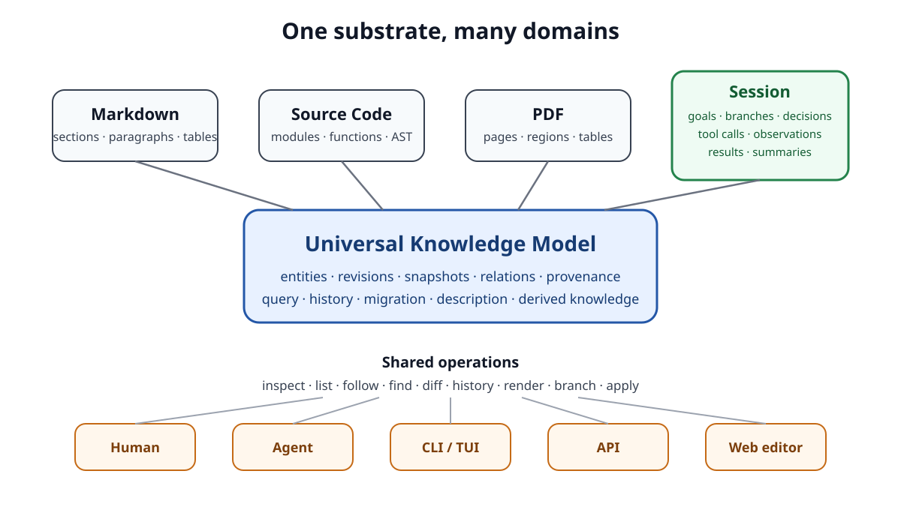
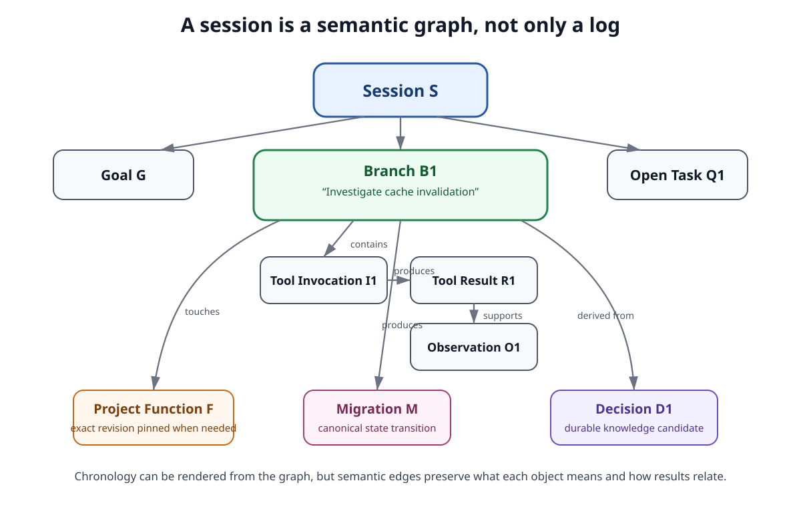
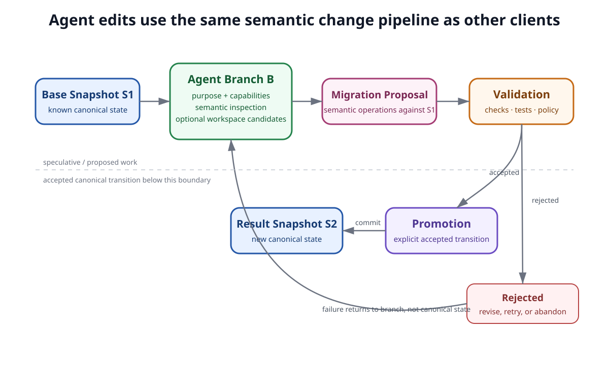
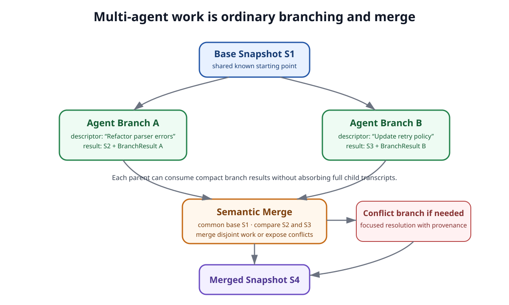

# Agent Interaction and Sessions

## 1. Purpose

Scriberig treats agents as clients of the same universal knowledge system used by humans, applications, domain adapters, and external tools.

An agent session is therefore not fundamentally a transcript stored beside the project. It is another structured knowledge graph in the same database.

A session may contain goals, questions, observations, decisions, tool invocations, tool results, branches, summaries, proposed migrations, validation results, artifact references, and user or agent messages. Those objects use the same identity, revision, snapshot, provenance, history, query, and relation concepts as the rest of Scriberig.

The central rule is:

> An agent does not receive a privileged view of the project. It navigates and changes the same typed knowledge system as every other consumer, while its own session is stored in that same system and exposed through the same progressive interaction model.

This document defines the architectural model for sessions and agent interaction. It intentionally does not define model-provider APIs, prompt templates, Rust traits, wire formats, HTTP endpoints, concrete tool schemas, or UI components. Those belong in lower-level designs.

---

## 2. Core Principles

Agent interaction and session storage follow these principles.

1. **Sessions use the universal knowledge substrate.** A session is not a second database or an opaque conversation blob.
2. **A transcript is a projection.** Chronological chat is one view over richer structured session knowledge.
3. **Branches are first-class objects.** Focused investigations, edits, retries, and delegated work can have their own identity, description, provenance, and result.
4. **Context is progressively disclosed.** Agents should see compact structure first and request deeper information only when needed.
5. **Agent work is transactional.** Speculative work happens in a branch or workspace and becomes canonical only through the normal migration and validation model.
6. **Historical references remain exact.** An observation can stay pinned to the exact revision the agent saw even after the current project changes.
7. **Agent access is capability-scoped.** Semantic access to known objects and operations is preferred over unrestricted filesystem or database access.
8. **Tool activity is structured knowledge.** Tool calls, results, observations, validation, and promoted outcomes are queryable objects, not only text in a transcript.
9. **Durable project knowledge is promoted explicitly.** An agent statement does not become authoritative merely because it was generated.
10. **The agent runtime is a consumer, not a dependency.** Session data remains useful to CLI, API, TUI, web, and third-party applications without an LLM present.

---

## 3. Sessions Are a Domain over the Universal Knowledge Model

The session domain specializes the same universal substrate used for Markdown, source code, PDFs, and other knowledge. The important point is that sessions contribute domain vocabulary—goals, branches, decisions, tool interactions, results—without introducing a new persistence model or a separate interaction grammar.



*Figure 1. The session domain is one specialization of the universal knowledge model. All clients reach domain knowledge through the same substrate and shared operations.*

The universal store does not need hard-coded understanding of a session turn, branch, goal, or tool result. The session domain defines those meanings through schemas, relations, descriptions, projections, validation rules, and domain-specific operations.

This keeps session architecture aligned with the rest of Scriberig: sessions can participate in universal operations such as inspect, list, follow relations, find, query, diff, history, render, branch, and merge.

---

## 4. A Session Is a Graph, Not a Log

A chronological log is useful for humans, but it is not sufficient as the canonical session model. The reader should notice that chronology is only one relationship among many: observations are derived from tool results, branches touch project entities, migrations are produced by focused work, and decisions can outlive the branch that created them.



*Figure 2. A session preserves semantic relationships in addition to chronological order.*

A session may conceptually contain objects such as:

```text
Session
Goal
HumanInput
AgentOutput
Question
Observation
Decision
Task
ToolInvocation
ToolResult
ArtifactReference
Branch
BranchResult
MigrationProposal
ValidationResult
Summary
```

These names describe semantics rather than mandatory tables or Rust types. The important rule is that known structure should not be unnecessarily collapsed into untyped text.

A familiar chat transcript can always be rendered from this graph, but flattening the graph back into messages would lose useful relationships and make later navigation, provenance, and automation harder.

---

## 5. Session Identity, Revisions, and Historical References

Sessions follow the same identity model as the rest of Scriberig.

A conceptual session can have stable identity while its exact state evolves through immutable revisions. Adding a branch, resolving a task, or promoting a decision creates new session state rather than rewriting historical state.

The same distinction applies to objects referenced by the session:

```text
current reference
    -> resolve this conceptual entity in the current scope

historical reference
    -> preserve the exact revision observed at that time
```

For example:

```text
Observation O7
    inspected -> Function F @ Revision FR12
```

Later, the current project may resolve `F` to `FR19`. Historical inspection of `O7` must still refer to `FR12`. A current agent can then ask for lineage or a semantic diff rather than receiving an silently substituted newer version.

Recording session activity may change the global snapshot even when project code does not change. Consumers that care about project changes should therefore observe the relevant project scope or dependencies rather than treating every global snapshot change as a source-code change.

---

## 6. Turns Are Presentation Boundaries

A conversational interface naturally groups activity into turns, but a turn is not the only meaningful boundary.

A single agent turn may contain:

```text
AgentTurn T
├── ToolInvocation I1
├── ToolResult R1
├── Observation O1
├── ToolInvocation I2
├── ToolResult R2
├── MigrationProposal M1
└── AgentOutput A1
```

Another consumer may care about `M1`, `O1`, or `R2` without needing the rest of the turn. A validation result may refer directly to the migration proposal. A branch summary may cite a particular observation. An audit view may show exact tool provenance.

Scriberig correctness must not depend on storing hidden model reasoning or implementation-specific chain-of-thought traces. Durable session semantics should be built from externally meaningful artifacts: user inputs, agent outputs, goals, observations, questions, decisions, tool interactions, migrations, validation evidence, summaries, and project references.

---

## 7. Branches Are First-Class Units of Focused Work

A branch represents a bounded piece of work derived from a parent context. It may investigate one question, edit one function, explore an alternative, resolve a conflict, validate a candidate, or delegate work to another agent.

Every significant branch should have a compact descriptor containing enough information for a human or agent to decide whether the branch matters without opening its history. Typical descriptor information includes:

```text
title
purpose
status
outcome
touched knowledge
result references
size or activity counts
```

For example:

```text
Branch B42

Title:
  Render cache invalidation

Purpose:
  Determine which identities participate in render caching.

Status:
  completed

Outcome:
  Cache by immutable content revision, immutable style revision,
  and renderer version.

Touches:
  RenderCache
  StyleModel
  RevisionIdentity

Result:
  Decision D19
```

A branch can remain fully stored while its parent context retains only the descriptor and result. The figure below shows the intended lifecycle: failure remains inside speculative work, while only selected successful outcomes return to the parent.


*Figure 3. A branch isolates focused work and returns a compact result without forcing its entire history into the parent context.*

Branches may contain nested branches. A parent branch can keep only child descriptors and results while preserving full child history for later inspection. This allows arbitrary depth without forcing arbitrary depth into model context.

A completed branch may produce a migration, decision, answer, summary, observation, rejected hypothesis, unresolved question, validation result, or no promoted result at all. The branch remains useful as provenance even when nothing becomes canonical project state.

---

## 8. Progressive Disclosure Is the Scaling Model

Agents should not need the entire project or session in context in order to make one decision.

The preferred navigation pattern is hierarchical:

```text
Session
  -> branch
     -> episode or turn
        -> observation or tool result
```

and:

```text
Project
  -> subsystem
     -> module
        -> function
           -> code group
              -> statement
```

The same idea applies to PDFs, documents, migrations, and future domains.

A container should be able to describe its shape before revealing all content. For example:

```text
Branch
  turns: 12
  tool calls: 7
  decisions: 2
  resulting migrations: 1
```

or:

```text
Function
  code groups: 6
  statements: 34
  external calls: 4
```

Descriptions, counts, summaries, and stable handles act as attention metadata. They reduce unnecessary context, repeated rereading, and the decision burden created by hundreds of possible next objects.

Large tool results follow the same principle. Persistent storage does not imply permanent injection into future model context.

---

## 9. Agent Context Is a Projection

The context sent to a model is not the session itself. It is one task-specific rendering of session and project knowledge. The figure should be read from the center outward: the same session graph can support a compact agent context, a human transcript, an audit view, or a decision-oriented view without any of those projections becoming the source of truth.


*Figure 4. Model context is a derived projection over session and project knowledge; other projections can coexist over the same canonical graph.*

A context policy may prefer:

```text
current goal
current branch purpose
recent interactions
open tasks
accepted decisions
relevant object descriptions
current project selection
relevant completed branch results
```

while omitting or summarizing:

```text
completed exploratory branches
redundant tool outputs
superseded decisions
unrelated history
large raw artifacts
failed attempts that no longer matter
```

Different agents or tasks may use different policies. A debugging agent may need diagnostics and exact code revisions; a design agent may need accepted decisions and branch summaries; a human transcript may prefer chronological completeness.

Compact context must preserve referential integrity. Summaries should contain stable handles so the agent can inspect the underlying branch, function, decision, migration, or historical revision when deeper information becomes necessary.

---

## 10. One Interaction Grammar across Domains

Agents should not need one mental model for code, another for sessions, another for PDFs, and another for documents.

The universal interaction model should support patterns equivalent to:

```text
inspect(object)
list(object, relation)
follow(object, relation)
find(scope, query)
diff(a, b)
history(object)
render(object, projection)
```

The domain determines which relations and specialized capabilities are available.

For example:

```text
Function F
relations:
  parameters
  body
  calls
  references
  comments
```

```text
PDF Document P
relations:
  pages
  headings
  tables
  figures
```

```text
Session S
relations:
  goals
  branches
  decisions
  tasks
  recent activity
```

Domain-specific semantic operations extend this grammar rather than replacing it. This gives agents a stable navigation language across the entire knowledge system.

---

## 11. Capability-Scoped Access

An agent should normally receive semantic capabilities over known knowledge rather than unrestricted byte-oriented filesystem or database access.

A branch may be scoped to:

```text
project P
module M
function F
document section S
session branch B
```

and granted operations such as:

```text
inspect
query
propose change
validate
render
```

A focused sub-agent working on one function should not automatically gain access to every unrelated document and session. A research branch that only needs read access should not automatically receive mutation capability.

Raw text and rendered projections remain available when exact presentation matters, but they are explicit capabilities rather than the universal access primitive.

---

## 12. Tool Invocations and Results Are First-Class Knowledge

A tool invocation should not exist only as prose in a transcript. The session should be able to preserve relationships such as:

```text
ToolInvocation I
    operation -> inspect
    target -> Function F
    pinned_revision -> FR12
    initiated_by -> Branch B3
```

A tool result may reference structured or reusable derived knowledge:

```text
ToolInvocation I1
    inspect -> Function F @ FR12

ToolResult R1
    produced -> FunctionSummary S9
```

The session records that `R1` was observed in this branch, while `FunctionSummary S9` may be reusable wherever the same immutable function revision and summary profile are requested.

This allows questions such as:

- which branch inspected this entity;
- which tool result supported this decision;
- which migration caused a validation run;
- whether an observation came from current or historical state.

It also connects session architecture directly to the broader derived-knowledge and caching model.

---

## 13. Agent Edits Produce Semantic Migrations

An agent is not a special mutation path. It should not write directly into canonical state merely because it has generated a plausible change.

The figure below separates speculative work from accepted state. The important boundary is validation and promotion: rejected work loops back into the branch, while accepted work becomes a normal semantic migration and new snapshot.



*Figure 5. Agent edits follow the same migration and validation path as other clients; speculative work does not silently mutate canonical state.*

A session branch and a project workspace are related but distinct. The branch represents conversational and semantic work; a workspace represents speculative project state derived from a base. One branch may compare several candidate workspaces before selecting a result.

Validation may include domain-appropriate checks such as schema validation, parsing, type checking, linting, tests, projection round trips, invariants, or human approval. Validation results are themselves structured objects linked to the branch, migration, and resulting state.

This change model is shared with human UI operations, CLI commands, API clients, and externally edited projections. Provenance differs; canonical transition semantics do not.

---

## 14. Decisions and Durable Project Knowledge

Sessions often produce information that remains useful after the conversation ends:

- accepted architectural decisions;
- facts discovered from project artifacts;
- constraints;
- open questions;
- rejected alternatives;
- tasks;
- validated hypotheses.

These may be promoted to durable project knowledge while retaining provenance back to the branch and evidence that produced them.

For example:

```text
Decision D19
    text -> "Canonical source nodes preserve chosen syntax"
    status -> accepted
    derived_from -> Branch B81
    concerns -> SourceModel
```

Promotion must be explicit or governed by clear policy. A conversational statement is not automatically authoritative knowledge merely because an agent generated it.

Useful states may include concepts such as proposed, accepted, rejected, superseded, or obsolete. Later agents should normally retrieve current accepted knowledge first while still being able to follow provenance into historical branches.

Summaries and model-generated interpretations are normally derived knowledge. They should preserve their source objects, source revisions, profile or policy, and provenance so that generated interpretation remains distinguishable from canonical facts.

---

## 15. Multi-Agent Work Uses the Same Branch Model

Multiple agents do not require a separate collaboration architecture. They operate on branches or workspaces derived from known bases, then use the same semantic merge model as other concurrent work. The reader should notice that the parent can consume compact branch results while merge operates on project state, not on combined conversation transcripts.



*Figure 6. Multi-agent collaboration is expressed through ordinary branches, results, common ancestors, semantic merge, and explicit conflict resolution.*

A parent agent may delegate to specialized child agents by giving each child:

- a purpose;
- a base state;
- selected knowledge handles;
- a capability scope;
- an expected result shape.

The parent receives a `BranchResult` rather than an uncontrolled stream of the child's complete history. Full child branches remain inspectable for provenance and debugging.

Agent configuration is execution metadata, not session identity. A persistent session may involve different models, providers, tools, context policies, or specialized agent profiles over time.

---

## 16. Human, Agent, Audit, and Database Views Share One Session

A human-facing application may render the session as familiar conversation. An agent-facing context renderer may show goals, branch summaries, decisions, and relevant project handles. An audit view may show every tool invocation, exact revision, validation result, and migration. A raw database browser may expose the underlying entity and relation graph.

These are projections over the same session knowledge.

The same semantic handle should also cross interface boundaries. If a user selects a function in the integrated editor and asks an agent to work on it, the scope should conceptually be:

```text
Function F at Snapshot S
```

rather than an informal conversion such as:

```text
"look at lines 120-180 of src/foo.rs"
```

The same handle can be used by the object inspector, history view, semantic diff, agent branch, validation system, CLI, API, TUI, and third-party clients.

---

## 17. Search and Attention Metadata

Session search should be semantic rather than limited to text matching over transcripts.

Useful queries include:

```text
find branches touching Function F
find decisions about snapshot identity
find migrations produced by Agent A
find failed validations for Module M
find observations derived from ToolResult R
find branches that superseded Decision D
```

Text search remains useful, but it should return semantic handles such as branches, decisions, tool results, and messages rather than only offsets.

Short descriptions are especially important for agents because they help decide what to inspect next without consuming the full object. Examples include:

```text
Function F
"Reconciles an externally edited Markdown projection."

Branch B
"Investigates whether entity identity should change on edits."

Migration M
"Adds session branches and branch-result promotion."
```

Descriptions should include provenance when generated rather than authored. They are navigation metadata over canonical knowledge, not replacements for it.

Implementations may also expose approximate information cost—small descriptor, medium summary, large full history—so an agent can choose detail before paying the context cost.

---

## 18. Context Change Does Not Invalidate Unrelated Understanding

A session's global snapshot may change frequently as new turns, branches, and results are added. That should not force every cached description, summary, or analysis to be recomputed.

Derived knowledge should depend on the exact immutable objects it actually used.

For example:

```text
FunctionSummary FS
    depends_on -> Function F @ FR12
```

A new session message does not invalidate `FS`. A different unrelated function changing does not invalidate `FS`. Only a relevant dependency change requires recomputation.

This is the same local-versus-global identity rule used throughout Scriberig: global snapshot identity gives certainty that something changed somewhere, while local immutable dependencies provide precise cache invalidation.

---

## 19. Security, Retention, and Auditability

Using one universal knowledge substrate does not imply that every object is visible to every agent.

Sessions may reference private repositories, external services, sensitive documents, local resources, or credentials-adjacent configuration. Authorization, provenance, retention, and capability scopes continue to apply when following session relations.

The session model should preserve enough structured provenance to reconstruct which knowledge and operations participated in important work. This does not imply deterministic replay of model behavior; models and external services may be nondeterministic or unavailable later.

The stronger guarantee is that historical inputs, exact referenced revisions, tool invocations, tool results, migrations, validations, and accepted outcomes remain inspectable.

Session data follows the same retention and reachability model as other immutable knowledge. Active sessions, pinned branches, accepted decisions, retained migrations, audit records, and referenced branch results may act as roots. Unreferenced transient work may become collectable when policy permits.

---

## 20. Relationship to Other Level 1 Designs

This document depends on and complements the other architectural documents rather than redefining their concepts.

- **Universal knowledge model:** defines the substrate that sessions specialize.
- **Identity, revisions, and snapshots:** defines exact historical references and evolving session state.
- **Changes, migrations, branches, and merge:** defines the state-transition model used by agent workspaces and multi-agent collaboration.
- **Projections and bidirectional editing:** defines the general projection model that also applies to transcripts and agent context.
- **Domain modeling and adapters:** defines how the session domain coexists with code, Markdown, PDFs, and other domains.
- **Derived knowledge, caching, and incrementality:** defines summaries, descriptions, reusable tool views, and precise invalidation.
- **Universal query and operation model:** defines the detailed shared vocabulary agents use for navigation and action.
- **Trust, validation, capabilities, and provenance:** defines authorization and promotion policies layered over the relationships described here.

The session layer coordinates and records work. It should not duplicate domain logic such as Rust parsing, PDF extraction, Markdown reconciliation, or source rendering.

---

## 21. Architectural Invariants

Implementations of agent interaction and sessions must preserve the following invariants.

1. **Sessions use the universal knowledge store.** They are not a separate transcript database.
2. **A transcript is a projection.** Chronological chat is one representation of richer session structure.
3. **Branches are first-class knowledge objects.** They can be described, queried, nested, summarized, retained, or collected.
4. **Completed branches may collapse in context without disappearing from storage.** A descriptor and result can stand in for full history until deeper inspection is needed.
5. **Session history does not require private reasoning traces.** Durable semantics are built from observable actions, outputs, decisions, tool interactions, and explicit knowledge.
6. **Agent context is derived from the session; it is not the session itself.** Different context policies may render the same session differently.
7. **Historical observations remain pinned to what was actually observed.** Later revisions do not rewrite old tool results or decisions.
8. **Agents use semantic handles where available.** Filenames, line numbers, and byte offsets are projection details.
9. **Agents do not require unrestricted file or database access.** Capabilities can be scoped to objects, relations, domains, and operations.
10. **Agent edits use the universal change model.** They produce semantic proposals and migrations rather than a separate mutation path.
11. **Speculative work is isolated.** Failed or exploratory branches do not silently become canonical state.
12. **Validation evidence is first-class.** Promotion can reference structured validation results.
13. **Session-derived knowledge has provenance.** Decisions and summaries retain links to branches and evidence.
14. **Generated summaries are not automatically canonical truth.** Derived interpretation remains distinguishable from accepted knowledge.
15. **Tool results may be persistent without being permanent context.** Large outputs can be summarized and reopened on demand.
16. **One interaction grammar spans domains.** Sessions, code, PDFs, documents, and future domains share universal navigation concepts.
17. **The agent runtime is a consumer, not a dependency of the knowledge system.** Session and project data remain useful through ordinary libraries and applications.
18. **Multi-agent work uses the same branch, snapshot, migration, and merge concepts as other concurrent work.**
19. **Project knowledge can outlive the session that produced it.** Durable facts, decisions, and tasks are promoted explicitly with provenance.
20. **All projections remain subordinate to canonical structured knowledge.** Human chat, agent context, audit views, and branch trees do not become independent sources of truth.

---

## 22. Non-Goals

This Level 1 design does not require:

- storing every model token;
- storing hidden chain-of-thought reasoning;
- deterministic replay of nondeterministic models;
- one fixed prompt format;
- one model provider;
- one fixed branch-depth limit;
- one universal summary algorithm;
- injecting every stored tool result into context;
- replacing domain-specific semantic tools with only generic graph traversal;
- giving agents unrestricted database or filesystem access;
- making every conversational statement project truth;
- keeping every abandoned branch forever;
- defining concrete Rust crate boundaries, protocol messages, or API endpoints.

Those choices belong in lower-level designs.

---

## 23. Definition of a Session

A Scriberig session is a structured, versioned knowledge graph describing an interaction process around goals, observations, decisions, actions, branches, and results.

It is stored in the same universal knowledge system as the artifacts the agent works on.

A session can be rendered as a human transcript, an agent context, an audit history, a branch tree, or a decision view without changing its canonical meaning.

Branches allow focused and nested work to proceed without permanently expanding parent context. Short descriptions and branch results make completed work cheap to navigate while retaining exact provenance.

Agents interact with project and session knowledge through stable semantic handles, progressive disclosure, shared query operations, and capability-scoped actions. Their edits become semantic migrations subject to the same branching, validation, history, and merge rules as changes produced by humans and other clients.

The result is a session model in which conversation is not an append-only wall of text. It is a navigable part of the project's knowledge graph, capable of scaling with long-running work while preserving history, exact references, and durable outcomes.
