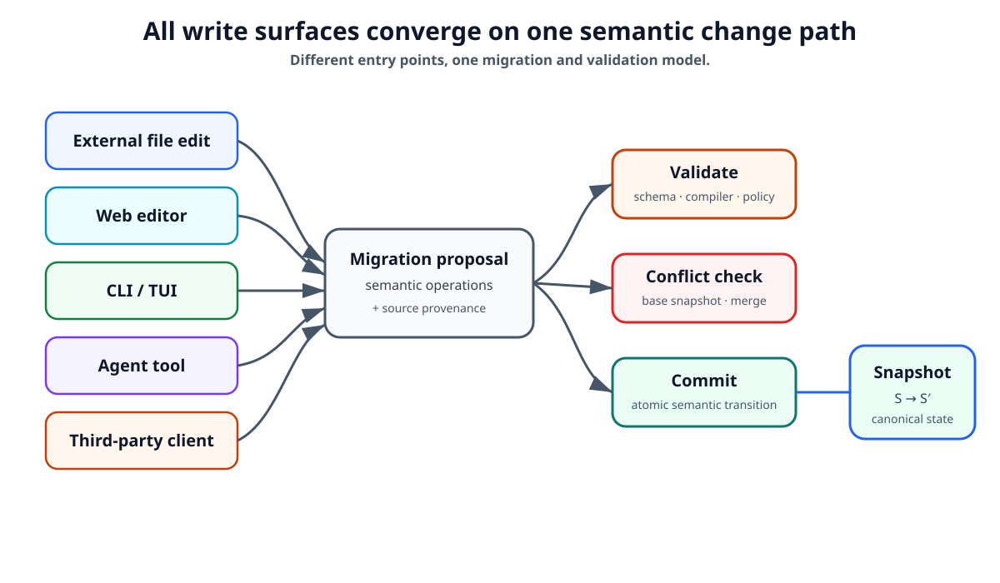

# Runtime Libraries, Protocol, and Product Surfaces

## 1. Purpose

Scriberig is not one application with several wrappers around it.

It is a reusable knowledge platform with multiple consumers.

The same underlying capabilities must be usable by:

- Rust applications embedding the libraries directly;
- the command-line interface;
- the TUI;
- the HTTP/API server;
- browser and desktop applications;
- third-party clients;
- the agent runtime;
- the full Scriberig editor.

These consumers should not each develop their own version of project inspection, semantic editing, querying, migration handling, validation, or session control.

The central architectural rule is:

> Product surfaces consume shared application operations. Lower-level storage and domain libraries never depend on product surfaces or on the agent runtime.

This document defines the separation between reusable runtime libraries, application operations, protocol types, transport adapters, command-line and interactive products, and the agent runtime.

It also defines how capabilities must evolve across those surfaces so that Scriberig does not become a powerful backend with incomplete or incompatible frontends.

Concrete crate names, Cargo features, endpoint paths, serialization formats, framework choices, process topology, command names, and UI component APIs belong in lower-level designs.

---

## 2. One System, Multiple Consumers

Scriberig has one semantic system and many ways to use it.

A small utility may link directly to the storage and graph libraries. The CLI may invoke application operations in-process. A browser may use the same operations through the server protocol. An external IDE may use a generated client library. An agent may use a constrained tool adapter over the same operation model.

Figure 1 shows the architectural center of gravity: reusable knowledge and domain libraries feed shared application operations, and every product surface is a consumer above that boundary. Embedded applications may call operations directly; remote applications cross a protocol boundary; agents receive an adapted tool surface but still rely on the same operations.


**Figure 1 — Scriberig has one reusable semantic platform and several peer product surfaces.**

The capability should remain conceptually the same in every case. For example, "inspect this entity" should not mean one thing to the CLI, another thing to the server, and a third thing to an agent.

---

## 3. The Lower Layers Must Be Useful Without Agents

The storage and semantic platform must not depend on the existence of an agent runtime.

A user may want Scriberig only as:

- a versioned semantic database;
- an immutable object and snapshot store;
- a structured knowledge graph;
- a query library;
- a Markdown or code model;
- a semantic diff engine;
- a projection and reconciliation engine;
- an API server for another application.

All of those must remain valid uses.

The storage layer must not import agent concepts. A Rust AST adapter must not know how prompts work. A Markdown reconciler must not know that a chat UI exists. The agent runtime is a consumer of the platform, not the platform's owner.

---

## 4. Logical Runtime Layers and Dependency Direction

The architecture is divided into logical layers. The exact number of crates may change, but the responsibilities and dependency direction must remain separated.

Figure 2 is the dependency rule in visual form. The key observation is that dependency arrows point toward more foundational layers, while each useful lower layer can stand on its own. Storage can be embedded without any agent or UI, and domain support can be used without running a server.


**Figure 2 — Dependency direction preserves independent use of the lower libraries and prevents product concerns from leaking downward.**

### 4.1 Core identity and value model

The bottom layer defines universal values and identities used throughout Scriberig, including concepts equivalent to entity identity, revision identity, snapshot identity, relation and collection identity, migration identity, operation identity, style identity, and type or schema identity.

This layer should have very few dependencies and should not know about SQLite, HTTP, Markdown, Rust source code, sessions, agents, React, or command-line parsing.

### 4.2 Persistence implementations

The persistence layer implements storage contracts such as immutable revision storage, snapshot storage, entity-to-revision mappings, transactions, deduplication, retained roots, storage-level indexes, and garbage-collection primitives.

The logical persistence API must not require consumers to know the backend representation. A first implementation may use SQLite, but SQLite must not become the public semantic API.

### 4.3 Universal graph and schema model

This layer exposes domain-independent semantic operations over entities, revisions, properties, typed relations, collections, provenance, descriptions, and schemas. It turns raw immutable storage into a knowledge system.

### 4.4 Query and change infrastructure

Shared query and change mechanisms belong above the universal graph. They include traversal, filtering, search, semantic diff, migration construction and application, history inspection, common-ancestor lookup, and merge support.

They remain domain-independent where possible.

### 4.5 Domain adapters

Domain libraries specialize the knowledge store for Markdown and structured documents, programming-language-independent code concepts, Rust, PDFs, sessions, and future languages or formats.

A domain adapter defines its own schemas, parsers, renderers, validators, relations, derived analyses, and specialized operations. It does not replace the shared persistence, query, history, or operation models.

### 4.6 Projection infrastructure

Projection infrastructure owns common concerns around projection identity, rendering lifecycle, style selection, external modification detection, reconciliation lifecycle, projection state, dirty-state tracking, and synchronization events.

Domain adapters provide domain-specific parse, render, and reconciliation behavior.

### 4.7 Application operations

Above the reusable libraries sits the application-operation layer.

This layer expresses user-visible capabilities rather than low-level storage calls. Examples include:

```text
inspect an entity
list semantic children
follow a relation
run a query
show history
compare two revisions
create a branch
apply a migration
render a projection
reconcile an edited projection
validate a candidate change
open a session
submit an agent command
```

The CLI, server, TUI, web application, and agent adapters should reuse these operations. This layer is the principal boundary between reusable semantic libraries and product surfaces.

---

## 5. Application Operations Are the Shared Product Core

The application layer must prevent product-specific business logic from spreading into each frontend.

A bad architecture would allow the CLI to implement one semantic diff, the server to implement another, the web app to own reconciliation, and the agent runtime to mutate database tables directly.

Scriberig instead requires one semantic operation to be presented in several ways.

The same principle applies to mutations. A web edit, agent edit, CLI edit, external-file edit, or third-party API edit should not have unrelated write paths.

Figure 3 shows the required convergence. The source of a change may differ, and that source should be recorded as provenance, but every canonical write becomes a migration proposal, passes the same validation and conflict rules, and advances canonical state through an explicit snapshot transition.



**Figure 3 — All user-visible mutation paths converge on the same migration, validation, conflict, and snapshot machinery.**

This shared path is important for correctness, auditability, permissions, testing, history, merge behavior, and alternative clients.

---

## 6. The Protocol Is a First-Class Architectural Boundary

The server protocol must not be treated as an accidental serialization of internal Rust structures.

It is a public architectural contract.

The protocol should represent stable semantic concepts such as:

- entity, revision, and snapshot references;
- typed object summaries;
- relation and collection summaries;
- descriptions;
- query expressions;
- semantic diffs;
- migrations;
- validation results;
- sessions and branches;
- operations and events;
- projection state;
- machine-readable errors;
- compatibility metadata.

Clients should receive semantic references such as `EntityReference`, `RevisionReference`, or `ObjectSummary`, not SQLite row IDs, page numbers inside a database file, or internal table names.

This allows the persistence implementation to evolve without redesigning every client.

---

## 7. One Wire Model

Protocol types must have one authoritative definition or one authoritative generation path. Rust server types and TypeScript client types must not evolve independently by hand.

Figure 4 shows the intended relationship. The canonical contract defines semantic payloads and compatibility rules; Rust, TypeScript, and future clients either derive from that contract or are mechanically checked against it. The server is an adapter from application operations to this contract, not the owner of a separate semantic model.


**Figure 4 — Scriberig has one wire contract even when many languages and clients represent it differently.**

The exact generation mechanism belongs in lower-level design. The invariant is that a protocol concept has one canonical contract.

This applies especially to IDs and references, operation states, errors, event forms, query forms, migration forms, and compatibility metadata.

---

## 8. Embedded Use and Server Use Must Share Semantics

Scriberig should support both embedded and service-oriented use.

An embedded Rust application may call application operations directly:

```text
application.inspect(...)
application.query(...)
application.apply(...)
```

A remote client may perform conceptually the same actions through a transport:

```text
client.inspect(...)
client.query(...)
client.apply(...)
```

The transport may add authentication, authorization, serialization, request IDs, retries, streaming, deadlines, subscriptions, and remote cancellation. It must not redefine the meaning of the operation.

This lets product behavior be tested once at the application layer and each transport be tested for faithful exposure.

---

## 9. Product Surfaces

Scriberig has several product surfaces. They serve different users but should expose the same conceptual platform.

### 9.1 CLI

The CLI is both a product and a diagnostic surface.

It should support low-level operations such as inspecting entities, revisions, snapshots, relations, queries, and migrations, as well as high-level operations such as rendering a project, reconciling projections, validating a branch, starting a session, issuing an agent command, running a one-shot task, starting the server, or starting the TUI.

The CLI should contain minimal business logic. Its purpose is to bind command-line input and output to shared application operations.

### 9.2 API server

The server exposes the application layer to remote clients.

Its responsibilities include transport, authentication and authorization where configured, request lifecycle, protocol compatibility, event delivery, long-running operation management, remote cancellation, and connection or subscription handling.

The server must not become a second implementation of the domain model.

### 9.3 TUI

The TUI is an interactive client of the same operations. It may combine graph navigation, session navigation, agent interaction, migration review, validation output, and projection inspection.

It should not receive privileged semantic access unavailable to other clients unless a capability explicitly requires local process access.

### 9.4 Web and desktop applications

Browser and desktop applications should use public protocol and client libraries. They may provide richer interaction and visualization but must not depend on private server internals.

The full reusable web/editor architecture is defined separately.

### 9.5 Agent runtime

The agent runtime consumes the same platform through a deliberately constrained tool layer. It may combine several application operations into agent-oriented tools, but it must not bypass the public semantic model.

An `inspect` tool should ultimately use the same semantic inspection facilities available to ordinary clients. An editing tool should produce the same migration forms used by non-agent clients.

---

## 10. The Agent Runtime Is an Adapter, Not a Privileged Backend

The agent runtime has special requirements: progressive disclosure, context budgeting, session state, tool schemas, branch management, model interaction, summarization, and capability restriction.

Those requirements justify an agent-specific layer. They do not justify direct access to private storage details.

The correct relationship is:

```text
agent request
  -> agent tool adapter
  -> application operation
  -> knowledge platform
```

The incorrect relationship is an agent reaching directly into backend tables or bypassing validation and migration semantics.

This boundary matters for safety, testing, compatibility, third-party agent implementations, alternative storage backends, and non-agent use of the same platform.

Agent tools may be coarser than application operations. A simple `inspect(object, detail_level)` tool may compose several application operations, and a high-level `edit_function(...)` tool may construct and validate several semantic changes before yielding one migration.

The agent adapter composes platform capabilities; it does not invent a second persistence model.

---

## 11. Universal Operation Identity and Events

Long-running and externally visible work should have stable operation identity.

Examples include an agent command, validation run, large query, import, projection reconciliation, render, compiler analysis, migration application, or test run.

An operation conceptually includes:

```text
id
kind
requested_by
input_snapshot
status
progress
result
diagnostics
```

Lifecycle states may include `queued`, `running`, `completed`, `failed`, and `cancelled`.

Figure 5 highlights the separation between operation identity, streaming delivery, and final state. A running operation can emit progress, partial output, or diagnostics to any observer, while its final result remains independently addressable. Events tell a client that something happened; they do not become an alternative database representation.


**Figure 5 — Stable operation identity unifies CLI, TUI, web, API, and agent observation without making streaming a separate semantic API.**

Useful event categories include snapshot changes, entity changes, projection changes, branch changes, migration creation, operation lifecycle changes, validation completion, and agent output.

A client receiving an `EntityChanged(E)` event should resolve the new state through the normal application or protocol model.

---

## 12. Queries and Commands Must Be Distinguishable

The runtime should distinguish operations that inspect state from operations that may create new canonical state.

Queries include concepts such as:

```text
inspect
list
follow
find
diff
history
```

Commands include concepts such as:

```text
branch
apply migration
reconcile
commit
merge
update projection configuration
```

Some expensive queries may populate derived caches, but they must not advance canonical snapshots merely because they ran.

This distinction supports clear permissions, retries, idempotency, audit history, agent capabilities, and UI behavior.

---

## 13. Product Surfaces Must Not Own Canonical State

A UI, CLI process, agent runtime, or server connection may maintain local view state such as current selection, expanded nodes, scroll position, command history, temporary form state, unsent text, and cached responses.

Those are product concerns.

Canonical project and session knowledge remains in the shared semantic system. A frontend must not silently become authoritative for data the rest of the system cannot see.

When product state becomes durable project knowledge, it must be committed through the normal semantic change model.

A product may intentionally persist durable workspace layouts, named views, bookmarks, saved queries, or similar state inside Scriberig, but those should become explicit domain entities rather than hidden implementation tables masquerading as project knowledge.

---

## 14. One Capability, Multiple Presentations

The same capability may look different in different surfaces.

Inspecting an entity may appear as:

```text
CLI        scriberig inspect <id>
TUI        selected object panel
Web        object inspector
Agent      inspect tool result
API client inspect(entity)
```

Semantic diff may appear as machine-readable protocol data, a colored terminal diff, a structured web visualization, or a compact agent summary.

Presentation may differ greatly. The underlying semantic result must remain consistent.

---

## 15. Vertical Capability Development

Scriberig must avoid developing one subsystem far ahead of all product surfaces.

A common failure mode is a mature backend with many capabilities, a partially complete CLI, a smaller server API, and a web or agent layer that exposes only a small subset. That produces several incompatible products sharing only a repository.

Instead, meaningful user-facing features should normally be developed vertically.

Figure 6 uses semantic diff as an example. The capability begins in shared knowledge and application semantics, then gains a protocol representation, server and client exposure, relevant presentations, agent exposure where useful, and conformance tests. The capability matrix beside it makes omissions explicit instead of allowing a feature to exist accidentally in only one surface.


**Figure 6 — User-level capabilities should be cross-surface slices, with explicit capability status and semantic conformance tests.**

A capability is not considered broadly available until the relevant surfaces expose it. Not every internal primitive needs a button in every UI, but meaningful user-facing gaps must be visible and intentional.

A project-level capability matrix should therefore record whether a capability exists in the reusable library, application layer, protocol, CLI, server, web, TUI, and agent surfaces. Status should reflect evidence rather than aspiration.

---

## 16. Third-Party Applications Are First-Class Consumers

The protocol and reusable libraries must be designed for consumers other than the reference Scriberig applications.

A third party may want to build a custom IDE, CAD or GIS application using the knowledge store, documentation editor, code-analysis service, CI integration, alternate agent runtime, specialized browser, or proprietary application embedding only the storage layer.

This implies:

- stable public boundaries;
- transport-independent semantic models;
- documented compatibility expectations;
- client libraries that do not require the full editor;
- no dependency from foundational crates to agent-specific code;
- no requirement to adopt the reference UI style.

The reference products should prove these public boundaries rather than bypass them.

---

## 17. Client Libraries

Remote use should be supported through reusable clients rather than requiring every application to manually construct transport requests.

A client library should expose semantic operations in the host language, conceptually including:

```text
client.inspect(entity)
client.query(query)
client.diff(a, b)
client.apply(migration)
client.subscribe(...)
```

The client may provide request construction, protocol version negotiation, typed decoding, operation tracking, event subscriptions, retry helpers where safe, cancellation, and common error handling.

It must not implement a separate semantic model. The server remains one transport realization of application operations.

---

## 18. The Reference Products Must Use Public Boundaries

The full Scriberig products should behave like demanding external consumers.

The reference web editor should use public client and UI libraries. The CLI should use the shared application layer rather than private shortcuts. The TUI should use the same semantic operations. The agent runtime should use the same public platform interfaces expected of alternate agents.

This gives a strong architectural test:

> If the reference product needs a private path to implement an important capability, the reusable boundary is probably incomplete.

Carefully justified local-only capabilities may exist, but they must be explicit exceptions.

---

## 19. Deployment Shapes

Scriberig should support several deployment shapes without changing its semantic architecture.

Figure 7 compares three common forms. In-process use links an application directly to operations and a local store. A desktop environment may run a local server used by CLI, TUI, or browser clients. A shared environment may use a remote service and managed store. The process boundary changes, but inspect, query, apply, snapshot, and error semantics should remain recognizably equivalent.


**Figure 7 — Scriberig supports embedded, local-server, and remote-service deployments without changing the semantic model.**

A convenient distribution may expose several modes from one executable, such as server mode, TUI mode, one-shot commands, agent commands, and maintenance operations. That is a packaging choice, not an architectural requirement.

The important property is that these modes remain thin hosts over reusable libraries so they can later be split into separate processes without redesigning the knowledge model.

---

## 20. Shared Error and Snapshot Semantics

Errors are part of the protocol contract.

The system should distinguish machine-readable categories such as entity not found, revision not found, snapshot not found, schema violation, stale base snapshot, semantic conflict, validation failure, permission denied, unsupported domain operation, projection out of sync, operation cancelled, and transport failure.

A frontend may render these differently, but it must not infer semantic error meaning by parsing arbitrary text messages.

Clients must also know which semantic state they are viewing or modifying.

A client that inspected an entity under snapshot `S10` while the project later advances to `S11` must be able to distinguish "show me exactly what I previously viewed" from "show me the current revision of this entity." Mutating commands should make their base state explicit whenever conflicts matter.

Client caches must retain revision and snapshot identity. If connectivity is lost, cached historical data may remain visible, but it must not silently be presented as current.

If offline editing is eventually supported, it should produce a branch or migration against an explicit base snapshot and reconcile on reconnect.

---

## 21. Transport, Streaming, and Protocol Evolution

HTTP, WebSocket, local IPC, or another transport may be used. Those choices should remain replaceable.

Transport-specific concepts include URLs, headers, connection lifecycle, framing, streaming channels, and request deadlines. Semantic concepts include entities, revisions, snapshots, migrations, branches, queries, and operations.

The protocol model may be serialized through a transport, but semantic behavior must not depend unnecessarily on one transport technology.

Streaming is a delivery mechanism, not a separate semantic API. Agent responses, large queries, validation logs, test runs, import progress, and long reconciliations may emit incremental output while still producing one final addressable operation result.

The protocol will evolve, so compatibility must be explicit. The architecture should support protocol version identification, additive evolution where practical, capability discovery or negotiation where useful, explicit unsupported-operation handling, and a migration strategy for breaking changes.

Internal Rust APIs may evolve faster than the public remote protocol, which should have stronger compatibility discipline.

---

## 22. Domain Extensibility Must Reach Product Surfaces

Adding a new domain should not require rewriting every product.

A domain adapter may contribute type descriptions, child relations, renderers, specialized commands, validators, query fields, summaries, and diff interpretation.

Generic products should still be able to browse unknown domains using universal operations such as inspect entity, list relations, list collections, show description, show history, and show revisions.

Specialized UI can improve the experience later without making the domain inaccessible beforehand.

Clients and agents should also be able to discover what can be done with an object or runtime, including supported relation types, renderers, domain operations, validators, protocol capabilities, runtime features, and permission-constrained operations.

Capability discovery is especially important for generic clients and simpler agents that should navigate future domains without hard-coding every possibility.

---

## 23. Raw and High-Level Operations Must Coexist

Advanced users need access to the underlying knowledge model, while other users need task-oriented operations.

Low-level operations may include:

```text
inspect revision
list outgoing relations
list incoming relations
inspect snapshot mapping
show migration operations
```

High-level operations may include:

```text
rename symbol
move section
reconcile Markdown file
resume session branch
ask agent to refactor function
```

High-level operations should reduce to shared semantic mechanisms rather than mutate hidden state.

This duality is important for debugging, extensibility, power users, automated agents, and the integrated editor.

---

## 24. Conformance and Vertical Acceptance Tests

A shared architecture requires shared tests.

Important capabilities should have conformance tests verifying equivalent behavior across relevant surfaces. Given a fixed snapshot, application inspection, server/client inspection, CLI inspection, and agent inspection should describe the same semantic object even if formatting differs.

Mutation tests should verify that equivalent edits create equivalent semantic results. Event tests should verify consistent operation visibility. Protocol tests should verify that client and server types remain compatible.

The goal is semantic equivalence, not byte-for-byte identical presentation.

Each important feature should eventually have an end-to-end path. For example, semantic diff may be considered complete when a test can create two snapshots, compute the diff through the application layer, retrieve it through the protocol, decode it with a client library, render it in a relevant product, and make it available to an agent when appropriate.

This catches architectural drift and ensures reference products exercise public interfaces.

---

## 25. Observability and Security Belong at Runtime Boundaries

The runtime should expose operational information needed to diagnose the system, such as operation duration, cache hits and misses, query cost, validation duration, projection synchronization state, request tracing, agent-tool timing, and event backlog.

These are operational concerns. They should not become canonical domain knowledge unless explicitly imported for a reason.

Security must also be enforceable below the UI. Hiding buttons or tool descriptions is not authorization.

The server and application layers must be able to enforce capabilities such as reading or querying a scope, creating a branch, proposing or committing changes, running validation, executing an agent, and accessing external resources.

The detailed trust and capability model is defined separately. The runtime rule is:

> Authorization decisions are enforced at shared operation boundaries, not only in individual frontends.

---

## 26. Public and Internal APIs

Not every internal helper must become a compatibility-guaranteed public API.

The project should distinguish:

```text
internal implementation interfaces
reusable library interfaces
application-operation interfaces
public remote protocol
```

Internal helpers may change freely. Reusable library interfaces should evolve carefully. The public remote protocol should have the strongest compatibility discipline.

A practical test for a reusable boundary is:

> Can a user reasonably want this capability without the layers above it?

A user may want storage without agents, graph and query without Markdown, Markdown projection without code support, source-code analysis without the agent runtime, the server without the reference web app, or the protocol client without Scriberig UI components.

These are strong candidates for explicit library boundaries.

The project should avoid collapsing these distinctions into one monolithic feature-flagged core. Feature flags are reasonable for optional backend integrations, but they should not replace meaningful architectural boundaries.

Products may be opinionated about a default database, transport, web framework, component library, agent runtime, or rendering style. Those choices simplify a product without constraining the reusable libraries underneath it.

---

## 27. Architectural Smells

The following are signs that responsibilities are leaking across boundaries:

- storage wants to know about sessions or prompts;
- a parser wants to call the agent runtime directly;
- a domain library wants to emit web-specific view models;
- the server contains semantic business logic unavailable in-process;
- the CLI defines canonical semantics through command syntax;
- the web app needs a private mutation endpoint;
- the agent reaches directly into persistence tables;
- the Rust and TypeScript protocol models drift independently;
- a feature exists in one frontend only because that frontend bypassed the application layer.

These pressures should normally be resolved with explicit interfaces, adapters, callbacks, application orchestration, domain events, or derived-data providers rather than dependency cycles.

---

## 28. Examples of Shared Semantics

### 28.1 Inspecting a function

An embedded application may call `application.inspect(Function F, Snapshot S)`, a CLI may run an inspect command, a remote client may call `client.inspect(F, S)`, a web editor may open an object inspector, and an agent may request an inspect tool.

All should resolve to the same semantic revision under the same snapshot. Presentation may differ; semantic truth may not.

### 28.2 Editing a paragraph

A web editor and an agent may enter through different adapters, but both should produce a migration through the shared application layer, pass validation, and result in the same kind of explicit snapshot transition.

### 28.3 Browsing raw knowledge

A third-party database browser may know nothing about Rust or Markdown. It should still be able to inspect entities and revisions, list properties, relations, and collections, and show provenance and history.

A specialized code client can recognize the same entity as a function and add domain-specific commands such as showing parameters, code groups, callers, or rendered source.

### 28.4 Starting an agent command

An agent command should itself be an operation with explicit session, project snapshot, scope, and instruction. The runtime may create a session branch, tool invocations, a candidate project branch, validation operations, and a resulting migration.

The CLI, web editor, TUI, or external API client can all start the same class of operation. The agent runtime remains independent of which product initiated it.

---

## 29. Level Boundaries

This document defines architecture, not package manifests.

Lower-level designs must decide details such as:

- exact Rust crate names;
- crate dependency graph;
- trait definitions;
- sync versus async boundaries;
- SQLite adapter design;
- API framework;
- HTTP endpoint structure;
- streaming transport;
- serialization format;
- generated-client tooling;
- CLI command hierarchy;
- TUI framework;
- process lifecycle;
- exact operation and event enums;
- protocol version negotiation;
- feature flags.

Those decisions must preserve the invariants defined here.

---

## 30. Required Invariants

Lower-level designs and implementations must preserve the following rules.

1. Foundational storage and graph libraries are useful without an agent runtime.
2. Lower layers do not depend on product surfaces.
3. Domain adapters do not depend on the agent runtime.
4. The agent runtime consumes public semantic operations rather than private storage details.
5. CLI, TUI, server, web clients, and agents share application-level semantics.
6. User-visible mutations converge on the shared migration and validation model.
7. The server protocol represents semantic concepts rather than backend tables.
8. Protocol types have one authoritative contract or generation path.
9. Embedded and remote use expose equivalent semantic behavior where applicable.
10. Long-running work has stable operation identity.
11. Events report changes but do not replace authoritative state.
12. Canonical state remains snapshot-aware across all surfaces.
13. Client caches retain revision and snapshot identity.
14. The reference products use public or reusable boundaries wherever practical.
15. Third-party applications are first-class consumers.
16. Domain extensions remain generically browsable before specialized UI exists.
17. User-level capabilities evolve vertically across relevant product surfaces.
18. Conformance tests verify semantic equivalence across surfaces.
19. Transport concerns remain separate from domain semantics.
20. Product-specific convenience must not collapse the reusable platform into one monolithic application.

---

## 31. Architectural Summary

Scriberig should be built as a stack of reusable semantic capabilities with several product surfaces above them.

The foundation is not the server, the CLI, the web editor, or the agent runtime. The foundation is the knowledge platform.

Application operations turn that platform into reusable user-facing capabilities. The protocol makes those capabilities available across process and language boundaries. The CLI, TUI, API server, web applications, external clients, and agent runtime are different consumers and presentations of the same system.

The main product-development rule follows directly:

> Build capabilities once in the shared semantic and application layers, then expose them coherently across the relevant product surfaces.

This keeps Scriberig usable as infrastructure, prevents the agent runtime from owning the architecture, and allows CLI, API, TUI, web, and third-party applications to evolve together instead of becoming incompatible implementations of the same ideas.
