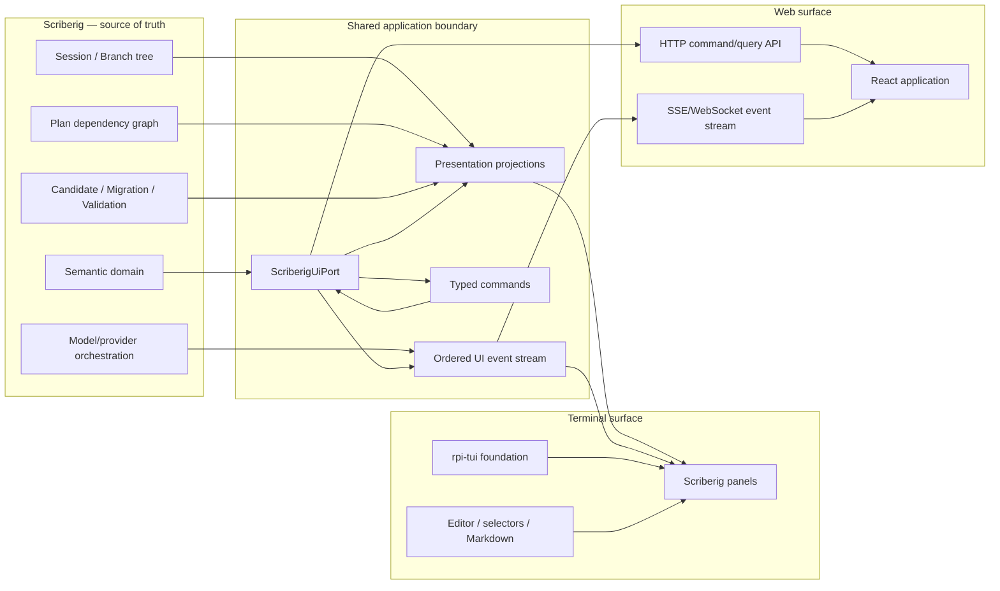
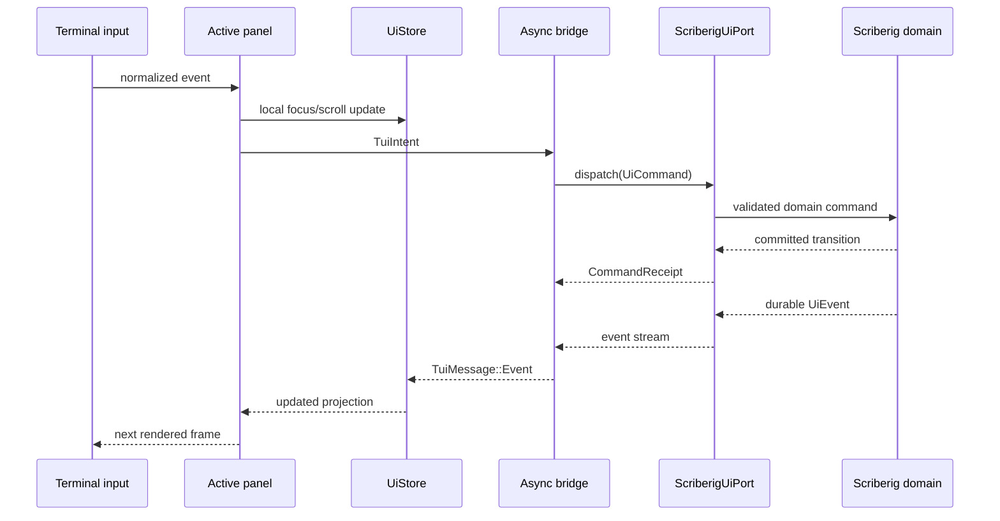
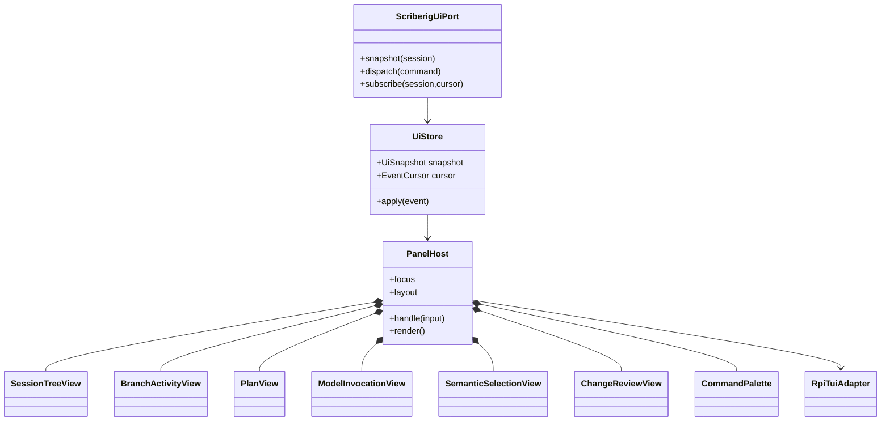
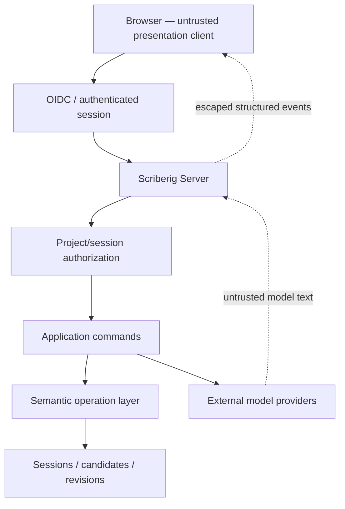
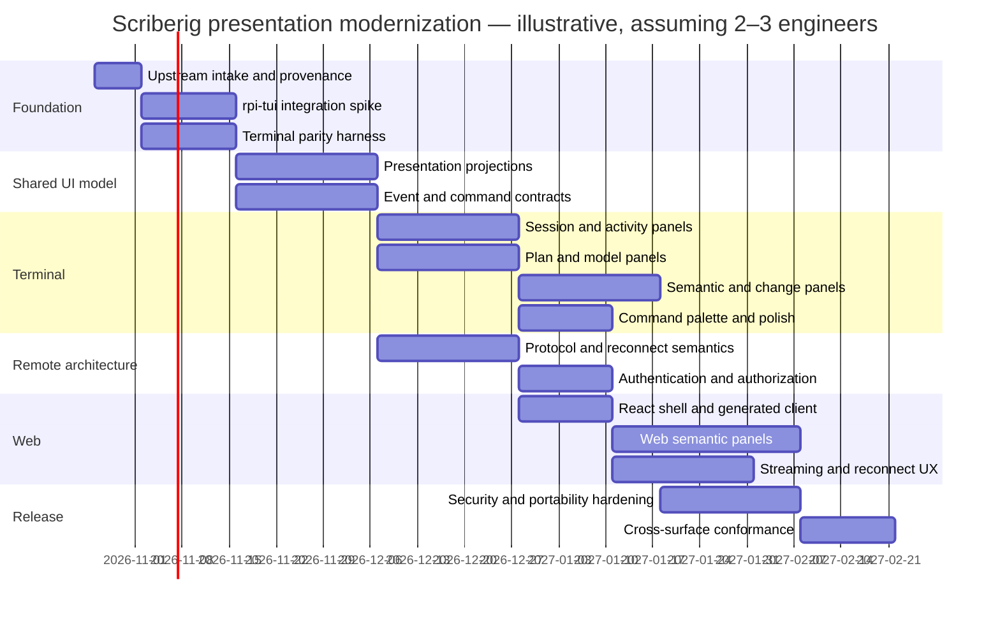

# Scriberig TUI Reuse Study and Multi-Surface Architecture Masterplan

## Executive summary

The research supports the original intuition: **Scriberig should stop treating terminal interaction as a framework-development problem.** There are now mature enough Rust implementations of Pi-style terminal interaction that Scriberig can reuse a large fraction of editor, Markdown, terminal lifecycle, selection, clipboard, theme, streaming-render and resize machinery while keeping its distinctive semantic/session/change architecture entirely its own.

The strongest foundation is **`rpi-tui` from `bigfish1913/pi-rust`**. The decisive architectural fact is not simply that `rpi` has a good TUI; it is that the project explicitly separates `rpi-tui` from the rest of the agent stack. The current `rpi` documentation says that `rpi-tui` depends on **no other `rpi-*` crate** and assigns it the narrow responsibility “terminal UI primitives: components, layout, editor, transcript rendering.” The full project separately divides provider abstraction, agent loop, tools, durable session harness, plugin ABI, extensions, and CLI into distinct crates. citeturn6search1

My recommendation is therefore:

> **Adopt the `rpi-tui` interaction model and most of its leaf components; initially vendor the crate at a known upstream commit; build a very thin `scriberig-ui` presentation-model layer between it and Scriberig; do not import `rpi`'s agent, tool, session, or plugin semantics into the Scriberig domain.**

`tape_tui` is the best alternative and an excellent secondary reference. Its architecture is unusually clean: it is a line-oriented streaming TUI designed to preserve terminal scrollback, with its runtime, component contract, editor, input parser, terminal abstraction, Markdown renderer and searchable selection list separated into individual modules. Its core crate has no async runtime dependency; Tokio appears only in development dependencies in the inspected `Cargo.toml`. However, it describes itself as experimental and is currently at `0.1.0`, so its **architectural cleanliness is stronger than its maturity signal**. The primary files inspected were `src/tui.rs`, `src/component.rs`, `src/terminal.rs`, `src/input.rs`, `src/editor.rs`, `src/markdown.rs`, `src/select_list.rs`, `src/keybindings.rs`, and `docs/ARCHITECTURE.md`.

**CCherry07/pi-rs is the strongest whole-product behavioral reference**, and in some areas it is substantially more ambitious than `rpi`: fullscreen Ratatui/Crossterm/Tokio UI, Markdown and syntax highlighting, CJK IME handling, copy selection, history, scroll, command selectors, five frontend modes, resumable Pi v4 session trees, plugin reload, provider diversity, project trust, image handling, scheduling and native plus JavaScript extension systems. citeturn6search0 Its TUI, however, lives in a much larger product runtime rather than a tiny generic TUI leaf crate. That makes it a source of ideas and selectively portable widgets, not the foundation I would choose.

**`tau-agent/tau` is the strongest reference for the eventual Scriberig client/server topology.** It deliberately runs its agent as a long-lived server and makes the Ratatui TUI a thin Unix-socket client; a separate `tau-agent-client` crate exposes the same server to scripts. Its workspace explicitly separates `tau-agent-tui`, `tau-agent-engine`, `tau-agent-plugin`, `tau-agent-client`, and shared protocol types. citeturn6search2 I would borrow this architectural pattern, not its agent/task semantics.

The full **`bigfish1913/rpi` runtime** is also worth mining selectively. Its headless server/remote-client mode is already designed so that the client has no providers, tools, plugins or session files; all execution remains server-side. It also has durable crash-resumable sessions, a stable plugin ABI and deterministic offline testing. citeturn6search1 Those are excellent design references, but adopting the runtime itself would undermine Scriberig's semantic boundary.

There are two material research caveats. First, I positively identified the likely OxiCode candidate as `nhtera/OxiCode`, but did not obtain enough primary-source material in this pass to make a responsible file-level adoption recommendation; it therefore stays **D: ideas only / pending audit**. Second, **“PiG” was not uniquely resolvable to an unambiguous repository from the available primary evidence**. I therefore do not invent architecture, licensing or activity facts for it. It should remain D until its exact repository is pinned. This matters particularly for licensing and provenance.

For Scriberig itself, I treated **`TNick/scriberig`, branch `main`**, as the repository implied by the request. The repository was pushed on October 19, 2026, and the tree I inspected includes the existing domain/application family such as `scriberig-core`, `scriberig-cli`, `scriberig-server`, `scriberig-provider`, `scriberig-query`, `scriberig-source`, `scriberig-knowledge`, `scriberig-lang`, and related crates. A repository search found **no current `scriberig-tui` crate and no `ratatui` occurrence on this public `main`**, so the recommendation below treats the TUI as a new presentation surface rather than assuming the earlier experimental TUI code is still present.

The high-level target should be:



The important choice is therefore **not “which coding agent should Scriberig become?”** It is **“which mature presentation machinery should sit in front of Scriberig?”** On that question, `rpi-tui` is the clear first choice.

## Scope, assumptions, and evaluation criteria

The report assumes a small engineering team of roughly two to three Rust developers, with one of them or an additional engineer able to work on TypeScript/React. No delivery deadline was supplied. Effort ratings therefore mean architectural and integration difficulty rather than calendar commitments.

I assume Scriberig's current semantic architecture remains authoritative: sessions and branches are domain concepts, understood source/schema content is changed through semantic operations, plans are distinct from conversational transcripts, and candidates/migrations/validation are durable application concepts. The proposed TUI must project those semantics rather than reducing them to a conventional `read`/`write`/`bash` coding-agent transcript.

I also assume the desired outbound Scriberig licensing policy is permissive **MIT, Apache-2.0, or dual MIT/Apache-2.0**. Under that assumption, MIT code is generally suitable for incorporation provided its copyright and license notice are retained; vendoring MIT code does **not** mean stripping its upstream MIT notice or pretending the copied code originated in Scriberig. `rpi` identifies itself as MIT and explicitly retains upstream copyright/MIT notices in `LICENSE` and `NOTICE`; Tau also declares MIT. citeturn6search1turn6search2 `pi-rs` must similarly be consumed according to the license file of the exact pinned revision rather than merely inferred from its relationship to Pi.

The classifications used below are:

| Class | Meaning |
|---|---|
| **A — adopt wholesale** | Use the upstream component substantially unchanged behind our adapter; preferably depend on or vendor the complete module. |
| **B — vendor and adapt** | Preserve provenance and license, but carry a Scriberig-controlled copy because APIs/security/UX require changes. |
| **C — reimplement** | The concept belongs to Scriberig semantics; sharing the foreign implementation would create the wrong abstraction. |
| **D — ideas only** | Study behavior/architecture but do not introduce the code into the production dependency graph. |

The most important evaluation criterion is **decoupling from coding-agent semantics**. A beautiful transcript renderer that assumes every item is `AssistantMessage | ToolCall | ToolResult` is less valuable to us than a slightly simpler renderer accepting arbitrary components.

A second criterion is **deterministic testability**. `rpi` is particularly strong here: it exposes a deterministic faux provider, an in-memory execution environment and a workspace test path intended to run offline. citeturn6search1 `pi-rs` likewise documents deterministic provider support and focused workspace/integration validation, although its complete product has a much broader dependency and runtime surface. citeturn6search0

A third is **transport independence**. A panel should not know whether its data came from an in-process Rust service, a Unix socket, TCP, HTTP or a replayed fixture. Tau's explicit server/TUI/client/shared-protocol split is especially instructive here. citeturn6search2

A fourth is **terminal safety**. All foundations that deal with clipboard access, terminal control sequences, hyperlinks or pixel-image protocols should be considered privileged presentation code. Model/tool text is untrusted input: Scriberig should never emit arbitrary model-generated ANSI/OSC control sequences directly to the user's terminal.

A final assumption concerns activity. Because “last commit” is intrinsically volatile, I would not make procurement-level decisions from a date captured once. At the October 20, 2026 snapshot used here, `rpi` is clearly active—the primary repository exposes 518 commits and documents current release `0.6.0`; `pi-rs` describes an actively evolving product baseline; Tau describes itself as under active development. citeturn6search1turn6search0turn6search2 The exact commit SHA, contributors and security-policy state should be frozen in an intake manifest when implementation starts.

## Candidate analysis

The table first gives the high-level result. `✓` means directly evidenced; `◐` means available but coupled to another layer or only partial; `—` means not evidenced in the inspected material; `?` means evidence was insufficient and should not be guessed.

| Candidate | TUI boundary | Editor | Markdown | Stream | Scroll | Select | Diff | Images | Themes | Copy/paste | Resize | Plugins | Client/server | Resume |
|---|---|---:|---:|---:|---:|---:|---:|---:|---:|---:|---:|---:|---:|---:|
| **rpi-tui** | **Excellent leaf crate** | ✓ | ✓ | ✓ | ✓ | ✓ | ◐ | ◐ | ✓ | ✓ | ✓ | — | — | — |
| **rpi overall** | Excellent crate split | ✓ | ✓ | ✓ | ✓ | ✓ | ✓/◐ | ◐ | ✓ | ✓ | ✓ | ✓ | **✓** | **✓** |
| **CCherry07/pi-rs** | Product-coupled TUI | ✓ | ✓ | ✓ | ✓ | ✓ | ◐ | **✓** | ◐ | **✓** | ✓ | **✓** | RPC/ACP | **✓** |
| **tape_tui** | **Excellent generic crate** | ✓ | ✓ | ✓ | **✓** | ✓ | — | **✓** | ◐ | ✓ | ✓ | — | — | — |
| **tau** | Dedicated Ratatui crate | ✓/◐ | ◐ | **✓** | ✓ | **✓** | ◐ | ? | **✓** | ◐ | ✓ | **✓** | **✓** | **✓** |
| **OxiCode** | insufficiently verified | ? | ? | ? | ? | ? | ? | ? | ? | ? | ? | ? | ? | ? |
| **PiG** | repository ambiguous | ? | ? | ? | ? | ? | ? | ? | ? | ? | ? | ? | ? | ? |
| **Scriberig main** | no current TUI found | — | — | — | — | — | semantic diff belongs here | — | — | — | — | domain extensions ≠ TUI plugins | server exists | domain-owned |

### `rpi-tui` from `bigfish1913/pi-rust`

This is the best match to the narrow problem.

The complete `rpi` repository has a deliberately layered nine-crate architecture. The published responsibilities are `rpi-ai` for provider-neutral messages/streams, `rpi-agent` for the loop, `rpi-tools` for execution tools, `rpi-harness` for the session tree/persistence/recovery, `rpi-tui` for terminal primitives, `rpi-cli` for the actual product, `rpi-plugin-sdk` for ABI definitions, `rpi-extensions` for plugin hosting, and `rpi-telemetry` for instrumentation. Crucially, the upstream documentation explicitly says **`rpi-tui` depends on no other `rpi-*` crate**. citeturn6search1

The inspected `crates/rpi-tui/Cargo.toml` reinforces that claim. At the snapshot examined it uses a small terminal-oriented dependency set around Crossterm, Unicode-width handling, text wrapping and clipboard support, without Tokio as a TUI-runtime dependency. The source root exposes dedicated modules for ANSI handling, clipboard, components, editor, fuzzy matching, input, layout, Markdown, selection, style, terminal handling, text, theme and utilities.

The files most worth adopting or adapting are:

```text
crates/rpi-tui/src/component.rs
crates/rpi-tui/src/editor.rs
crates/rpi-tui/src/input.rs
crates/rpi-tui/src/layout.rs
crates/rpi-tui/src/markdown.rs
crates/rpi-tui/src/select.rs
crates/rpi-tui/src/terminal.rs
crates/rpi-tui/src/text.rs
crates/rpi-tui/src/theme.rs
crates/rpi-tui/src/clipboard.rs
crates/rpi-tui/src/ansi.rs
crates/rpi-tui/src/lib.rs
crates/rpi-tui/README.md
crates/rpi-tui/Cargo.toml
```

I would take the **editor, fuzzy/select components, text model, theme model and most Markdown machinery as A**, while taking the terminal/runtime/component integration as **B**. The B classification is not because the code looks poor; it is because terminal security policy, Scriberig's panel layout and the desired no-lock-in adapter are important enough that we should control the seam.

The main security concern is clipboard and terminal-output handling. A model response, tool diagnostic or imported source string must be escaped into text segments rather than interpreted as arbitrary ANSI/OSC. Clipboard interaction should be explicit, and there should be a configuration mode that disables clipboard/image access on remote or high-assurance installations.

### Full `bigfish1913/rpi`

As an application architecture, `rpi` is arguably the most relevant comparison because it has already solved several problems we will face later: provider-independent streaming, durable crash recovery, embedded operation, plugins, remote operation and offline testing. Its session harness stores a session tree with JSONL persistence and per-frame progress, and the project claims recovery from a crash during a tool call rather than merely restoring the preceding user message. citeturn6search1

Its remote topology is also highly relevant. `rpi --server` exposes a headless agent and `rpi --connect ...` starts a TUI client; upstream states that the client holds no providers, tools, extensions or session files. citeturn6search1 That is very close to the eventual role we want for a remote Scriberig TUI or browser.

Its plugin system is more sophisticated than most Rust agent implementations: Rust `cdylib`s behind a hand-written `#[repr(C)]` boundary with version negotiation, plus host-side isolation of plugin/runtime responsibilities. Plugins can register tools, providers, slash commands, event handlers, Markdown renderers and resources. citeturn6search1

But those are precisely the reasons **not to adopt the whole runtime**. Scriberig already has domain semantics. Replacing them with `rpi-harness` and `rpi-agent` would turn Scriberig's session tree, semantic operations and durable change model into foreign concepts wrapped around a coding-agent conversation.

Recommended use:

```text
A: rpi-tui leaf utilities/components where semantics are generic
B: selected remote protocol/terminal infrastructure only if independently useful
C: Scriberig session, plans, semantic operations, validation, promotions
D: rpi-harness session semantics, agent tools and plugin architecture as design references
```

Security is comparatively well considered upstream: the repository includes `SECURITY.md`, plugin ABI containment, optional rather than default web tooling, and deterministic offline testing. citeturn6search1 Nevertheless, native plugins remain native code and should be treated as arbitrary-code execution from Scriberig's threat-model perspective.

### `CCherry07/pi-rs`

`pi-rs` is the most useful **product-behavior oracle** in this set.

The current README characterizes it as a production-oriented Rust implementation of the Pi terminal agent whose TUI is built with **Ratatui, Crossterm and Tokio**. It explicitly lists Markdown, syntax highlighting, CJK IME input, copy selection, input history, scrolling and command selectors. citeturn6search0 It also has interactive TUI, one-shot output, NDJSON, bidirectional stdio RPC and ACP frontends running over a common runtime. citeturn6search0

Its image path is particularly mature: startup file attachments and clipboard images are supported, common image formats are validated/converted, and the documentation explicitly warns that native clipboard access is unavailable over SSH. citeturn6search0

The session implementation deserves study rather than adoption. It supports durable Pi v4 session trees, `/resume`, queues, branch/tree semantics, compaction, recovery and import of previous Pi session versions. The documented recovery behavior is careful about side effects: after interruption it reconciles state and marks the interrupted operation aborted rather than blindly replaying a tool whose effects are uncertain. citeturn6search0 That is exactly the kind of invariant Scriberig needs for semantic mutations, but Scriberig should implement it around **candidate/change transaction IDs**, not Pi tool calls.

The plugin architecture is powerful but correspondingly high risk. `pi-rs` supports native Rust `cdylib` plugins plus optional JavaScript/TypeScript extensions; project trust controls project-local extension discovery. The native package manager checks SHA-256 integrity, but upstream itself explicitly notes that this currently provides **integrity, not publisher authentication**. citeturn6search0 This is an excellent security lesson for Scriberig: “hash matches downloaded artifact” and “artifact came from an authorized publisher” are different guarantees.

Because its TUI resides in `apps/pi-cli` rather than being the exceptionally clean leaf boundary offered by `rpi-tui`, I classify most direct reuse as **B or D**, not A.

Files/directories to study or selectively extract are:

```text
apps/pi-cli/
apps/pi-cli/README.md
crates/pi-sdk/
crates/pi-plugin-manager/
packages/pi/
docs/pi-core-test-matrix.md
```

The exact widget files should be pinned from the intake commit before copying; the repository is active enough that guessing current paths beyond those verified directories would be irresponsible.

### `Gurpartap/tape_tui`

`tape_tui` is perhaps the nicest *pure TUI design* in the comparison.

Its inspected `docs/ARCHITECTURE.md` defines a line-oriented component API in which components render a `Vec<Line>` and receive normalized input tokens. The runtime handles differential redraw, terminal state and deferred structural modifications. The main modules are unusually easy to understand:

```text
src/tui.rs          runtime/render loop/differential updates
src/component.rs    Component, Container, Text, Spacer
src/terminal.rs     terminal abstraction and RealTerminal
src/input.rs        normalized keyboard/paste parser
src/editor.rs       cursor/navigation/editing/undo
src/markdown.rs     Markdown → styled terminal lines
src/select_list.rs  searchable selection UI
src/keybindings.rs  key identifiers and bindings
docs/ARCHITECTURE.md
Cargo.toml
```

The data model is simple—styled `Line` and `Segment` structures—making deterministic snapshot testing straightforward. Its terminal abstraction includes image rendering; image values can represent RGBA data or a file path. It explicitly supports alternate-screen configuration and scroll offsets.

Its most attractive property for Scriberig is **scrollback-preserving streaming**. Rather than assuming a fullscreen frame buffer is the only valid terminal UX, it was designed around streaming tools that should coexist with normal terminal history.

The second attractive property is crash safety. The architecture describes terminal reset from panic/drop paths, including restoring cursor visibility and undoing bracketed-paste/keyboard/alternate-screen modes. This class of defensive terminal lifecycle logic is absolutely worth having.

The inspected core `Cargo.toml` is minimal—Crossterm, Unicode width/wrapping and clipboard support—while Tokio/Futures are development dependencies rather than a runtime requirement. That makes the UI core easy to embed in a Scriberig process using any async runtime.

Its disadvantage is maturity: the inspected crate identifies itself as experimental and uses a `0.1.0` version. I therefore rank it **second behind rpi-tui**, despite preferring aspects of its architecture.

Recommended treatment: **D for overall architecture, A/B for carefully selected leaf implementations if `rpi-tui` lacks an equivalent**. Avoid casually mixing two independently evolving Pi-derived rendering stacks. Choose one base and treat the other as a reference unless a specific deficiency justifies importing a module.

### `tau-agent/tau`

Tau's most compelling feature is not a Markdown renderer. It is its process architecture.

The workspace explicitly separates the executable, full-agent library, Ratatui TUI, core engine, plugin SDK, default plugins, client and shared protocol types. citeturn6search2 The long-running server owns session state and the TUI connects through a Unix socket; users can detach and reconnect, and scripts use the same service through `tau-agent-client`. citeturn6search2

That gives us a strong precedent for this Scriberig rule:

> **A UI is a client of Scriberig application semantics, not the owner of them.**

Tau additionally has streaming output, session pickers, task-board views and theme support. citeturn6search2 Its plugin model uses subprocesses communicating through typed RPC, with configurable sandbox profiles including Docker or SSH execution. citeturn6search2 This is materially safer and more operationally flexible than making every extension an in-process Rust dynamic library, although it comes with IPC/versioning complexity.

The parts to study are therefore:

```text
tau-agent-tui/
tau-agent-client/
tau-agent-base/
tau-agent-plugin/
tau-agent-engine/
```

The reuse classification is **D for TUI widgets**, because we already have a cleaner generic foundation; **D/B for client protocol concepts**; and **D for plugin isolation**, potentially becoming C if Scriberig later designs its own capability-oriented plugin protocol.

Do not import Tau's worktree/task/merge semantics. Its task model is designed for a coding agent editing Git repositories; Scriberig's plans, branches and semantic migrations have different invariants.

### OxiCode and PiG

The likely OxiCode repository is `nhtera/OxiCode`, described in GitHub search metadata as a high-performance Rust AI coding agent. I did **not** obtain enough primary-source file-level evidence during this research snapshot to certify its TUI decoupling, license, exact runtime surface, test quality, plugin model or session persistence. A deep-reuse recommendation without that evidence would be false precision.

It therefore remains:

```text
OxiCode:
    D — ideas/reference only until a source/provenance audit is completed.
```

“PiG” is more problematic: the name did not resolve unambiguously enough to tie the request to one repository with confidence. Consequently, no claims about its language, license, architecture or maintenance are made here.

```text
PiG:
    D — do not consume code until the exact OWNER/REPOSITORY and revision are pinned.
```

That is not merely a research nicety. **An ambiguous project identity is a licensing/provenance blocker.**

### Scriberig

For the repository treated as current Scriberig, the major strategic advantage is that the application is already decomposed into domain-oriented crates rather than being one terminal executable. The tree inspected contained, among others:

```text
crates/scriberig-cli
crates/scriberig-core
crates/scriberig-enterprise
crates/scriberig-knowledge
crates/scriberig-provider
crates/scriberig-query
crates/scriberig-server
crates/scriberig-source
crates/scriberig-lang
...
```

The current public `main` did not yield a `scriberig-tui` or `ratatui` search hit. That actually makes the proposed boundary easier to establish cleanly.

I would add:

```text
crates/
  scriberig-ui/          # transport-neutral presentation models + intents/events
  scriberig-tui/         # executable/application adapter
  scriberig-tui-kit/     # vendored/wrapped terminal foundation, if desired
  scriberig-protocol/    # network DTOs/event envelope/versioning

web/
  scriberig-web/         # React/TypeScript application

third_party/
  rpi-tui/               # optional pinned vendor location
  LICENSES/
```

The single most important architectural constraint is that **`scriberig-tui` and `scriberig-web` may depend on `scriberig-ui`; `scriberig-core` must never depend back on either UI.**

## Reuse decisions and comparison

The component-level decision is clearer than a project-level winner-takes-all decision.

| Component | Preferred source | Decision | Reason |
|---|---|---:|---|
| Terminal lifecycle | `rpi-tui` | **B** | Mature and isolated, but terminal-safety policy warrants Scriberig-controlled adapter/vendor layer. |
| Generic component primitives | `rpi-tui` | **A/B** | Generic and agent-independent; wrap public interfaces so replacement remains possible. |
| Editor | `rpi-tui` | **A** | Solved commodity problem; no semantic value in rewriting it. |
| Input/key handling | `rpi-tui` | **A/B** | Reuse parser; retain Scriberig command/keymap layer. |
| Markdown renderer | `rpi-tui` | **A** | Commodity presentation; sanitize untrusted input. |
| Search/select/fuzzy UI | `rpi-tui` | **A** | Directly useful for command and semantic selectors. |
| Theme primitives | `rpi-tui` | **A** | Presentation-only; inexpensive to wrap. |
| Scrollback model | `rpi-tui`, informed by `tape_tui` | **B** | Preserve terminal-native history; copy behavior rather than mix runtimes unnecessarily. |
| Image terminal support | `tape_tui`/`pi-rs` reference | **B/D** | Useful but nonessential; protocol support and remote behavior complicate it. |
| Generic textual diff widget | upstream/reference | **B** | Rendering can be reused; semantic diff production stays Scriberig-owned. |
| Semantic change diff | Scriberig | **C** | Must understand entities/migrations/validation rather than raw files. |
| Session tree | Scriberig | **C** | Fundamental domain object. |
| Resume/recovery | Scriberig, informed by `rpi`/`pi-rs` | **C** | Side-effect semantics differ; foreign session format is inappropriate. |
| Plans/dependency DAG | Scriberig | **C** | Core product semantics, not a TUI concern. |
| Model invocation projection | Scriberig | **C** | Needs provider-neutral Scriberig telemetry/history. |
| Client/server protocol | Scriberig, informed by Tau/rpi | **C** | Protocol must expose Scriberig commands/events, not coding-agent calls. |
| Remote reconnect semantics | Tau/rpi ideas | **D → C** | Excellent precedent, but implement around our sequence IDs/snapshots. |
| Native plugins | rpi/pi-rs ideas | **D** | ABI is impressive but extension authority conflicts with semantic-operation controls. |
| Out-of-process plugins | Tau ideas | **D → C later** | Better security boundary if extensions become important. |
| Command palette | `rpi-tui` select/fuzzy + Scriberig registry | **A/C** | Widget A; command semantics C. |
| Provider layer | Existing Scriberig | **C** | No architectural reason to replace it with an agent project's provider abstraction. |

The project-level conclusion is consequently:

| Project | Presentation | Editor | Renderer | Session/resume | Client/server | Plugins | Themes | Overall |
|---|---:|---:|---:|---:|---:|---:|---:|---|
| **rpi-tui** | **B** | **A** | **A/B** | n/a | n/a | n/a | **A** | **Foundation** |
| **rpi** | D | via rpi-tui | D | **D** | **D/B patterns** | **D** | via rpi-tui | Architectural reference |
| **pi-rs** | B/D | B/D | B/D | **D** | D | **D** | D | Product/UX oracle |
| **tape_tui** | B/D | A/B | B | n/a | n/a | n/a | B/D | Backup TUI foundation |
| **Tau** | D | D | D | D | **D → C** | **D → C** | D | Distributed architecture reference |
| **OxiCode** | D | D | D | D | D | D | D | Pending audit |
| **PiG** | D | D | D | D | D | D | D | Exact repository required |
| **Scriberig** | **C panels** | no | semantic rendering | **C** | **C** | **C** | product config | Source of truth |

There is an important licensing implication to the A/B distinction. For vendored upstream source:

```text
third_party/rpi-tui/
    UPSTREAM.md       # repository, exact SHA, intake date
    LICENSE           # exact upstream license
    PATCHES.md        # intentional local differences
    src/...
```

`UPSTREAM.md` should record the source revision and paths. An automated CI check should report divergence from the pinned upstream tree. Do not periodically “copy the newest files” by hand without preserving provenance.

For components classified A but used through a dependency, pin a semver range plus lockfile. For components B, pin a commit and carry explicit local patches.

`rpi`'s current repository is especially attractive from a maintenance perspective because it has documentation per crate, offline workspace tests, architecture/user/security docs, and an explicitly library-first structure. citeturn6search1 `pi-rs` has similarly substantial validation, including workspace tests, Clippy, Node/NAPI checks and deterministic provider fixtures, but its broader product footprint creates more possible integration surface. citeturn6search0

Security should be enforced above all of these libraries:

| Risk | Scriberig policy |
|---|---|
| Model-generated terminal escapes | Render model/tool strings as escaped text segments; prohibit raw ANSI except trusted theme/render code. |
| Clipboard leakage | Clipboard disabled/configurable in secure mode; explicit user action only. |
| Image escape/protocol vulnerabilities | Off by default for first release; validate dimensions/size/format before enabling. |
| Session persistence contains proprietary code/secrets | Redaction hooks, configurable retention, file permission hardening, no credentials in session events. |
| Native plugin compromise | No native-plugin ABI in initial Scriberig TUI. |
| Project-local plugin surprise | Explicit project trust/capability grant if extensions are later introduced. |
| Remote unauthenticated daemon | Never bind remotely without authentication; loopback/Unix socket by default. |
| Duplicate semantic operations after reconnect | Commands carry idempotency IDs; application layer records accepted operations. |
| UI optimistic state diverges from server | Optimism only for ephemeral UI state; semantic mutation completes on authoritative event/ack. |
| Markdown/XSS in browser | Treat Markdown and model content as untrusted; no unsanitized HTML injection. |

The `pi-rs` experience is useful here: its project-trust boundary governs project resources and plugins, and its documented interrupted-session recovery explicitly avoids blind re-execution of unknown-side-effect operations. citeturn6search0 Tau's out-of-process/sandboxable plugin model provides the other useful security precedent. citeturn6search2

## TUI architecture and custom panel design

The proposed implementation adds **one presentation abstraction above Scriberig and below every UI**.

Do not expose `scriberig-core` structures directly to a widget. Core structures inevitably evolve for persistence/domain reasons. Instead, create immutable presentation projections that are deliberately optimized for UI consumption.

```rust
// scriberig-ui/src/model.rs

use std::sync::Arc;

#[derive(Debug, Clone, PartialEq, Eq, Hash)]
pub struct SessionId(pub Arc<str>);

#[derive(Debug, Clone, PartialEq, Eq, Hash)]
pub struct BranchId(pub Arc<str>);

#[derive(Debug, Clone)]
pub struct UiSnapshot {
    pub revision: u64,
    pub session: SessionTreePm,
    pub branch_activity: BranchActivityPm,
    pub plan: PlanPm,
    pub invocation: Option<ModelInvocationPm>,
    pub semantic_selection: SemanticSelectionPm,
    pub change_review: ChangeReviewPm,
}

#[derive(Debug, Clone)]
pub struct SessionTreePm {
    pub root: BranchNodePm,
    pub selected: BranchId,
}

#[derive(Debug, Clone)]
pub struct BranchNodePm {
    pub id: BranchId,
    pub title: String,
    pub state: BranchStatePm,
    pub children: Vec<BranchNodePm>,
}

#[derive(Debug, Clone)]
pub struct PlanPm {
    pub nodes: Vec<PlanNodePm>,
    pub selected: Option<Arc<str>>,
}

#[derive(Debug, Clone)]
pub struct ChangeReviewPm {
    pub candidate_id: Option<Arc<str>>,
    pub operations: Vec<ChangeOperationPm>,
    pub diagnostics: Vec<DiagnosticPm>,
    pub can_promote: bool,
}
```

The application-facing port should distinguish **queries, durable event subscription and commands**:

```rust
// scriberig-ui/src/port.rs

use async_trait::async_trait;
use futures_core::Stream;
use std::{pin::Pin, sync::Arc};

pub type UiEventStream =
    Pin<Box<dyn Stream<Item = Result<UiEventEnvelope, UiError>> + Send>>;

#[derive(Debug, Clone, Copy, PartialEq, Eq)]
pub struct EventCursor(pub u64);

#[derive(Debug, Clone)]
pub struct UiEventEnvelope {
    pub cursor: EventCursor,
    pub session_revision: u64,
    pub event: UiEvent,
}

#[async_trait]
pub trait ScriberigUiPort: Send + Sync {
    async fn snapshot(&self, session: &SessionId)
        -> Result<UiSnapshot, UiError>;

    async fn dispatch(
        &self,
        command: UiCommand,
    ) -> Result<CommandReceipt, UiError>;

    async fn subscribe(
        &self,
        session: &SessionId,
        after: Option<EventCursor>,
    ) -> Result<UiEventStream, UiError>;
}
```

The significant detail is that **`rpi-tui` itself should not acquire Tokio as a requirement just because Scriberig is asynchronous**. A shell task bridges async application events into a synchronous TUI inbox:

```rust
pub enum TuiMessage {
    Snapshot(UiSnapshot),
    Event(UiEventEnvelope),
    CommandAccepted(CommandReceipt),
    CommandFailed {
        command_id: String,
        message: String,
    },
    Disconnected,
}

pub enum TuiIntent {
    SelectBranch(BranchId),
    SubmitPrompt(String),
    CancelInvocation,
    SelectPlanNode(String),
    SelectSemanticItem(String),
    AcceptCandidate(String),
    RejectCandidate(String),
    RunCommand(CommandId),
}
```



The panels should share a tiny interface. The exact adapter can conform to the selected `rpi-tui::Component` API; Scriberig's side should remain independent of upstream signatures:

```rust
pub trait ScriberigPanel {
    fn id(&self) -> PanelId;

    /// Presentation-state update only; never performs domain mutations.
    fn sync(&mut self, snapshot: &UiSnapshot);

    /// Returns a semantic intent. The shell owns dispatch.
    fn handle(&mut self, event: &UiInput) -> Option<TuiIntent>;

    /// Render into our small abstraction, later translated to rpi-tui lines.
    fn render(&self, width: usize, height: usize) -> Vec<UiLine>;
}
```

A simple `PlanView` might look like:

```rust
pub struct PlanView {
    model: PlanPm,
    selected: usize,
    scroll: usize,
}

impl ScriberigPanel for PlanView {
    fn id(&self) -> PanelId {
        PanelId::Plan
    }

    fn sync(&mut self, snapshot: &UiSnapshot) {
        self.model = snapshot.plan.clone();
        self.selected = self.selected.min(
            self.model.nodes.len().saturating_sub(1)
        );
    }

    fn handle(&mut self, event: &UiInput) -> Option<TuiIntent> {
        match event {
            UiInput::Down => {
                self.selected =
                    (self.selected + 1)
                        .min(self.model.nodes.len().saturating_sub(1));
                None
            }
            UiInput::Up => {
                self.selected = self.selected.saturating_sub(1);
                None
            }
            UiInput::Enter => self.model.nodes
                .get(self.selected)
                .map(|node| TuiIntent::SelectPlanNode(node.id.to_string())),
            _ => None,
        }
    }

    fn render(&self, width: usize, height: usize) -> Vec<UiLine> {
        self.model
            .nodes
            .iter()
            .skip(self.scroll)
            .take(height)
            .map(|node| {
                UiLine::from_segments([
                    UiSegment::muted(status_glyph(node.state)),
                    UiSegment::plain(" "),
                    UiSegment::plain(truncate(&node.title, width.saturating_sub(2))),
                ])
            })
            .collect()
    }
}
```

Then a small translation layer converts `UiLine` to `rpi-tui`'s native text representation. This extra translation may seem redundant, but it buys us the ability to replace the entire terminal foundation without changing a single semantic panel.

The required panel responsibilities should be sharply separated:

| Panel | Projection owned | Local UI state | Emits |
|---|---|---|---|
| **SessionTreeView** | recursive session/branch structure, branch status/result summary | expanded nodes, cursor, scroll | select/focus/fork/navigate branch |
| **BranchActivityView** | ordered human/model/operation/result activity | scroll, follow-tail, collapsed entries | submit input, inspect event, cancel |
| **PlanView** | plan nodes, dependency/blocking state, results | selection, filters | select/run/cancel plan action |
| **ModelInvocationView** | provider/model, lifecycle, usage, tool/operation calls, continuation | detail tabs, scroll | cancel, inspect invocation |
| **SemanticSelectionView** | symbols/schema entities/context selection | search/filter/check state | add/remove semantic context |
| **ChangeReviewView** | candidate operations, semantic diff, diagnostics/validation | selected operation, diff mode | validate/promote/reject |
| **CommandPalette** | applicable commands generated from capabilities/context | query, selected row | typed `UiCommand` |

The relationship should be:



The crucial distinction between **domain state** and **interaction state** should remain explicit:

```text
Domain / durable                  UI-local / disposable
────────────────────────          ─────────────────────────
selected active branch            scroll offset
branch results                    focus
plan execution state              expanded/collapsed rows
candidate migration               palette query
validation result                 cursor position
model invocation history          selected tab
semantic selection                hover state
session revision                  visual animation state
```

Nothing in the right column should need to be persisted as part of Scriberig's semantic session except deliberately chosen user preferences.

For streaming output, do not append raw token strings directly to terminal state forever. Keep an in-progress projection keyed by invocation/message ID:

```rust
pub enum UiEvent {
    ModelStarted { invocation: InvocationPm },
    ModelDelta {
        invocation_id: String,
        sequence: u64,
        text: String,
    },
    ModelCompleted {
        invocation_id: String,
        final_message: MessagePm,
    },
    BranchChanged { branch: BranchPm },
    PlanChanged { plan: PlanPm },
    CandidateChanged { change: ChangeReviewPm },
}
```

The store folds deltas into the current projection. The TUI renderer receives a coherent state snapshot. The browser follows the **same event semantics**.

## TypeScript and React web application

The web application should not be a second Scriberig implementation. It should be a second adapter around the same application interface.

The clean structure is:

```text
Rust
├── scriberig-core
├── scriberig-ui
├── scriberig-protocol
└── scriberig-server
        │
        ├── REST/HTTP commands + snapshots
        └── SSE event stream
              │
TypeScript    ▼
└── scriberig-web
    ├── src/api/
    ├── src/state/
    ├── src/panels/
    ├── src/components/
    └── src/routes/
```

I recommend **HTTP for queries/commands plus SSE for the authoritative server→client event stream** rather than starting with WebSockets.

Scriberig interaction is overwhelmingly asymmetric: the server streams model output, diagnostics and session state; the client occasionally sends a command. HTTP gives command requests clear authorization, idempotency and observability; SSE gives ordered reconnectable streaming with `Last-Event-ID`. WebSockets should be added only if later requirements genuinely require high-frequency bidirectional data.

The minimal API should resemble:

| Method | Endpoint concept | Purpose |
|---|---|---|
| `GET` | `/api/v1/sessions` | list resumable sessions |
| `POST` | `/api/v1/sessions` | create session |
| `GET` | `/api/v1/sessions/{id}/snapshot` | complete presentation snapshot |
| `GET` | `/api/v1/sessions/{id}/events?after=…` | SSE ordered event feed |
| `POST` | `/api/v1/sessions/{id}/commands` | dispatch typed UI/domain command |
| `GET` | `/api/v1/sessions/{id}/branches/{id}` | optional detailed branch projection |
| `GET` | `/api/v1/capabilities` | feature/provider/server capabilities |
| `GET` | `/api/v1/health` | liveness/readiness without sensitive session information |

The command envelope should support retries safely:

```rust
#[derive(Debug, Clone, serde::Serialize, serde::Deserialize)]
pub struct CommandEnvelope {
    pub command_id: uuid::Uuid,       // idempotency key
    pub expected_revision: Option<u64>,
    pub command: UiCommand,
}

#[derive(Debug, Clone, serde::Serialize, serde::Deserialize)]
pub struct EventEnvelope<T> {
    pub sequence: u64,
    pub session_revision: u64,
    pub timestamp: time::OffsetDateTime,
    pub payload: T,
}
```

Client synchronization then becomes deterministic:

```text
connect
  │
  ├─ GET snapshot
  │     revision = 418
  │     event_cursor = 9812
  │
  └─ subscribe events after 9812
          │
          ├─ 9813
          ├─ 9814
          └─ disconnect
                │
                └─ reconnect after 9814
```

If the cursor has fallen outside server retention, the server returns a “snapshot required” condition and the client atomically refreshes.

In React, the network layer can be small:

```ts
export interface UiSnapshot {
  revision: number;
  cursor: number;
  session: SessionTreePm;
  branchActivity: BranchActivityPm;
  plan: PlanPm;
  invocation: ModelInvocationPm | null;
  semanticSelection: SemanticSelectionPm;
  changeReview: ChangeReviewPm;
}

export interface EventEnvelope<T extends UiEvent = UiEvent> {
  sequence: number;
  sessionRevision: number;
  payload: T;
}

export interface ScriberigClient {
  snapshot(sessionId: string): Promise<UiSnapshot>;

  command(
    sessionId: string,
    command: UiCommand,
    expectedRevision?: number
  ): Promise<CommandReceipt>;

  subscribe(
    sessionId: string,
    after: number,
    onEvent: (event: EventEnvelope) => void,
    signal: AbortSignal
  ): Promise<void>;
}
```

The React store should use exactly the same reducer logic conceptually as the Rust `UiStore`:

```ts
export function applyUiEvent(
  state: UiSnapshot,
  envelope: EventEnvelope,
): UiSnapshot {
  if (envelope.sequence <= state.cursor) {
    return state; // duplicate after reconnect
  }

  const next = reducePayload(state, envelope.payload);

  return {
    ...next,
    cursor: envelope.sequence,
    revision: envelope.sessionRevision,
  };
}
```

A web `PlanView` consequently remains almost embarrassingly simple:

```tsx
type Props = {
  plan: PlanPm;
  onSelect: (id: string) => void;
};

export function PlanView({ plan, onSelect }: Props) {
  return (
    <section aria-label="Plan">
      <header>
        <h2>Plan</h2>
      </header>

      <ol>
        {plan.nodes.map((node) => (
          <li key={node.id}>
            <button
              type="button"
              onClick={() => onSelect(node.id)}
              aria-current={plan.selected === node.id}
            >
              <span aria-hidden="true">
                {statusGlyph(node.state)}
              </span>
              <span>{node.title}</span>
            </button>
          </li>
        ))}
      </ol>
    </section>
  );
}
```

The recommended frontend library set is deliberately conservative:

| Need | Recommendation |
|---|---|
| Build/application shell | **React + TypeScript + Vite** unless routing/SSR requirements justify a larger framework |
| Server query cache | **TanStack Query** |
| Small ephemeral UI state | **Zustand** or plain React context/reducer |
| API type generation | OpenAPI → **openapi-typescript**, or a Rust-side generator if Scriberig standardizes on one |
| Runtime boundary validation | **Zod** where generated/static typing cannot protect network input |
| Markdown | **react-markdown**, with raw HTML disabled; sanitize if HTML support is later enabled |
| Syntax highlighting | **Shiki** or another renderer that returns controlled markup |
| Virtualized long activity/session lists | **TanStack Virtual** |
| Accessible primitives | **Radix UI** where useful, but keep Scriberig styling independent |
| Graph visualization | lightweight custom SVG first; a React graph package only for genuinely interactive plan DAGs |
| Tests | **Vitest + React Testing Library**, plus **Playwright** for reconnect/auth/streaming scenarios |

The server should produce an OpenAPI contract for request/response endpoints and a versioned schema for event payloads. Type generation should happen in CI so Rust and TypeScript cannot silently drift.

Authentication depends on deployment mode.

For **local desktop/developer mode**, default to a Unix-domain socket for TUI access where possible, or loopback-only HTTP with an ephemeral high-entropy token. Do not expose an unauthenticated service on `0.0.0.0`.

For **remote/team mode**, use an external OIDC provider with Authorization Code + PKCE. A browser-facing deployment should prefer a secure, `HttpOnly`, `SameSite` session cookie rather than handing a durable bearer token to JavaScript. Mutating cookie-authenticated endpoints need CSRF protection. Authorization should be checked server-side against workspace/project/session capabilities, not merely hidden in the UI.

The security boundary is:



Most importantly, **neither the browser nor the TUI receives authority to bypass semantic operations simply because it can formulate an arbitrary command**. The command enum should represent allowed application actions. There should be no generic remote “execute Rust method,” “write arbitrary persistence record,” or hidden raw-shell escape masquerading as an API.

Tau and `rpi` validate the broader architectural direction: both demonstrate the value of separating the interactive terminal client from the long-lived execution/runtime owner. citeturn6search2turn6search1

## Masterplan, milestones, risks, and rollback strategy

The implementation should be incremental enough that Scriberig never enters a state where completing the TUI rewrite is necessary to keep the product usable.

Assuming roughly two to three engineers, a reasonable program is **several engineering months rather than a multi-quarter terminal-framework project**. The uncertainty lies mostly in Scriberig's semantic projections and remote protocol, not in rendering.

| Phase | Outcome | Effort | Principal risk | Rollback |
|---|---|---:|---|---|
| **Foundation intake** | Pin `rpi-tui`, license/provenance manifest, compile minimal shell | Low | upstream/API mismatch | remove vendor/dependency; no domain code touched |
| **Interaction parity** | editor, Markdown, key handling, selection, resize, clipboard policy, streaming demo | Medium | terminal edge cases | retain existing CLI output path |
| **Presentation model** | `scriberig-ui`, snapshots, events, typed intents | **High** | leaking domain internals into UI | keep facade additive; core remains unchanged |
| **Semantic panels** | all seven required views | **High** | hierarchy/layout becomes too complex | panels individually feature-gated |
| **Durable synchronization** | revisions, idempotency, reconnect, event cursor | **High** | duplicate semantic effects | disable remote mode; in-process port remains |
| **Server protocol** | versioned HTTP/SSE surface | Medium/High | auth/protocol churn | keep server API experimental/versioned |
| **React application** | browser feature parity for core workflows | **High** | two surfaces drift | shared contract + generated types + conformance fixtures |
| **Hardening/release** | fuzz/snapshot/e2e/security/accessibility/docs | Medium | obscure terminal/network failures | release TUI/web as opt-in preview first |

A practical timeline is:



These dates are illustrative, not a delivery commitment. Parallel work is intentional.

The **foundation milestone** should have a brutally simple success criterion: an executable that uses the selected upstream editor/Markdown/select/terminal machinery without importing `rpi-agent`, `rpi-harness`, or provider types. If that cannot be achieved cleanly, abort the choice and run the same adapter against `tape_tui`.

The **presentation milestone** is more important than feature polish. A fixture should be able to load a `UiSnapshot` from JSON and render every TUI panel **without initializing a provider, database, parser or server**. That is the point at which the architecture is genuinely decoupled.

The **cross-surface conformance milestone** should replay the same recorded sequence:

```text
Snapshot R100
Event 501: branch started
Event 502: model started
Event 503: model delta
Event 504: semantic operation proposed
Event 505: candidate created
Event 506: validation completed
Event 507: model completed
```

against both the Rust `UiStore` and TypeScript reducer and assert equivalent final presentation state. This will be worth far more than large numbers of widget-specific mocks.

For rendering tests, use golden fixtures for tree rails, narrow widths, Unicode, RTL/CJK where supported, large Markdown, malformed Markdown, enormous unbroken tokens and resize sequences. `rpi`'s deterministic/offline testing philosophy is a good precedent here. citeturn6search1 `pi-rs` is also useful as a behavioral corpus because its product explicitly exercises IME, scrolling, copy selection, resumable trees and multiple presentation modes. citeturn6search0

The principal architectural risks and mitigations are:

**Upstream churn.** `rpi` is active, which is both positive and a source of API risk. citeturn6search1 Pin a commit, put it behind `scriberig-tui-kit`, and upgrade intentionally rather than continuously.

**Accidental agent-semantic contamination.** The easiest path during implementation will sometimes be to copy `ToolCallComponent` or session structures wholesale. Resist it. Only terminal-generic types cross the vendor boundary.

**Event-model overengineering.** Do not turn every hover/focus change into a durable event. Durable events correspond to authoritative Scriberig state; UI state stays local.

**Remote side-effect replay.** This is the most dangerous correctness failure. Use command UUIDs, optimistic-concurrency revisions and durable command receipts. `pi-rs`'s explicit refusal to blindly replay interrupted side-effecting operations is the right conceptual precedent. citeturn6search0

**Plugin enthusiasm.** Both `rpi` and `pi-rs` demonstrate sophisticated plugin capabilities, while Tau offers sandboxed subprocess plugins. citeturn6search1turn6search0turn6search2 Scriberig does not need to solve that problem in the TUI migration. Defer a public plugin ABI until the semantic capability model is stable.

**Browser security.** Provider/model output is attacker-controlled text from the perspective of a renderer. Never use React `dangerouslySetInnerHTML` for model Markdown. Sanitize links and any future HTML extension. Do not put provider credentials in the browser.

**Supply-chain/provenance drift.** Every copied upstream file must remain attributable to its precise source/revision. This is especially important if code is selectively taken from more than one Pi-derived implementation.

**OxiCode/PiG uncertainty.** These should not block the project because neither is needed for the preferred design. Before any code is copied from them, perform a fresh license, path and revision audit. For PiG in particular, first identify the repository unambiguously.

The master rollback architecture is deliberately simple:

```text
                    ScriberigUiPort
                    /            \
                   /              \
         old CLI/text path      new presentation
                                  /       \
                            rpi-tui       web
```

As long as **all new presentation work hangs below `ScriberigUiPort`**, we can replace `rpi-tui`, disable remote mode, postpone the React application, or revert individual panels without changing Scriberig's semantic core.

The final recommendation is consequently more precise than “clone Pi in Rust”:

> **Do not clone Pi. Do not fork an entire coding agent. Pin and reuse `rpi-tui` as presentation infrastructure, with `tape_tui` as the fallback/reference; mine full `rpi` and `pi-rs` for recovery and UX patterns; mine Tau for transport and plugin-isolation architecture; keep Scriberig's session, plan, semantic-operation, candidate, validation and promotion machinery entirely Scriberig-owned.**

That allocates engineering effort to the layer where Scriberig can actually differentiate, while reusing the terminal engineering that the Rust/Pi ecosystem has already paid for.